<div align="center">

# Programación RAPID para el ABB IRB 140

**Guía introductoria · Comunicaciones Industriales SCADA**<br>
Laboratorio de Robótica (LabSIR) · Universidad Nacional de Colombia, Sede Bogotá


<br><br>

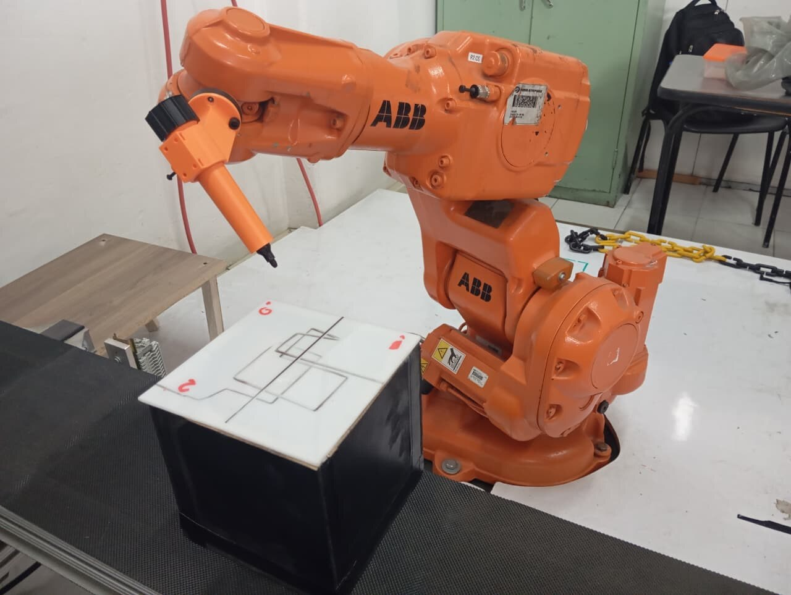

<sub>IRB 140 del LabSIR con el portamarcador impreso en PLA y la caja-pastel sobre la banda transportadora.<br>
Laboratorio 1 de Robótica Industrial 2025-II: <a href="https://github.com/Nicolas-Eule/Laboratorio_Robotica_1">Nicolas-Eule/Laboratorio_Robotica_1</a>.</sub>

</div>

---

Este repositorio reúne, de forma introductoria, las instrucciones, funciones y tipos de datos de **RAPID** (el lenguaje de los controladores ABB) que se usan con el manipulador **IRB 140** del laboratorio. Explica cómo mover el robot eje por eje, cómo construir trayectorias cartesianas, cómo usar variables y contadores para generar movimientos, cómo **simular y sincronizar** el programa en **RobotStudio** con distintos objetos de trabajo, cómo monitorear el estado del robot y, en la parte final, **cómo integrarlo a un sistema SCADA**: conexión física y de red, preparación del programa RAPID, publicación de variables por **OPC UA** y **OPC DA**, y envío de datos por **MQTT**.

Los ejemplos reales provienen del **Laboratorio 1 de Robótica Industrial 2025-II** (decoración de una torta virtual con el IRB 140), y la parte SCADA se apoya en prácticas previas del LabSIR que comunicaron el robot con Node-RED e Ignition por OPC UA.

> [!IMPORTANT]
> Los ejemplos están escritos para un controlador **IRC5 con RobotWare 6.x**. Todo programa nuevo se valida primero en RobotStudio, luego en el robot real en **modo manual** a velocidad reducida, y solo después en modo automático. Revise la sección [0. Antes de empezar](#0-antes-de-empezar).

### Ruta de trabajo

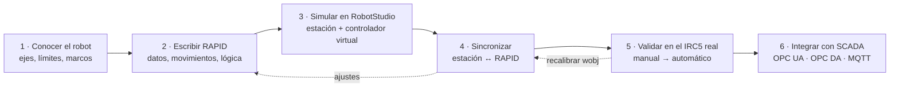

---

## Tabla de contenido

| Fundamentos | Programación | RobotStudio | Integración SCADA |
|---|---|---|---|
| [0. Antes de empezar](#0-antes-de-empezar) | [5. Movimiento](#5-instrucciones-de-movimiento) | [15. Flujo de trabajo](#15-robotstudio-flujo-de-trabajo) | [19. Arquitectura SCADA](#19-arquitectura-scada-para-el-irb-140) |
| [1. El IRB 140](#1-el-manipulador-irb-140) | [6. Movimiento articular](#6-movimiento-articular-control-de-los-ángulos-de-cada-eje) | [16. Sincronización](#16-sincronización-estación--rapid) | [20. Conexión y red](#20-conexión-física-y-configuración-de-red) |
| [2. Estructura](#2-estructura-de-un-programa-rapid) | [7. Funciones de posición](#7-funciones-de-posición-y-transformación) | [17. Varios objetos de trabajo](#17-trabajo-con-varios-objetos-de-trabajo) | [21. RAPID para SCADA](#21-preparar-el-programa-rapid-para-el-scada) |
| [3. Tipos de datos](#3-tipos-de-datos-y-declaración-de-variables) | [8. Trayectorias](#8-construcción-de-trayectorias) | [18. Al robot real](#18-del-simulador-al-robot-real) | [22. OPC UA con IoT Gateway](#22-opc-ua-con-abb-iot-gateway) |
| [4. Marcos de referencia](#4-sistemas-de-coordenadas-herramientas-y-objetos-de-trabajo) | [9. Control de flujo](#9-control-de-flujo) | | [23. Ignition y Node-RED](#23-clientes-opc-ua-ignition-y-node-red) |
| | [10. Variables y contadores](#10-variables-contadores-arreglos-y-matemáticas) | | [24. OPC DA](#24-opc-da-clásico) |
| | [11. Entradas y salidas](#11-entradas-y-salidas-es) | | [25. MQTT](#25-mqtt) |
| | [12. FlexPendant](#12-interacción-con-el-flexpendant) | | [26. Sockets y RWS](#26-alternativas-sockets-y-robot-web-services) |
| | [13. Interrupciones](#13-interrupciones-y-manejo-de-errores) | | [27. Prácticas del LabSIR](#27-prácticas-de-referencia-del-labsir) |
| | [14. Monitoreo](#14-monitoreo-y-seguimiento-del-robot) | | [28. Errores comunes](#28-errores-comunes-y-buenas-prácticas) · [29. Referencias](#29-referencias-y-créditos) |

---

## 0. Antes de empezar

Varios elementos dependen de la configuración de cada controlador. Verifíquelos antes de usar los ejemplos:

| Elemento | Dónde se verifica | Por qué importa |
|---|---|---|
| Versión de RobotWare | FlexPendant → *Información del sistema* | Robot Web Services (RWS) requiere RobotWare 6 o superior. |
| Opciones de software | FlexPendant → *Información del sistema → Opciones de sistema* | Sockets (*PC Interface*), multitarea (*Multitasking*) y buses de campo son opciones adicionales. |
| Nombres de las señales de E/S | FlexPendant → *Entradas y salidas* · RobotStudio → *Configuración → I/O System* | Esta guía usa las señales del Laboratorio 1 (`DI_01`, `DI_02`, `DO_02`, `Conveyor_FWD`, en la tarjeta DSQC 652). Confírmelas para cada robot. |
| Herramienta montada (`tooldata`) | Medición del TCP en el laboratorio | Un TCP o una masa incorrectos producen trayectorias erróneas. |
| Límites articulares | RobotStudio → *Configuración → Motion → Arm* | Pueden ser más restrictivos que los mecánicos. |
| Zonas de seguridad de la celda | Responsable del laboratorio | Bandas, mesas y el otro robot comparten el volumen de trabajo. |

> [!NOTE]
> El LabSIR tiene dos IRB 140 con controlador IRC5. Prácticas anteriores del laboratorio muestran que al menos uno de ellos tiene instalada la opción **PC Interface (616-1)**: el proyecto [Task_Planning_Cobotic](https://github.com/labsir-un/Task_Planning_Cobotic/tree/main/ABB/RAPID) usa *Socket Messaging* en el robot real, y el proyecto SCADA de 2023 lo conectó por OPC UA (sección [27](#27-prácticas-de-referencia-del-labsir)). Confirme las opciones del robot que va a usar.

---

## 1. El manipulador IRB 140

<table>
<tr>
<td align="center" width="33%"><br><sub>Versión estándar</sub></td>
<td align="center" width="33%"><br><sub>Versión Foundry Plus</sub></td>
<td align="center" width="33%"><br><sub>Configuración para soldadura de arco</sub></td>
</tr>
</table>
<p align="center"><sub>Imágenes © ABB, enlazadas desde el sitio de producto de ABB Robotics (no se redistribuyen en este repositorio).</sub></p>

Robot industrial articulado de **6 ejes**, de carga ligera. ABB lo lista hoy como producto **descontinuado**, reemplazado por la familia **IRB 1300**; la programación en RAPID es la misma.

| Característica | Valor |
|---|---|
| Ejes | 6 (rotacionales) |
| Carga útil | 6 kg (hojas de datos antiguas: 5 kg) |
| Alcance (al centro del eje 5) | 810 mm |
| Repetibilidad | ± 0,03 mm |
| Montaje | Piso, pared o invertido |
| Controlador en el laboratorio | IRC5 |

### 1.1 Ejes, límites y velocidades

<p align="center"></p>

| Eje | Movimiento | Límite inferior | Límite superior | Velocidad máx. |
|:-:|---|:-:|:-:|:-:|
| 1 | Rotación de la base | −180° | +180° | 200 °/s |
| 2 | Brazo inferior | −90° | +110° | 200 °/s |
| 3 | Brazo superior | −230° | +50° | 260 °/s |
| 4 | Rotación de muñeca | −200° | +200° | 360 °/s |
| 5 | Flexión de muñeca | −120° | +120° | 360 °/s |
| 6 | Rotación de brida | −400° | +400° | 450 °/s |

> [!NOTE]
> Los límites son los del modelo del IRB 140 en RobotStudio. La hoja de datos de ABB da un recorrido total de 230° para el eje 5 y define los ejes 4 y 6 como de rotación ilimitada (400° por defecto en el eje 4). **Los límites vigentes son los configurados en el controlador.**

**Posición *home* típica:** `[0, 0, 0, 0, 30, 0]` grados. El eje 5 queda a 30° para alejar la muñeca de la singularidad (ejes 4 y 6 alineados cuando el eje 5 vale 0°).

---

## 2. Estructura de un programa RAPID

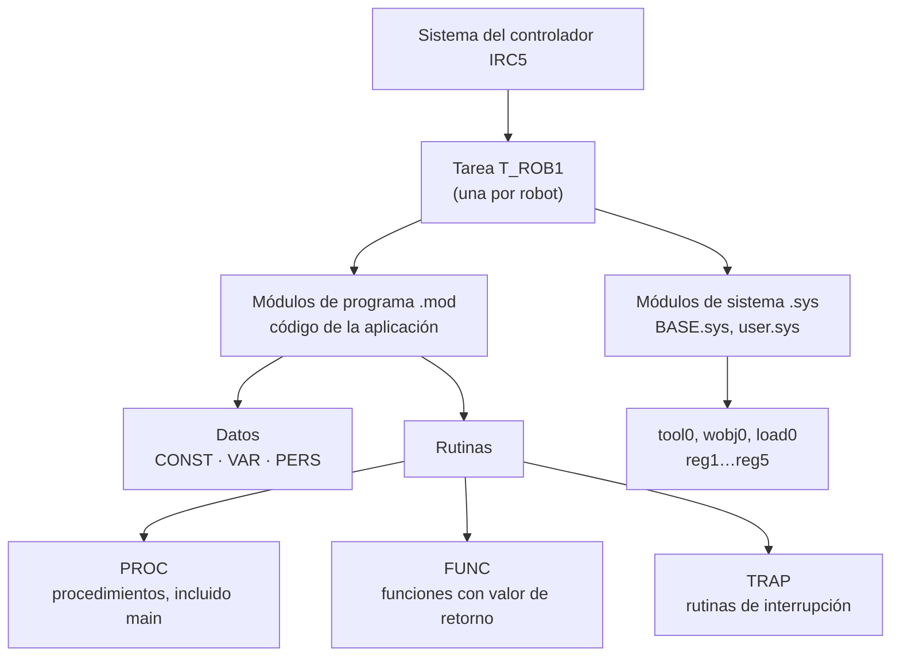

| Rutina | Palabra clave | Uso |
|---|---|---|
| Procedimiento | `PROC … ENDPROC` | Ejecuta acciones; no retorna valor. |
| Función | `FUNC <tipo> … ENDFUNC` | Retorna un valor con `RETURN`. |
| Rutina de interrupción | `TRAP … ENDTRAP` | Se ejecuta al dispararse una interrupción. |

El punto de entrada del programa es el procedimiento `main`.

```rapid
MODULE Modulo_Ejemplo
    ! Los comentarios empiezan con signo de exclamación

    ! ---- Datos ----
    CONST jointtarget jHome := [[0,0,0,0,30,0],[9E9,9E9,9E9,9E9,9E9,9E9]];
    VAR num contador := 0;

    ! ---- Rutina principal ----
    PROC main()
        Inicializar;
        MoveAbsJ jHome, v200, fine, tool0;
        TPWrite "Programa terminado. Ciclos: " \Num:=contador;
    ENDPROC

    ! ---- Procedimiento auxiliar ----
    PROC Inicializar()
        contador := 0;
        TPErase;
    ENDPROC

    ! ---- Función con parámetros ----
    FUNC num Cuadrado(num x)
        RETURN x * x;
    ENDFUNC
ENDMODULE
```

**Parámetros de rutinas:** se pasan por valor por defecto; `INOUT` permite modificar el argumento; `VAR` y `PERS` exigen ese tipo de almacenamiento (los datos que reciben las instrucciones de movimiento, como `tooldata` y `wobjdata`, se pasan como `PERS`). Los parámetros opcionales se escriben con `\` (`PROC Mover(robtarget p \num vel)`) y su presencia se consulta con `Present(vel)`.

---

## 3. Tipos de datos y declaración de variables

### 3.1 Tipos de almacenamiento

| Declaración | Comportamiento | Uso típico |
|---|---|---|
| `CONST` | Valor fijo; no se modifica en ejecución. | Puntos fijos, parámetros. |
| `VAR` | Vuelve a su valor inicial al cargar el programa o al mover el puntero a `main`. | Contadores, variables de trabajo. |
| `PERS` | Persistente: el valor actual se guarda en el código y sobrevive a reinicios del programa. Visible desde otras tareas y desde el exterior. | `tooldata`, `wobjdata`, intercambio con SCADA. |

### 3.2 Tipos básicos

| Tipo | Descripción | Ejemplo |
|---|---|---|
| `num` | Número real o entero | `VAR num i := 0;` |
| `dnum` | Número de doble precisión | `VAR dnum t := 0;` |
| `bool` | Lógico | `VAR bool listo := FALSE;` |
| `string` | Texto (máx. 80 caracteres) | `VAR string msg := "Hola";` |
| `byte` | Entero 0–255 | `VAR byte b := 10;` |

### 3.3 Tipos de movimiento y geometría

| Tipo | Contenido | Estructura |
|---|---|---|
| `pos` | Posición cartesiana [mm] | `[x, y, z]` |
| `orient` | Orientación en cuaternión | `[q1, q2, q3, q4]` |
| `pose` | Marco de referencia | `[pos, orient]` |
| `confdata` | Configuración del brazo (cuadrantes) | `[cf1, cf4, cf6, cfx]` |
| `extjoint` | Ejes externos (`9E9` = sin eje) | `[e1, …, e6]` |
| `robtarget` | Punto cartesiano del TCP | `[pos, orient, confdata, extjoint]` |
| `robjoint` | Ángulos de los 6 ejes [°] | `[rax_1, …, rax_6]` |
| `jointtarget` | Posición articular | `[robjoint, extjoint]` |
| `speeddata` | Velocidad | `[v_tcp, v_ori, v_leax, v_reax]` |
| `zonedata` | Zona de aproximación | `fine`, `z0`, `z1`, `z5`, `z10`, … |
| `tooldata` | Herramienta (TCP + carga) | `[robhold, tframe, tload]` |
| `wobjdata` | Objeto de trabajo | `[robhold, ufprog, ufmec, uframe, oframe]` |
| `loaddata` | Carga útil | `[masa, cog, aom, ix, iy, iz]` |

Acceso a componentes con punto: `p10.trans.x`, `p10.rot`, `j1.robax.rax_3`.

### 3.4 Datos predefinidos

- **Velocidades** (`speeddata`, mm/s del TCP): `v5`, `v10`, `v20`, `v50`, `v100`, `v150`, `v200`, `v300`, `v400`, `v500`, `v600`, `v800`, `v1000`, `v1500`, `v2000`, `v2500`, `v3000`, `v4000`, `v5000`, `v6000`, `v7000`, `vmax`.
- **Zonas** (`zonedata`, radio en mm): `fine`, `z0`, `z1`, `z5`, `z10`, `z15`, `z20`, `z30`, `z40`, `z50`, `z60`, `z80`, `z100`, `z150`, `z200`.
- **Herramienta y objeto por defecto:** `tool0` (TCP en el centro de la brida) y `wobj0` (coincide con el sistema base).

### 3.5 Declaración de un `robtarget`

```rapid
!                         pos [mm]        orient (cuaternión)   confdata     ejes externos
CONST robtarget pA := [[500, 0, 400], [0, 0, 1, 0], [0, 0, 0, 0], [9E9,9E9,9E9,9E9,9E9,9E9]];
```

El cuaternión `[0, 0, 1, 0]` es una rotación de 180° alrededor de Y: el eje Z de la herramienta apunta hacia abajo.

> [!TIP]
> Enseñe (*teach*) los puntos de referencia con el FlexPendant o créelos en RobotStudio en lugar de escribir el `confdata` a mano, y derive el resto con `Offs` o `RelTool`.

---

## 4. Sistemas de coordenadas, herramientas y objetos de trabajo

<p align="center"></p>

| Sistema | Descripción |
|---|---|
| **World** | Referencia global de la celda. Con un solo robot suele coincidir con **Base**. |
| **Base** | Origen en la base del robot (`wobj0`). |
| **User frame** (`uframe`) | Marco de la mesa o del accesorio; se mide con 3 puntos. |
| **Object frame** (`oframe`) | Marco de la pieza, relativo al `uframe`. |
| **Tool** (`tooldata`) | Marco de la herramienta; su origen es el **TCP**. |

Programar los puntos dentro de un `wobjdata` permite **reubicar toda una trayectoria** cambiando solo el marco del objeto de trabajo (sección [17](#17-trabajo-con-varios-objetos-de-trabajo)).

### 4.1 Definición de una herramienta

```rapid
!                       robhold  [ TCP [mm]  , orientación ]   [ masa[kg], cog[mm], aom, Ix, Iy, Iz ]
PERS tooldata tMarcador := [TRUE, [[0, 0, 150], [1, 0, 0, 0]], [0.3, [0, 0, 60], [1, 0, 0, 0], 0, 0, 0]];
```

- `robhold = TRUE`: la herramienta la sostiene el robot.
- La **masa debe ser mayor que 0**.
- El TCP se mide con el método de 4 puntos en el FlexPendant (*Movimiento → Herramienta → Definir*).

**Ejemplo del laboratorio.** El portamarcador del Laboratorio 1 se diseñó en Autodesk Inventor a partir de las dimensiones de la brida del IRB 140, se imprimió en PLA y lleva un resorte dentro del soporte del marcador para tolerar pequeñas diferencias de altura al dibujar.

<table>
<tr>
<td align="center" width="50%">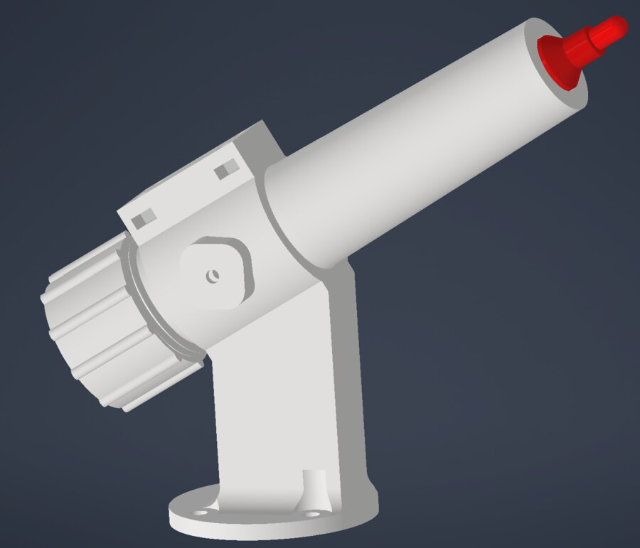<br><sub>Modelo CAD</sub></td>
<td align="center" width="50%">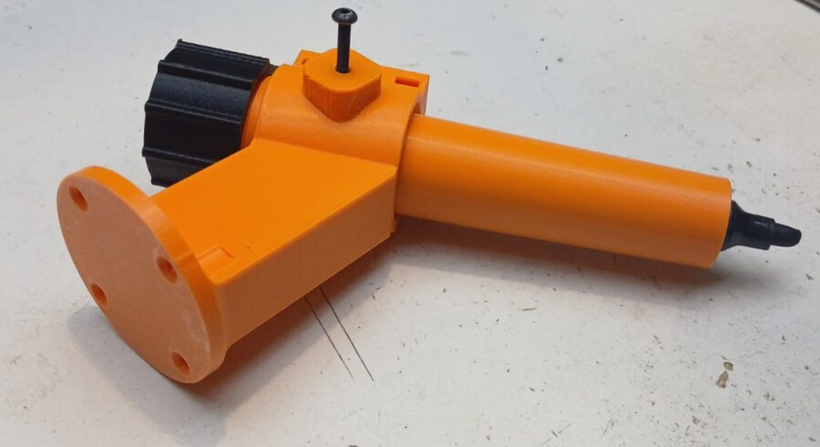<br><sub>Herramienta impresa con el marcador</sub></td>
</tr>
</table>

El marcador queda inclinado respecto a la brida, así que el `tframe` tiene traslación **y** rotación:

```rapid
PERS tooldata Marcador:=[TRUE,[[0,-100.213,125.309],[0.165634,0.0951553,-0.490794,0.850078]],[1,[0,0,1],[1,0,0,0],0,0,0]];
```

| Componente | Valor | Interpretación |
|---|---|---|
| Traslación del TCP | `[0, -100.2, 125.3]` mm | La punta está a 160,5 mm del centro de la brida. |
| Orientación | cuaternión del `tframe` | El eje Z de la herramienta queda inclinado 60° respecto al eje de la brida, hacia −Y. |
| Carga | 1 kg, centro de gravedad en `[0, 0, 1]` | Valor genérico; conviene medir la masa real de la herramienta. |

<sub>Valores del módulo <a href="rapid/lab01_decoracion/Module1.mod"><code>Module1.mod</code></a> del Laboratorio 1. Mida su propia herramienta.</sub>

### 4.2 Definición de un objeto de trabajo

```rapid
!                        robhold ufprog ufmec  uframe (marco de usuario)          oframe (marco del objeto)
PERS wobjdata wMesa := [FALSE, TRUE, "", [[400, -200, 100], [1, 0, 0, 0]], [[0, 0, 0], [1, 0, 0, 0]]];
```

El `uframe` se mide con el método de 3 puntos (origen, punto sobre X, punto sobre Y), en el FlexPendant o en RobotStudio.

---

## 5. Instrucciones de movimiento

<p align="center"></p>

### 5.1 Resumen

| Instrucción | Interpolación | Destino | Uso |
|---|---|---|---|
| `MoveAbsJ` | Articular | `jointtarget` | Ángulos absolutos (home, posiciones seguras). |
| `MoveJ` | Articular | `robtarget` | Desplazamientos rápidos donde la trayectoria del TCP no importa. |
| `MoveL` | Lineal | `robtarget` | TCP en línea recta (dibujo, inserción, soldadura). |
| `MoveC` | Circular | 2 × `robtarget` | Arco por un punto intermedio hasta un punto final. |
| `MoveJDO` / `MoveLDO` / `MoveCDO` | J / L / C | `robtarget` | Movimiento + activación de una salida digital en el punto. |
| `MoveJSync` / `MoveLSync` / `MoveCSync` | J / L / C | `robtarget` | Movimiento + llamada a un procedimiento en el punto. |
| `SearchL` / `SearchC` | L / C | `robtarget` | Se detiene o registra la posición al cambiar una señal. |
| `TriggL` / `TriggJ` / `TriggC` | L / J / C | `robtarget` | Eventos de E/S a una distancia o tiempo dentro de la trayectoria. |

### 5.2 Sintaxis general

```rapid
MoveL ToPoint [\ID] , Speed [\V] | [\T] , Zone [\Z] [\Inpos] , Tool [\WObj] [\Corr];
```

| Argumento | Descripción |
|---|---|
| `ToPoint` | Punto de destino (`robtarget`). |
| `Speed` | `speeddata` (`v100`) o personalizado. |
| `\V:=` | Sobrescribe la velocidad del TCP (mm/s). |
| `\T:=` | Fija el tiempo total del movimiento (s). |
| `Zone` | `fine` = parada exacta; `zN` = paso suave con radio N mm. |
| `Tool` | `tooldata` activa. |
| `\WObj:=` | Objeto de trabajo (por defecto `wobj0`). |
| `\Conc` | Ejecuta las instrucciones siguientes mientras el robot se mueve. |

### 5.3 Zonas de aproximación

<p align="center"></p>

Con `fine` el robot se detiene exactamente en el punto. Con `zN` pasa cerca del punto sin detenerse, redondeando la esquina dentro de un radio de N mm. Use `fine` donde lea una señal, actúe una herramienta o tome una medida.

### 5.4 Ejemplos

```rapid
MoveAbsJ jHome, v200, fine, tool0;                              ! Ángulos absolutos
MoveJ pA, v500, z50, tMarcador \WObj:=wMesa;                    ! Articular hacia pA
MoveL Offs(pA, 0, 0, -50), v50, fine, tMarcador \WObj:=wMesa;   ! Baja 50 mm en línea recta
MoveL pB, v100 \V:=75, z1, tMarcador \WObj:=wMesa;              ! Velocidad TCP = 75 mm/s
MoveL pC, v100 \T:=3, fine, tMarcador \WObj:=wMesa;             ! Llega en 3 s
MoveC pMedio, pFin, v100, z10, tMarcador \WObj:=wMesa;          ! Arco por pMedio hasta pFin
MoveLDO pD, v100, fine, tMarcador, DO_01, 1;                    ! Activa DO_01 al llegar a pD
```

### 5.5 Ajustes globales del movimiento

| Instrucción | Efecto |
|---|---|
| `VelSet 50, 500;` | Escala las velocidades programadas al 50 % y limita el TCP a 500 mm/s. |
| `AccSet 50, 100;` | Reduce la aceleración al 50 % (rampa al 100 %). |
| `ConfJ \Off;` / `ConfL \Off;` | Desactiva el control de configuración del brazo (usar con cuidado). |
| `SingArea \Wrist;` | Permite variar la orientación para atravesar singularidades de muñeca. |
| `SingArea \Off;` | Comportamiento por defecto. |
| `WaitRob \InPos;` | Espera a que el robot se detenga en posición. |
| `StopMove;` / `StartMove;` | Detiene / reanuda el movimiento (útil en rutinas TRAP). |

---

## 6. Movimiento articular: control de los ángulos de cada eje

### 6.1 Definir y alcanzar ángulos

```rapid
VAR jointtarget jObjetivo := [[0, 0, 0, 0, 30, 0], [9E9,9E9,9E9,9E9,9E9,9E9]];

PROC IrAAngulos()
    jObjetivo.robax.rax_1 := 45;      ! Eje 1 a 45°
    jObjetivo.robax.rax_2 := 10;      ! Eje 2 a 10°
    jObjetivo.robax.rax_3 := -20;     ! Eje 3 a -20°
    MoveAbsJ jObjetivo, v200, fine, tool0;
ENDPROC
```

### 6.2 Leer la posición articular actual

```rapid
VAR jointtarget jActual;

jActual := CJointT();
TPWrite "Eje 1 [deg]: " \Num:=jActual.robax.rax_1;
TPWrite "Eje 5 [deg]: " \Num:=jActual.robax.rax_5;
```

### 6.3 Barrido de una articulación con contador

Mueve cada eje de forma independiente alrededor del *home*, dentro de un margen seguro.

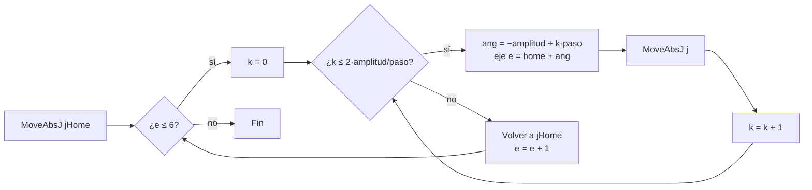

```rapid
PROC BarridoEje(num eje, num amplitud, num paso)
    VAR jointtarget j;
    VAR num ang;

    j := jHome;
    FOR k FROM 0 TO Trunc(2 * amplitud / paso) DO
        ang := -amplitud + k * paso;
        TEST eje
        CASE 1: j.robax.rax_1 := jHome.robax.rax_1 + ang;
        CASE 2: j.robax.rax_2 := jHome.robax.rax_2 + ang;
        CASE 3: j.robax.rax_3 := jHome.robax.rax_3 + ang;
        CASE 4: j.robax.rax_4 := jHome.robax.rax_4 + ang;
        CASE 5: j.robax.rax_5 := jHome.robax.rax_5 + ang;
        CASE 6: j.robax.rax_6 := jHome.robax.rax_6 + ang;
        ENDTEST
        MoveAbsJ j, v100, z5, tool0;
    ENDFOR
    MoveAbsJ jHome, v100, fine, tool0;
ENDPROC

PROC main()
    MoveAbsJ jHome, v200, fine, tool0;
    FOR e FROM 1 TO 6 DO
        BarridoEje e, 20, 5;       ! ±20° en pasos de 5°
    ENDFOR
ENDPROC
```

### 6.4 Validar ángulos antes de mover

```rapid
FUNC bool DentroDeLimites(jointtarget j)
    ! Límites de referencia (ajustar a los configurados en el controlador)
    IF Abs(j.robax.rax_1) > 180 RETURN FALSE;
    IF j.robax.rax_2 < -90 OR j.robax.rax_2 > 110 RETURN FALSE;
    IF j.robax.rax_3 < -230 OR j.robax.rax_3 > 50 RETURN FALSE;
    IF Abs(j.robax.rax_4) > 200 RETURN FALSE;
    IF Abs(j.robax.rax_5) > 120 RETURN FALSE;
    IF Abs(j.robax.rax_6) > 400 RETURN FALSE;
    RETURN TRUE;
ENDFUNC
```

### 6.5 Conversión entre espacio articular y cartesiano

| Función | Descripción |
|---|---|
| `CalcJointT(robtarget, tool \WObj)` | Cinemática inversa: ángulos para alcanzar un `robtarget`. |
| `CalcRobT(jointtarget, tool \WObj)` | Cinemática directa: `robtarget` a partir de ángulos. |

```rapid
VAR jointtarget jCalc;
VAR robtarget pCalc;

jCalc := CalcJointT(pA, tMarcador \WObj:=wMesa);
pCalc := CalcRobT(jCalc, tMarcador \WObj:=wMesa);
```

---

## 7. Funciones de posición y transformación

<p align="center"></p>

| Función / instrucción | Descripción | Ejemplo |
|---|---|---|
| `Offs(p, dx, dy, dz)` | Desplaza un punto en el marco del objeto de trabajo. | `Offs(pA, 100, 0, 0)` |
| `RelTool(p, dx, dy, dz \Rx \Ry \Rz)` | Desplaza o rota en el marco de la herramienta. | `RelTool(pA, 0, 0, 20 \Rz:=45)` |
| `CRobT(\Tool \WObj)` | Posición cartesiana actual (`robtarget`). | `pAct := CRobT(\Tool:=tMarcador \WObj:=wMesa);` |
| `CPos(\Tool \WObj)` | Posición actual (`pos`) sin orientación. | `posAct := CPos();` |
| `CJointT()` | Ángulos articulares actuales. | `jAct := CJointT();` |
| `OrientZYX(z, y, x)` | Cuaternión a partir de ángulos de Euler ZYX [°]. | `pA.rot := OrientZYX(0, 180, 0);` |
| `EulerZYX(\X \| \Y \| \Z, orient)` | Extrae un ángulo de Euler de un cuaternión. | `rz := EulerZYX(\Z, pA.rot);` |
| `NOrient(orient)` | Normaliza un cuaternión. | `q := NOrient(q);` |
| `PoseMult(p1, p2)` | Composición de marcos. | `T := PoseMult(T1, T2);` |
| `PoseInv(p)` | Inversa de un marco. | `Ti := PoseInv(T);` |
| `PoseVect(p, pos)` | Transforma un vector por un marco. | `v2 := PoseVect(T, v1);` |
| `Distance(p1, p2)` | Distancia entre dos `pos` [mm]. | `d := Distance(pA.trans, pB.trans);` |
| `PDispSet` / `PDispOn` / `PDispOff` | Desplazamiento de programa: traslada o rota los puntos siguientes. | Ver 8.6 |

---

## 8. Construcción de trayectorias

<p align="center"></p>

<sub>Las figuras se calcularon con los mismos parámetros de las rutinas de esta sección (vista superior del plano XY del objeto de trabajo, origen en <code>pCentro</code>).</sub>

> [!NOTE]
> `pCentro` es un punto enseñado sobre la superficie de trabajo con el eje Z de la herramienta hacia abajo. Las dimensiones son ilustrativas: compruebe el alcance en RobotStudio.

```rapid
PERS robtarget pCentro := [[0, 0, 0], [0, 0, 1, 0], [0, 0, 0, 0], [9E9,9E9,9E9,9E9,9E9,9E9]];
CONST num zSeg := 50;   ! Altura de aproximación [mm]
```

### 8.1 Cuadrado con `Offs`

```rapid
PROC Cuadrado(num lado)
    MoveJ Offs(pCentro, 0, 0, zSeg), v300, z10, tMarcador \WObj:=wMesa;
    MoveL pCentro, v50, fine, tMarcador \WObj:=wMesa;
    MoveL Offs(pCentro, lado, 0, 0),    v100, z1, tMarcador \WObj:=wMesa;
    MoveL Offs(pCentro, lado, lado, 0), v100, z1, tMarcador \WObj:=wMesa;
    MoveL Offs(pCentro, 0, lado, 0),    v100, z1, tMarcador \WObj:=wMesa;
    MoveL pCentro,                      v100, fine, tMarcador \WObj:=wMesa;
    MoveL Offs(pCentro, 0, 0, zSeg),    v100, z10, tMarcador \WObj:=wMesa;
ENDPROC
```

### 8.2 Círculo completo con `MoveC`

`MoveC` traza como máximo un arco; un círculo completo requiere dos instrucciones o más.

```rapid
PROC Circulo(num r)
    MoveJ Offs(pCentro, r, 0, zSeg), v300, z10, tMarcador \WObj:=wMesa;
    MoveL Offs(pCentro, r, 0, 0), v50, fine, tMarcador \WObj:=wMesa;
    MoveC Offs(pCentro, 0, r, 0),  Offs(pCentro, -r, 0, 0), v100, z1, tMarcador \WObj:=wMesa;
    MoveC Offs(pCentro, 0, -r, 0), Offs(pCentro,  r, 0, 0), v100, fine, tMarcador \WObj:=wMesa;
    MoveL Offs(pCentro, r, 0, zSeg), v100, z10, tMarcador \WObj:=wMesa;
ENDPROC
```

### 8.3 Trayectorias paramétricas con contadores

Las funciones trigonométricas de RAPID trabajan en **grados**.

```rapid
! Polígono regular de n lados (n grande ≈ círculo)
PROC Poligono(num r, num n)
    VAR num ang;
    MoveJ Offs(pCentro, r, 0, zSeg), v300, z10, tMarcador \WObj:=wMesa;
    FOR i FROM 0 TO n DO
        ang := i * 360 / n;
        MoveL Offs(pCentro, r * Cos(ang), r * Sin(ang), 0), v100, z1, tMarcador \WObj:=wMesa;
    ENDFOR
    MoveL Offs(pCentro, r, 0, zSeg), v100, z10, tMarcador \WObj:=wMesa;
ENDPROC

! Espiral de Arquímedes
PROC Espiral(num vueltas, num paso)
    VAR num ang;
    VAR num r;
    MoveJ Offs(pCentro, 0, 0, zSeg), v300, z10, tMarcador \WObj:=wMesa;
    MoveL pCentro, v50, fine, tMarcador \WObj:=wMesa;
    FOR i FROM 0 TO vueltas * 36 DO
        ang := i * 10;                     ! 10° por iteración
        r := paso * ang / 360;             ! El radio crece 'paso' mm por vuelta
        MoveL Offs(pCentro, r * Cos(ang), r * Sin(ang), 0), v80, z1, tMarcador \WObj:=wMesa;
    ENDFOR
    MoveL Offs(CRobT(\Tool:=tMarcador \WObj:=wMesa), 0, 0, zSeg), v100, fine, tMarcador \WObj:=wMesa;
ENDPROC

! Hélice (variación en Z)
PROC Helice(num r, num vueltas, num avanceZ)
    VAR num ang;
    FOR i FROM 0 TO vueltas * 36 DO
        ang := i * 10;
        MoveL Offs(pCentro, r * Cos(ang), r * Sin(ang), zSeg + avanceZ * ang / 360), v100, z1, tMarcador \WObj:=wMesa;
    ENDFOR
ENDPROC
```

> [!TIP]
> Los puntos calculados con `Offs` dentro de un bucle no existen como *targets* en la estación de RobotStudio, así que no se dibujan al sincronizar. Para verlos use **Rastreo del TCP** (*TCP Trace*) durante la simulación (sección [15.4](#154-simular-y-depurar)).

### 8.4 Trayectoria definida por un arreglo de puntos

```rapid
CONST num nPts := 5;
CONST pos ruta{nPts} := [[0,0,0], [80,0,0], [80,60,0], [40,90,0], [0,60,0]];

PROC SeguirRuta()
    MoveJ Offs(pCentro, ruta{1}.x, ruta{1}.y, zSeg), v300, z10, tMarcador \WObj:=wMesa;
    FOR i FROM 1 TO Dim(ruta, 1) DO
        MoveL Offs(pCentro, ruta{i}.x, ruta{i}.y, ruta{i}.z), v100, z1, tMarcador \WObj:=wMesa;
    ENDFOR
    MoveL Offs(pCentro, ruta{1}.x, ruta{1}.y, 0), v100, fine, tMarcador \WObj:=wMesa;   ! Cierra la figura
    MoveL Offs(pCentro, ruta{1}.x, ruta{1}.y, zSeg), v100, z10, tMarcador \WObj:=wMesa;
ENDPROC
```

### 8.5 Paletizado con contadores de filas y columnas

```rapid
PROC Paletizar(num filas, num cols, num dx, num dy)
    VAR num pieza := 0;
    FOR f FROM 0 TO filas - 1 DO
        FOR c FROM 0 TO cols - 1 DO
            Incr pieza;
            MoveJ Offs(pCentro, c * dx, f * dy, zSeg), v500, z20, tMarcador \WObj:=wMesa;
            MoveL Offs(pCentro, c * dx, f * dy, 0), v100, fine, tMarcador \WObj:=wMesa;
            ! Aquí: SetDO / Reset de la pinza
            WaitTime 0.3;
            MoveL Offs(pCentro, c * dx, f * dy, zSeg), v200, z20, tMarcador \WObj:=wMesa;
            TPWrite "Pieza: " \Num:=pieza;
        ENDFOR
    ENDFOR
ENDPROC
```

### 8.6 Reutilizar una figura en otra posición (`PDispSet`)

```rapid
PROC FiguraDesplazada()
    VAR pose desp := [[150, 0, 0], [1, 0, 0, 0]];   ! Trasladar 150 mm en X
    PDispSet desp;
    Cuadrado 50;
    PDispOff;
ENDPROC
```

La alternativa recomendada es usar otro objeto de trabajo (sección [17](#17-trabajo-con-varios-objetos-de-trabajo)).

### 8.7 Variación de orientación sobre un punto (`RelTool`)

```rapid
PROC Inclinaciones()
    FOR k FROM -2 TO 2 DO
        MoveL RelTool(pCentro, 0, 0, -zSeg \Rx:=k * 10), v50, fine, tMarcador \WObj:=wMesa;
    ENDFOR
    FOR k FROM 0 TO 8 DO
        MoveL RelTool(pCentro, 0, 0, -zSeg \Rz:=k * 45), v50, z1, tMarcador \WObj:=wMesa;
    ENDFOR
ENDPROC
```

### 8.8 Ejemplo real: decoración de la torta (Laboratorio 1)

El Laboratorio 1 de Robótica Industrial 2025-II pide escribir los nombres del equipo y una decoración sobre una "torta" (una caja de 15 × 15 × 15 cm con tapa de acrílico), partiendo y terminando en *home*, con velocidades entre `v100` y `v1000` y zonas de máximo `z10`. Las trayectorias se crearon en RobotStudio y se sincronizaron a RAPID: cada letra es una secuencia de `MoveL` a `v100` con zona `z1` en el objeto de trabajo `Pastel`.

<table>
<tr>
<td align="center" width="40%">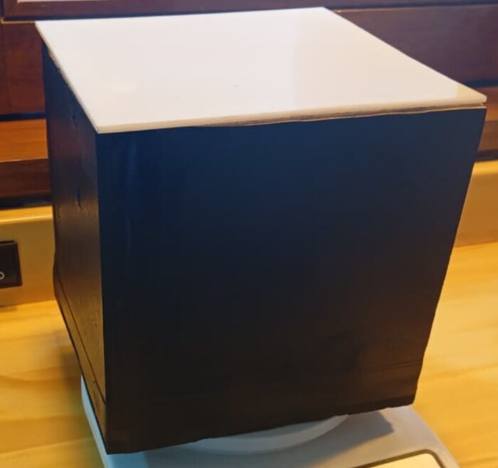<br><sub>La "torta": caja con tapa de acrílico y contrapeso interno</sub></td>
<td align="center" width="60%">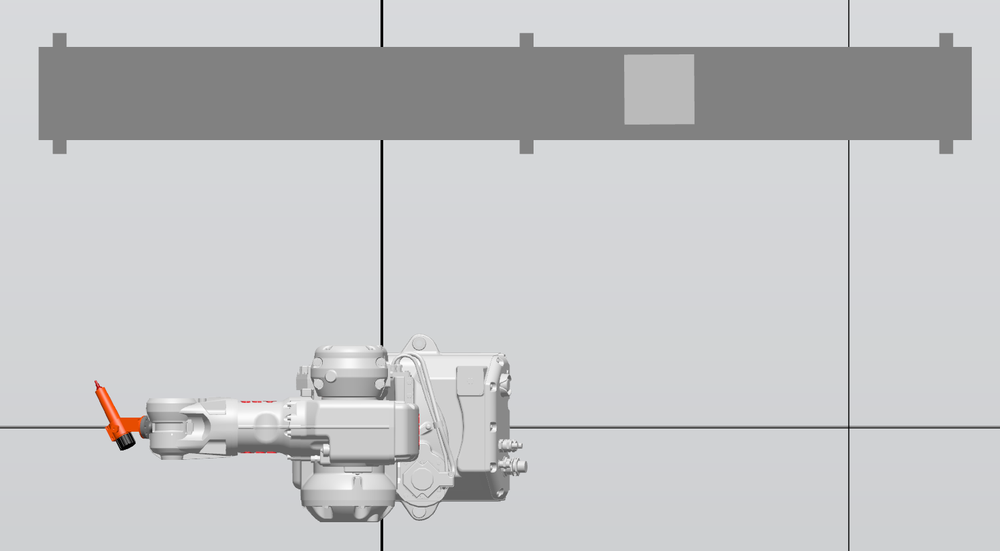<br><sub>Plano de planta de la celda en RobotStudio</sub></td>
</tr>
</table>

<p align="center">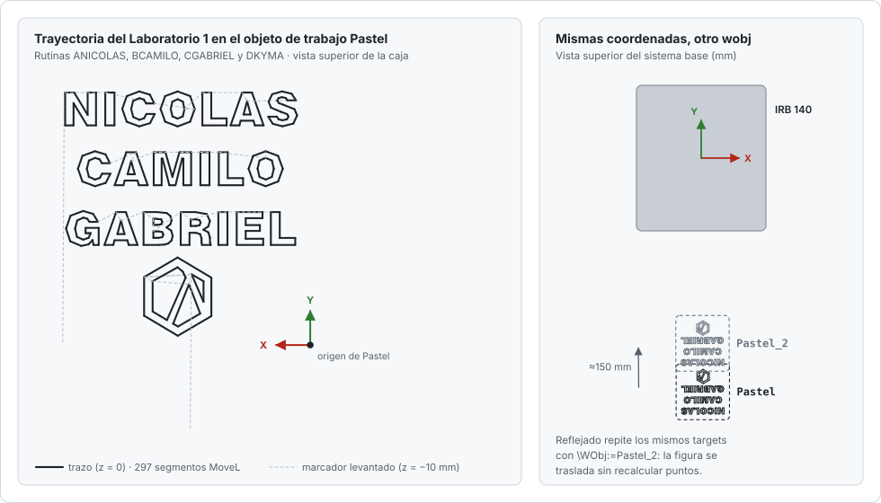</p>

<sub>La figura se generó leyendo los <code>robtarget</code> y las instrucciones <code>MoveL</code> de <a href="rapid/lab01_decoracion/Module1.mod"><code>Module1.mod</code></a>. El panel derecho se explica en la sección <a href="#174-ejemplo-real-pastel-y-pastel_2">17.4</a>.</sub>

| Rutina | Contenido | Movimientos |
|---|---|:-:|
| `ANICOLAS` | Aproximación desde `HOME` y nombre NICOLAS | 122 |
| `BCAMILO` | Nombre CAMILO | 94 |
| `CGABRIEL` | Nombre GABRIEL | 147 |
| `DKYMA` | Logotipo del grupo de investigación Kyma | 34 |

En los *targets*, `z = 0` es la superficie de la caja y `z = −10` levanta el marcador entre letras: el eje Z de `Pastel` apunta hacia la caja, porque su `oframe` está rotado 180° alrededor de X.

**Lógica del programa principal** (dos botones del panel, una luz y la banda):

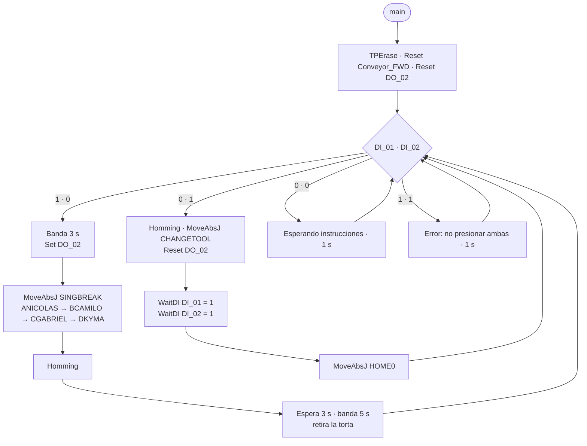

La rutina `Homming` es un buen ejemplo de lectura de ángulos con `CJointT` (sección [6.2](#62-leer-la-posición-articular-actual)): solo mueve el robot si algún eje está a más de 0,5° de cero.

```rapid
PROC Homming()
    CONST num tol := 0.5;
    VAR jointtarget jt;
    jt := CJointT();
    IF  Abs(jt.robax.rax_1) < tol AND
        Abs(jt.robax.rax_2) < tol AND
        Abs(jt.robax.rax_3) < tol AND
        Abs(jt.robax.rax_4) < tol AND
        Abs(jt.robax.rax_5) < tol AND
        Abs(jt.robax.rax_6) < tol THEN
        TPWrite "Robot en home articular (Aprox 0)";
    ELSE
        TPWrite "Yendo a Home";
        MoveL HOME,v100,z1,Marcador\WObj:=Pastel;
        MoveAbsJ home0, v500, fine, Marcador;
        TPWrite "Robot en Home";
    ENDIF
ENDPROC
```

El programa completo, listo para cargar desde el FlexPendant (`AQUI.pgf` y sus módulos), está en [`rapid/lab01_decoracion/`](rapid/lab01_decoracion).

---

## 9. Control de flujo

| Estructura | Sintaxis |
|---|---|
| Condicional | `IF cond THEN … ELSEIF cond THEN … ELSE … ENDIF` |
| Condicional compacto | `IF cond instrucción;` |
| Bucle con contador | `FOR i FROM 1 TO 10 [STEP 2] DO … ENDFOR` |
| Bucle condicional | `WHILE cond DO … ENDWHILE` |
| Selección | `TEST var CASE 1: … CASE 2, 3: … DEFAULT: … ENDTEST` |
| Salto | `GOTO etiqueta;` … `etiqueta:` |
| Retorno | `RETURN;` / `RETURN valor;` |
| Esperas | `WaitTime 1.5;` · `WaitUntil cond \MaxTime:=5;` |
| Detener | `Stop;` (pausa reanudable) · `EXIT;` (termina el programa) · `Break;` |

> [!NOTE]
> La variable de un `FOR` se declara implícitamente y solo existe dentro del bucle.

**Menú de trayectorias seleccionable desde el FlexPendant:**


```rapid
PROC main()
    VAR num opcion;
    WHILE TRUE DO
        TPReadFK opcion, "Seleccione trayectoria", "Cuadrado", "Circulo", "Espiral", "Home", "Salir";
        TEST opcion
        CASE 1: Cuadrado 60;
        CASE 2: Circulo 40;
        CASE 3: Espiral 3, 10;
        CASE 4: MoveAbsJ jHome, v200, fine, tool0;
        CASE 5: EXIT;
        ENDTEST
    ENDWHILE
ENDPROC
```

---

## 10. Variables, contadores, arreglos y matemáticas

### 10.1 Contadores

| Instrucción | Efecto |
|---|---|
| `Incr reg1;` | `reg1 := reg1 + 1` |
| `Decr reg1;` | `reg1 := reg1 - 1` |
| `Add reg1, 5;` | `reg1 := reg1 + 5` |
| `Clear reg1;` | `reg1 := 0` |

`reg1` … `reg5` son variables `num` predefinidas en el módulo de sistema `user.sys`.

### 10.2 Arreglos

```rapid
VAR num angulos{6};                     ! Arreglo de 6 elementos (índice desde 1)
VAR num matriz{3, 4};                   ! Matriz 3x4
VAR robtarget puntos{10};

angulos{1} := 45;
n := Dim(angulos, 1);                   ! Tamaño en la dimensión 1
```

### 10.3 Funciones matemáticas

| Función | Descripción |
|---|---|
| `Abs(x)`, `Sqrt(x)`, `Pow(b, e)`, `Exp(x)`, `Ln(x)` | Básicas |
| `Sin`, `Cos`, `Tan` | Trigonométricas (**grados**) |
| `ASin`, `ACos`, `ATan`, `ATan2(y, x)` | Inversas (resultado en grados) |
| `Round(x \Dec:=n)`, `Trunc(x \Dec:=n)` | Redondeo y truncamiento |
| `Max(a, b)`, `Min(a, b)` | Máximo y mínimo |
| `DOT(v1, v2)`, `CrossProd(v1, v2)`, `VectMagn(v)` | Operaciones vectoriales sobre `pos` |
| `a DIV b`, `a MOD b` | División entera y residuo |

### 10.4 Cadenas de texto

| Función | Descripción |
|---|---|
| `NumToStr(x, dec)` | Número → texto con `dec` decimales |
| `StrToVal(str, var)` | Texto → valor (retorna `bool`) |
| `ValToStr(dato)` | Cualquier dato → texto |
| `StrLen(str)`, `StrPart(str, ini, len)`, `StrFind(…)` | Manipulación |
| `+` | Concatenación: `"Eje: " + NumToStr(a, 2)` |

---

## 11. Entradas y salidas (E/S)

Las señales se definen en la configuración de E/S del controlador (`EIO.cfg`). Tipos: `signaldi`, `signaldo`, `signalai`, `signalao`, `signalgi`, `signalgo`.

| Instrucción / función | Descripción |
|---|---|
| `SetDO DO_01, 1;` | Escribe una salida digital. |
| `Set DO_01;` / `Reset DO_01;` | Pone a 1 / a 0. |
| `PulseDO \PLength:=0.5, DO_01;` | Pulso de 0,5 s. |
| `SetAO AO_01, 2.5;` | Salida analógica. |
| `SetGO GO_01, 7;` | Salida de grupo (entero sobre varios bits). |
| `DInput(DI_01)` / `DOutput(DO_01)` | Lee una señal; también se puede usar directamente: `IF DI_01 = 1 THEN`. |
| `AInput(AI_01)`, `GInput(GI_01)` | Lectura analógica / de grupo. |
| `WaitDI DI_01, 1 \MaxTime:=10;` | Espera a que una entrada tome un valor. |
| `WaitDO DO_01, 1;` | Espera sobre una salida. |

### 11.1 Intercambio de señales con un PLC

El patrón típico es un *handshake*: el PLC elige la trayectoria y da la orden de arranque, y el robot informa si está ocupado y cuándo terminó.

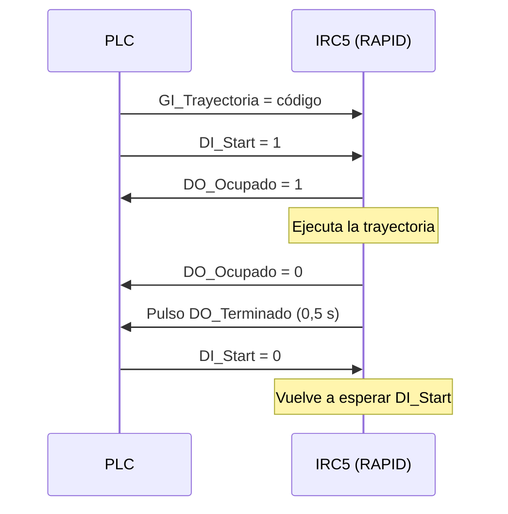

```rapid
PROC main()
    WHILE TRUE DO
        WaitDI DI_Start, 1;
        SetDO DO_Ocupado, 1;
        TEST GInput(GI_Trayectoria)
        CASE 1: Cuadrado 60;
        CASE 2: Circulo 40;
        DEFAULT: TPWrite "Codigo no valido";
        ENDTEST
        SetDO DO_Ocupado, 0;
        PulseDO \PLength:=0.5, DO_Terminado;
        WaitDI DI_Start, 0;
    ENDWHILE
ENDPROC
```

> [!WARNING]
> `DI_Start`, `GI_Trayectoria`, `DO_Ocupado` y `DO_Terminado` son nombres de ejemplo. Defínalos en el controlador (o use `DI_0x` / `DO_0x` del laboratorio) antes de cargar el módulo; una señal no declarada impide cargar el programa.

### 11.2 Señales del laboratorio (tarjeta DSQC 652)

El IRC5 del laboratorio tiene una tarjeta de E/S digitales **DSQC 652** (3HAC025917-001, 16 entradas y 16 salidas). En el Laboratorio 1, dos botones del panel de mando entran como `DI_01` y `DI_02`, y las salidas encienden una luz indicadora y el variador de una banda transportadora.

| Señal | Tipo | Uso en el programa del Laboratorio 1 |
|---|---|---|
| `DI_01` | Entrada | Con `DI_02 = 0`, inicia el decorado. |
| `DI_02` | Entrada | Con `DI_01 = 0`, lleva el robot a la pose de cambio de herramienta. |
| `DO_02` | Salida | Se activa al iniciar el decorado y se apaga en mantenimiento. |
| `Conveyor_FWD` | Salida | Mueve la banda: 3 s para traer la torta y 5 s para retirarla. |

<sub>Según <a href="rapid/lab01_decoracion/Module1.mod"><code>Module1.mod</code></a>. La tabla <a href="rapid/lab01_decoracion/mapeo_IO.md"><code>mapeo_IO.md</code></a> del mismo laboratorio asigna la luz a <code>DO_01</code> y la banda a <code>DO_02</code>; verifique el cableado del panel antes de reutilizar los nombres.</sub>

---

## 12. Interacción con el FlexPendant

| Instrucción | Descripción |
|---|---|
| `TPErase;` | Limpia la pantalla. |
| `TPWrite "Texto" [\Num:=] [\Bool:=] [\Pos:=] [\Orient:=];` | Escribe un mensaje con un dato. |
| `TPReadNum var, "Pregunta";` | Solicita un número al operador. |
| `TPReadFK var, "Texto", "F1", "F2", "F3", "F4", "F5";` | Menú de 5 teclas de función (`stEmpty` para vacías). Retorna 1–5. |
| `UIMsgBox`, `UINumEntry`, `UIListView` | Cuadros de diálogo más elaborados. |
| `ErrWrite "Titulo", "Detalle";` | Registra un mensaje en el registro de eventos. |

```rapid
PROC ParametrosOperador()
    VAR num lado;
    TPReadNum lado, "Lado del cuadrado [mm] (10-100):";
    IF lado < 10 OR lado > 100 THEN
        TPWrite "Valor fuera de rango";
        RETURN;
    ENDIF
    Cuadrado lado;
ENDPROC
```

---

## 13. Interrupciones y manejo de errores

### 13.1 Interrupciones (`TRAP`)

| Instrucción | Descripción |
|---|---|
| `CONNECT intnum WITH rutinaTrap;` | Asocia una interrupción a una rutina. |
| `ISignalDI DI_01, 1, intnum;` | Interrupción por flanco de una entrada digital. |
| `ITimer 1, intnum;` | Interrupción periódica cada 1 s (`\Single` = una sola vez). |
| `ISleep` / `IWatch` | Desactiva / reactiva temporalmente. |
| `IDelete intnum;` | Elimina la interrupción. |

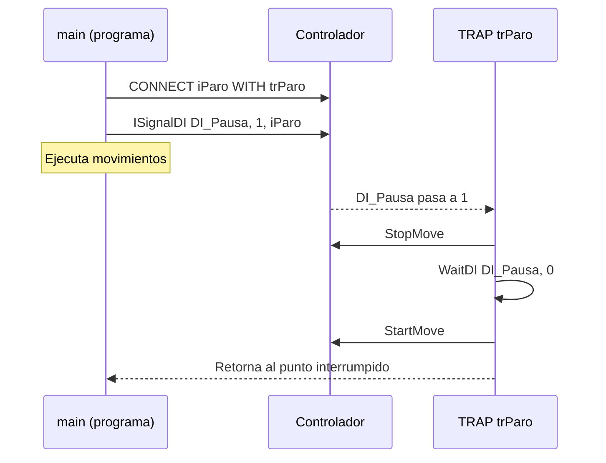

```rapid
VAR intnum iParo;

PROC main()
    IDelete iParo;
    CONNECT iParo WITH trParo;
    ISignalDI DI_Pausa, 1, iParo;
    ! ... programa ...
ENDPROC

TRAP trParo
    StopMove;
    TPWrite "Pausa solicitada";
    WaitDI DI_Pausa, 0;
    StartMove;
ENDTRAP
```

### 13.2 Manejo de errores

Cada rutina puede tener un bloque `ERROR` que se ejecuta cuando ocurre un error recuperable; el código está en `ERRNO`.

```rapid
PROC LeerValor()
    VAR num x;
    x := 10 / reg1;
ERROR
    IF ERRNO = ERR_DIVZERO THEN
        reg1 := 1;
        RETRY;          ! Reintenta la instrucción que falló
    ENDIF
ENDPROC
```

| Instrucción | Acción |
|---|---|
| `RETRY` | Reintenta la instrucción que causó el error. |
| `TRYNEXT` | Continúa con la siguiente instrucción. |
| `RETURN` | Sale de la rutina. |
| `RAISE` | Propaga el error a la rutina llamadora. |

---

## 14. Monitoreo y seguimiento del robot

### 14.1 Mostrar ángulos y posición durante un recorrido

```rapid
PROC Reportar()
    VAR jointtarget j;
    VAR robtarget p;
    j := CJointT();
    p := CRobT(\Tool:=tMarcador \WObj:=wMesa);
    TPWrite "J1..J3: " + NumToStr(j.robax.rax_1, 1) + " / " + NumToStr(j.robax.rax_2, 1) + " / " + NumToStr(j.robax.rax_3, 1);
    TPWrite "J4..J6: " + NumToStr(j.robax.rax_4, 1) + " / " + NumToStr(j.robax.rax_5, 1) + " / " + NumToStr(j.robax.rax_6, 1);
    TPWrite "TCP [mm]: " \Pos:=p.trans;
ENDPROC
```

> [!CAUTION]
> Con zonas `zN` el controlador ejecuta instrucciones por adelantado. Use `fine` (o `WaitRob \InPos`) antes de leer `CJointT` / `CRobT` si necesita el valor en el punto exacto.

### 14.2 Registro en archivo (*data logging*)

```rapid
VAR iodev log;
VAR clock reloj;

PROC IniciarLog()
    Open "HOME:" \File:="log_ejes.csv", log \Write;
    Write log, "t;J1;J2;J3;J4;J5;J6";
    ClkReset reloj;
    ClkStart reloj;
ENDPROC

PROC RegistrarMuestra()
    VAR jointtarget j;
    j := CJointT();
    Write log, NumToStr(ClkRead(reloj), 3) + ";" + NumToStr(j.robax.rax_1, 2) + ";" + NumToStr(j.robax.rax_2, 2) + ";"
             + NumToStr(j.robax.rax_3, 2) + ";" + NumToStr(j.robax.rax_4, 2) + ";" + NumToStr(j.robax.rax_5, 2) + ";"
             + NumToStr(j.robax.rax_6, 2);
ENDPROC

PROC CerrarLog()
    ClkStop reloj;
    Close log;
ENDPROC
```

El archivo queda en la carpeta `HOME` del controlador y se descarga con RobotStudio (*Controlador → Transferencia de archivos*, *File Transfer*) o por FTP.

### 14.3 Muestreo periódico con interrupción de tiempo

```rapid
VAR intnum iMuestreo;

PROC main()
    IniciarLog;
    CONNECT iMuestreo WITH trMuestreo;
    ITimer 0.2, iMuestreo;          ! Muestra cada 200 ms
    Espiral 3, 10;
    IDelete iMuestreo;
    CerrarLog;
ENDPROC

TRAP trMuestreo
    RegistrarMuestra;
ENDTRAP
```

### 14.4 Variables persistentes como interfaz de estado

Publicar el estado del programa en variables `PERS` permite leerlo desde fuera del controlador (sección [21](#21-preparar-el-programa-rapid-para-el-scada)):

```rapid
PERS num  nCiclos := 0;
PERS num  nPaso := 0;
PERS bool bEnMovimiento := FALSE;
PERS jointtarget jUltima := [[0,0,0,0,30,0],[9E9,9E9,9E9,9E9,9E9,9E9]];
```

### 14.5 Tiempos de ciclo

```rapid
VAR clock cCiclo;
VAR num tCiclo;

ClkReset cCiclo;
ClkStart cCiclo;
Cuadrado 60;
ClkStop cCiclo;
tCiclo := ClkRead(cCiclo);
TPWrite "Tiempo de ciclo [s]: " \Num:=tCiclo;
```

---

## 15. RobotStudio: flujo de trabajo

RobotStudio combina una **estación** (geometría 3D: robot, herramienta, mesas, piezas, *targets* y trayectorias) con un **controlador virtual** que ejecuta RAPID igual que el IRC5 real. La mayoría de los errores del laboratorio aparecen porque estas dos partes no están sincronizadas.

<table>
<tr>
<td width="50%">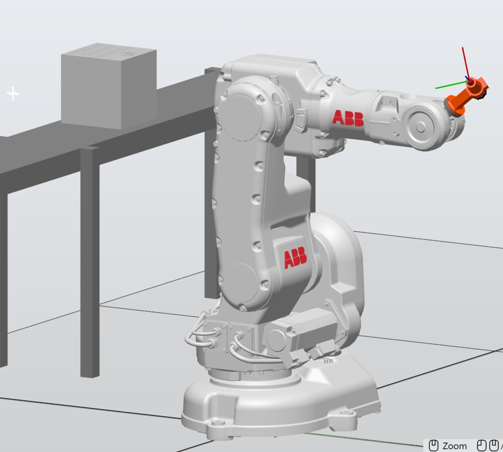</td>
<td width="50%">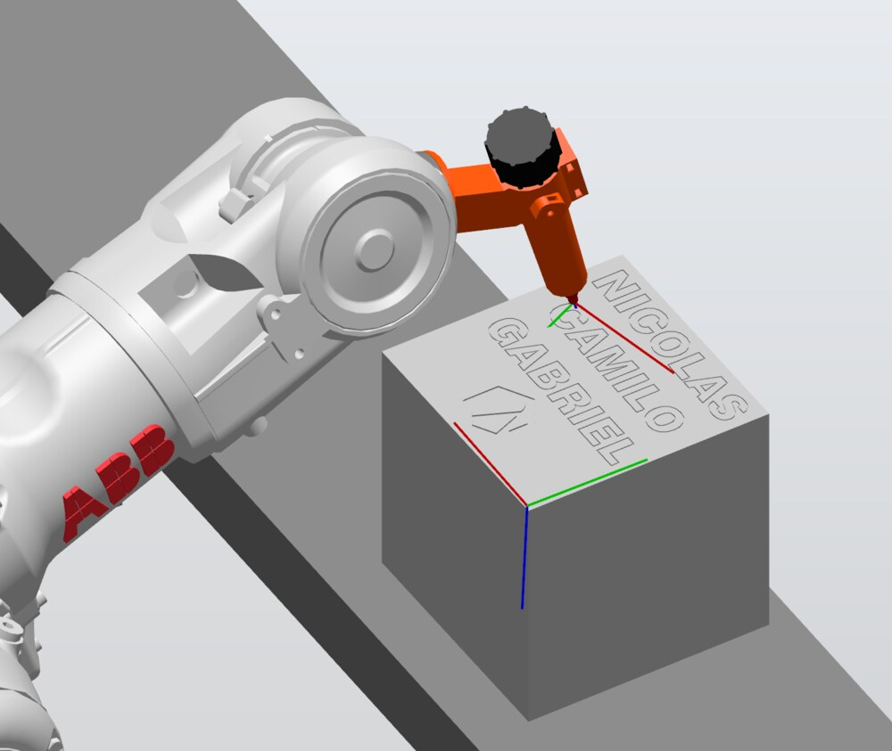</td>
</tr>
<tr>
<td align="center"><sub>Estación: robot, herramienta y caja</sub></td>
<td align="center"><sub>Trayectorias sobre la caja y marco del objeto de trabajo</sub></td>
</tr>
</table>
<p align="center"><sub>Capturas del Laboratorio 1, Robótica Industrial 2025-II (<a href="https://github.com/Nicolas-Eule/Laboratorio_Robotica_1">repositorio</a>).</sub></p>

> [!NOTE]
> Los nombres de menú se dan en español con el nombre en inglés entre paréntesis. Pueden variar ligeramente entre versiones de RobotStudio.

### 15.1 Flujo completo


### 15.2 Puntos clave de cada paso

| Paso | Qué configurar | Error típico si se omite |
|---|---|---|
| Controlador virtual | Misma versión de RobotWare y mismas opciones que el IRC5 del laboratorio. | Instrucciones de sockets o de multitarea no reconocidas. |
| Señales de E/S | Crear `DI_0x` / `DO_0x` sin dispositivo asignado (señales virtuales) y reiniciar el controlador virtual. | *Reference error*: señal no definida al cargar el módulo. |
| Herramienta | TCP en la punta real y masa mayor que 0. | Trayectoria desplazada respecto a la pieza. |
| Objeto de trabajo | Crear los *targets* con el objeto de trabajo correcto activo. | Los puntos quedan en `wobj0` y no se mueven con la mesa. |
| Configuración | Ejecutar *Configuración automática* en cada trayectoria antes de sincronizar. | *Configuration error* al simular o en el robot real. |
| Simulación | Punto de entrada `main` en *Configuración de simulación*. | La simulación no ejecuta el procedimiento esperado. |

### 15.3 Señales virtuales para probar la lógica de E/S

En el controlador virtual no hay tarjeta de E/S: las señales se crean sin dispositivo y se fuerzan desde el **Simulador de E/S** (*I/O Simulator*). Para que una señal mueva objetos de la estación (por ejemplo una banda), se conecta en **Lógica de estación** (*Station Logic*) con un *Smart Component*.

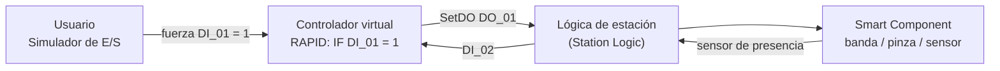

### 15.4 Simular y depurar

| Herramienta | Dónde | Para qué |
|---|---|---|
| **Rastreo del TCP** (*TCP Trace*) | Simulación | Dibuja la trayectoria real del TCP, incluidos los puntos calculados con `Offs` en bucles. |
| **Detección de colisiones** (*Create Collision Set*) | Simulación | Avisa si la herramienta o el brazo tocan la mesa, la banda o la pieza. |
| **Editor RAPID** con ejecución paso a paso | RAPID | Ejecutar instrucción por instrucción y ver el valor de las variables. |
| **Ventana de E/S** | Controlador | Ver y forzar señales durante la simulación. |
| **Analizador de señales** (*Signal Analyzer*) | Simulación | Registrar señales durante la simulación (por ejemplo, velocidad del TCP) y exportarlas. |
| **Desplazar ejes** (*Jog Joint*) | Clic derecho sobre el robot | Mover cada eje a mano y ver sus límites. |

---

## 16. Sincronización estación ↔ RAPID

La estación y el código RAPID son **dos copias** de la misma información. Sincronizar copia en un sentido y sobrescribe el otro.

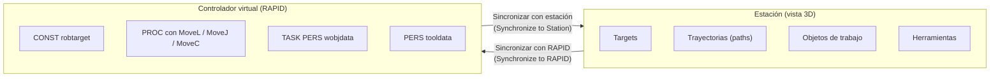

| Equivalencia | Estación | RAPID |
|---|---|---|
| Punto | *Target* | `robtarget` |
| Trayectoria | *Path* | `PROC` con instrucciones de movimiento |
| Objeto de trabajo | *Workobject* | `wobjdata` (`TASK PERS`) |
| Herramienta | *Tool* | `tooldata` (`PERS`) |

### 16.1 ¿Qué sentido usar?

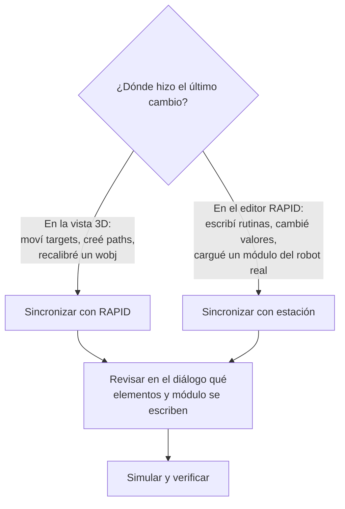

> [!WARNING]
> Sincronizar **sobrescribe** el destino. Si editó el código RAPID a mano y luego sincroniza con RAPID desde una estación desactualizada, perderá esos cambios. Guarde una copia del módulo (o haga *commit*) antes de sincronizar.

> [!TIP]
> *Sincronizar con estación* solo puede dibujar instrucciones con argumentos que resuelve al leer el código (`robtarget`, `wobjdata` y `tooldata` declarados). Las rutinas con `Offs` en bucles o con el objeto de trabajo como parámetro se ejecutan bien en simulación, pero no aparecen como *paths*; verifíquelas con el **Rastreo del TCP**.

---

## 17. Trabajo con varios objetos de trabajo

El mismo dibujo puede ejecutarse sobre distintas superficies (mesa, banda, plano inclinado) si los puntos se definen respecto a un objeto de trabajo. Al cambiar el objeto de trabajo, **toda la trayectoria se traslada y rota con él**.

### 17.1 En RobotStudio

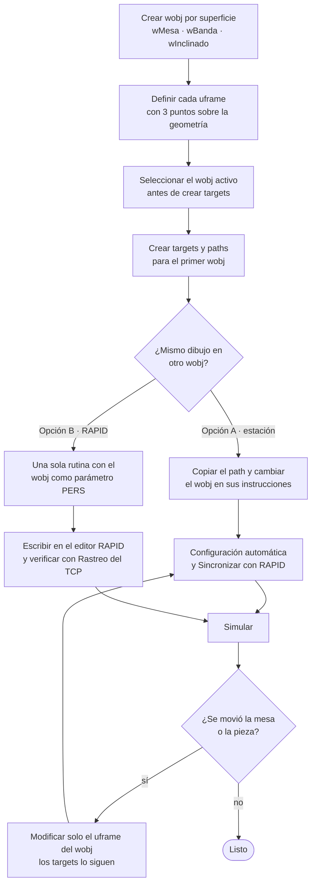

### 17.2 En RAPID: una rutina, varios objetos de trabajo

```rapid
TASK PERS wobjdata wMesa      := [FALSE, TRUE, "", [[400, -200, 100], [1, 0, 0, 0]], [[0, 0, 0], [1, 0, 0, 0]]];
TASK PERS wobjdata wBanda     := [FALSE, TRUE, "", [[-150, 450, 180], [0.7071, 0, 0, 0.7071]], [[0, 0, 0], [1, 0, 0, 0]]];
TASK PERS wobjdata wInclinado := [FALSE, TRUE, "", [[450, 150, 120], [0.9659, 0, 0.2588, 0]], [[0, 0, 0], [1, 0, 0, 0]]];

! El objeto de trabajo es un parámetro PERS: la misma figura sirve en cualquier superficie
PROC CuadradoEn(num lado, PERS wobjdata wo)
    MoveJ Offs(pCentro, 0, 0, zSeg), v300, z10, tMarcador \WObj:=wo;
    MoveL pCentro, v50, fine, tMarcador \WObj:=wo;
    MoveL Offs(pCentro, lado, 0, 0),    v100, z1, tMarcador \WObj:=wo;
    MoveL Offs(pCentro, lado, lado, 0), v100, z1, tMarcador \WObj:=wo;
    MoveL Offs(pCentro, 0, lado, 0),    v100, z1, tMarcador \WObj:=wo;
    MoveL pCentro,                      v100, fine, tMarcador \WObj:=wo;
    MoveL Offs(pCentro, 0, 0, zSeg),    v100, z10, tMarcador \WObj:=wo;
ENDPROC

PROC main()
    MoveAbsJ jHome, v200, fine, tool0;
    CuadradoEn 60, wMesa;
    CuadradoEn 60, wBanda;          ! Rotado 90° en Z respecto a la base
    CuadradoEn 60, wInclinado;      ! Plano inclinado 30° alrededor de Y
    MoveAbsJ jHome, v200, fine, tool0;
ENDPROC
```

<sub>Los marcos <code>uframe</code> de este ejemplo son ilustrativos; mídalos en la celda real. Los cuaterniones corresponden a 90° alrededor de Z (<code>[0.7071, 0, 0, 0.7071]</code>) y 30° alrededor de Y (<code>[0.9659, 0, 0.2588, 0]</code>).</sub>

### 17.3 Mover un objeto de trabajo desde el programa

Útil cuando un sensor o el SCADA informan dónde quedó la pieza (por ejemplo, un desplazamiento sobre la banda):

```rapid
PROC AjustarBanda(num dx)
    wBanda.oframe.trans.x := dx;    ! Solo cambia el marco del objeto
    CuadradoEn 60, wBanda;
ENDPROC
```

### 17.4 Ejemplo real: `Pastel` y `Pastel_2`

El Laboratorio 1 pide repetir la decoración en el cuadrante x(+), y(−) **con un nuevo objeto de trabajo, reutilizando las trayectorias** y sobre una banda transportadora. El programa lo resuelve así:

1. **Medición en el robot real.** Al definir un objeto de trabajo por tres puntos en el FlexPendant se generó el módulo [`Wobj_wobjnaranja.mod`](rapid/lab01_decoracion/Wobj_wobjnaranja.mod) con los puntos `X1`, `X2` e `Y1`. El resultado es `WNaranja`, y `Pastel` usa prácticamente los mismos valores: el marco medido sobre la caja real se llevó a la estación.
2. **Segundo objeto de trabajo.** `Pastel_2` ubica la misma caja en la otra posición.
3. **Reutilización.** La rutina `Reflejado` repite los mismos *targets* (copias con sufijo `_2`) con `\WObj:=Pastel_2`. Las coordenadas locales son idénticas; solo cambia el marco.

```rapid
TASK PERS wobjdata Pastel:=[FALSE,TRUE,"",[[0,0,0],[1,0,0,0]],[[-69.127,-648.568,653.794],[0.0103063,-0.999781,-0.00319575,-0.0179544]]];
TASK PERS wobjdata WNaranja:=[FALSE,TRUE,"",[[0,0,0],[1,0,0,0]],[[-69.1267,-648.568,653.794],[0.0103056,-0.999781,-0.00319482,-0.0179566]]];
TASK PERS wobjdata Pastel_2:=[FALSE,TRUE,"",[[750.001,-195.812,542.432],[0.999786,0.010364,-0.0179194,-3.3711E-5]],[[-815.382,-300.105,150],[0,0.999995,0.00323001,0]]];
```

Al transformar los puntos de trazo al sistema base, la figura de `Pastel_2` resulta la misma figura de `Pastel` desplazada unos 150 mm en Y (panel derecho de la figura de la sección [8.8](#88-ejemplo-real-decoración-de-la-torta-laboratorio-1)).

> [!TIP]
> Con la rutina parametrizada de la sección 17.2 (`PERS wobjdata wo`) no hace falta duplicar los *targets* con sufijo `_2`: basta con llamar la misma rutina con `Pastel` o con `Pastel_2`.

---

## 18. Del simulador al robot real

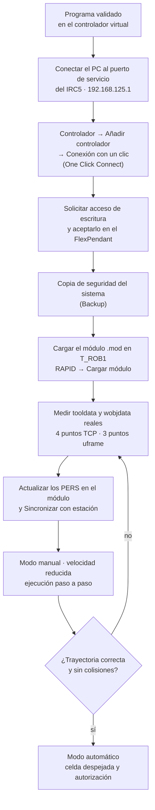

> [!CAUTION]
> En modo manual el controlador limita la velocidad del TCP a 250 mm/s y exige mantener el dispositivo de habilitación. No pase a automático sin la autorización del responsable del laboratorio y con la celda despejada: hay dos robots y bandas compartiendo el espacio.

**Resultado de este flujo en el Laboratorio 1.** La misma lógica se simuló en RobotStudio (estación con banda, herramienta y E/S virtuales) y luego se cargó al IRC5 desde el FlexPendant con el archivo de programa [`AQUI.pgf`](rapid/lab01_decoracion/AQUI.pgf).

<table>
<tr>
<td align="center" width="50%"><a href="https://youtu.be/w56WQL795BM"></a><br><sub>Simulación en RobotStudio</sub></td>
<td align="center" width="50%"><a href="https://youtu.be/gwcXK-_C6pA"></a><br><sub>Ejecución en el IRB 140 con IRC5</sub></td>
</tr>
</table>
<p align="center"><sub>Videos del <a href="https://github.com/Nicolas-Eule/Laboratorio_Robotica_1">Laboratorio 1</a>, Robótica Industrial 2025-II.</sub></p>

---

<div align="center">

# Parte V · Integración con SCADA

</div>

Hasta aquí el robot trabaja solo: el programa RAPID decide y los botones del panel lo disparan. En un sistema SCADA (*Supervisory Control And Data Acquisition*) el robot se vuelve una fuente de datos y un actuador más de la planta. El SCADA **supervisa** el estado del controlador, los ángulos de cada eje, la posición del TCP y los contadores de producción. También **ordena** qué rutina ejecutar y cuántas veces, y **registra** el historial para analizarlo.

Esta parte explica cómo hacerlo con el IRB 140 del LabSIR, con la misma ruta que usaron las prácticas anteriores del laboratorio: **RAPID → servidor OPC UA de ABB → Ignition / Node-RED → MQTT**.

---

## 19. Arquitectura SCADA para el IRB 140

<p align="center">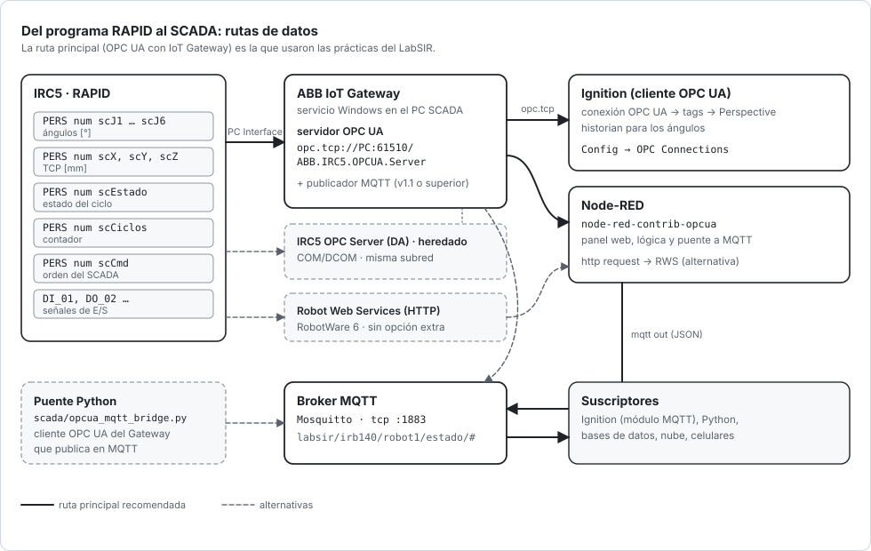</p>

La idea central: **el SCADA no mueve el robot directamente**. El programa RAPID publica su estado en variables `PERS` y lee órdenes de otras variables `PERS`. Un servidor OPC UA instalado en un PC expone esas variables a la red, y desde ahí las toman Ignition, Node-RED o un puente hacia MQTT. La seguridad del movimiento sigue en el controlador: el programa decide si acepta una orden y cuándo.

### 19.1 Rutas disponibles

| Ruta | Qué corre en el PC | Requisito en el IRC5 | Lectura | Escritura | Cuándo usarla |
|---|---|---|---|---|---|
| **OPC UA** · ABB IoT Gateway | Servicio Windows | PC Interface (616-1); desde RobotWare 6.11 también OPC UA Server (1582-1) | Estado del controlador, E/S, variables `PERS` | `PERS` y salidas con acceso *All* | **Ruta recomendada.** Ignition, Node-RED, cualquier cliente OPC UA. |
| **OPC DA** · IRC5 OPC Server | Servidor COM/DCOM | PC Interface (616-1) | E/S, datos RAPID, eventos | Sí | Solo con clientes que únicamente hablan DA. |
| **MQTT** | Broker + puente (Python, Node-RED o el publicador del IoT Gateway) | El de la fuente de datos | Lo que publique el puente | Lo que el puente reenvíe | Muchos suscriptores, IIoT, nube, celulares. |
| **Robot Web Services** | Nada (HTTP) | RobotWare 6 | Todo el controlador | Sí, con *mastership* | Pruebas rápidas sin licencias adicionales. |
| **Socket Messaging** | Programa propio | PC Interface (616-1) | Lo que el RAPID envíe | Lo que el RAPID acepte | Protocolos a medida. |
| **E/S cableadas** con PLC | — | Tarjeta DSQC 652 | Bits | Bits | Enclavamientos y señales de seguridad. |

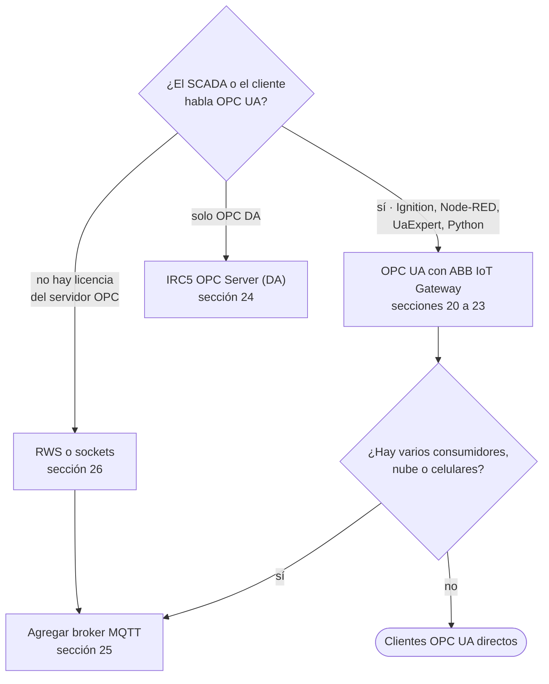

> [!IMPORTANT]
> El IoT Gateway se compra a ABB y se descarga del RobotStudio Developer Center. Antes de la práctica confirme con el laboratorio qué versión está instalada en el PC SCADA y qué opciones tiene el controlador. El IoT Gateway registra el estado `NoPCI` en un alias cuyo controlador no tiene PC Interface.

---

## 20. Conexión física y configuración de red

<p align="center">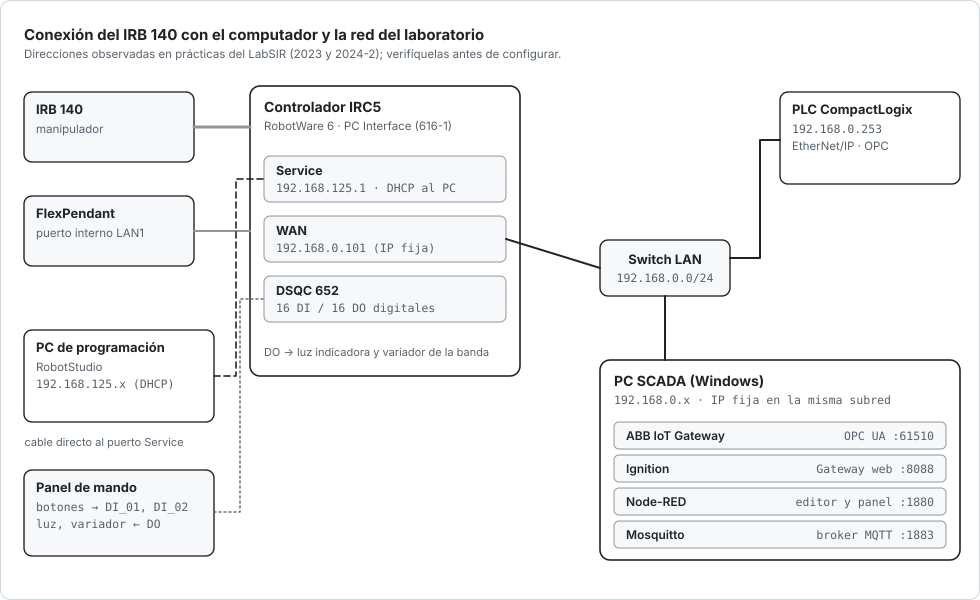</p>

### 20.1 Puerto de servicio y puerto WAN

El computador principal del IRC5 tiene varios puertos Ethernet. Dos interesan aquí:

| | Puerto **Service** | Puerto **WAN** (red del laboratorio) |
|---|---|---|
| Dirección del IRC5 | `192.168.125.1`, fija | Configurable; en las prácticas del LabSIR, `192.168.0.101` |
| Dirección del PC | Automática por DHCP (`192.168.125.x`) o fija `192.168.125.2` | Fija en la misma subred (p. ej. `192.168.0.50/24`) |
| Uso típico | Un PC con RobotStudio, conexión directa con cable | SCADA, IoT Gateway, PLC y varios PC a través de un switch |
| ¿Requiere PC Interface? | No | Sí, para RobotStudio en línea, PC SDK, IoT Gateway y servidores OPC |

<sub>En la unidad de cómputo principal del IRC5 suelen estar rotulados X2 (Service) y X6 (WAN); verifique la etiqueta del controlador del laboratorio.</sub>

> [!NOTE]
> En el video de la práctica 2024-2 (sección [27](#27-prácticas-de-referencia-del-labsir)) el PLC del laboratorio responde en `192.168.0.253` y el robot en `192.168.0.101`. Use esas direcciones como punto de partida, no como verdad: confírmelas en el FlexPendant.

### 20.2 Configurar la dirección del IRC5 (si aún no la tiene)

En el FlexPendant, con el robot en modo manual:

1. **ABB → Panel de control → Configuración → Temas → Communication**.
2. Abra **IP Setting** y agregue o edite una entrada:
   - **IP:** `192.168.0.101`
   - **Subnet:** `255.255.255.0`
   - **Interface:** `WAN`
   - **Label:** un nombre descriptivo
3. Acepte y **reinicie el controlador** cuando lo pida.

La misma configuración se puede hacer desde RobotStudio en línea (*Controlador → Configuración → Communication → IP Setting*) con acceso de escritura.

> [!WARNING]
> Cambiar la IP del controlador afecta a todos los que lo usan. Hágalo solo con autorización del responsable del laboratorio y registre la configuración anterior.

### 20.3 Configurar el PC SCADA

1. Conecte el PC al switch del laboratorio (o directo al puerto WAN con un cable).
2. En Windows, asigne una **IPv4 fija** al adaptador Ethernet, por ejemplo `192.168.0.50`, máscara `255.255.255.0`. No hace falta puerta de enlace para una red aislada.
3. Si el PC también está en Wi-Fi, verifique que la red del robot no se enrute por el Wi-Fi: el video de 2024-2 muestra un PC con Wi-Fi en `10.203.x.x` y Ethernet hacia el robot.
4. Pruebe la conexión: `ping 192.168.0.101`.
5. Abra en el firewall de Windows los puertos que va a usar:

| Puerto | Servicio | Dirección |
|---|---|---|
| TCP 61510 | Servidor OPC UA del IoT Gateway (valor por defecto) | Entrante |
| UDP/TCP 5512–5515 | Descubrimiento y control de controladores ABB | Entrante y saliente |
| TCP 8088 | Gateway web de Ignition | Entrante |
| TCP 1880 | Node-RED | Entrante |
| TCP 1883 | Broker MQTT | Entrante |

6. Instale **RobotStudio** o el **ABB Robot Communication Runtime**: lo necesitan el IoT Gateway y cualquier aplicación PC SDK.

### 20.4 Verificación

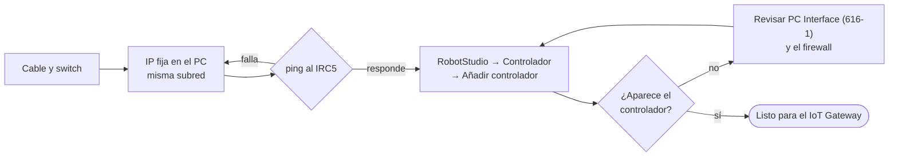

---

## 21. Preparar el programa RAPID para el SCADA

### 21.1 Variables de interfaz

El servidor OPC UA de ABB lee y escribe variables **`PERS`** del programa y señales de E/S. Por eso la interfaz con el SCADA se declara como un conjunto pequeño de `PERS` en un módulo propio, [`rapid/ModSCADA.mod`](rapid/ModSCADA.mod), pensado para el programa del Laboratorio 1:

| Variable | Dirección | Significado |
|---|---|---|
| `scJ1` … `scJ6` | RAPID → SCADA | Ángulos de cada eje [°], actualizados cada 200 ms |
| `scX`, `scY`, `scZ` | RAPID → SCADA | TCP del marcador en el sistema base [mm] |
| `scEstado` | RAPID → SCADA | 0 espera · 1 decorando · 2 mantenimiento · 3 *home* · 9 orden inválida |
| `scRutina` | RAPID → SCADA | 1 NICOLAS · 2 CAMILO · 3 GABRIEL · 4 KYMA |
| `scCiclos` | RAPID → SCADA | Tortas decoradas |
| `scCmd` | SCADA → RAPID | 1 decorar · 2 mantenimiento · 3 *home* · 4 reiniciar contador |
| `scRepeticiones` | SCADA → RAPID | Cuántas veces repetir el decorado |

> [!TIP]
> Publique los ángulos como seis `num` sueltos y no como un `jointtarget`: los tipos simples se leen igual en cualquier cliente OPC UA, en Ignition y en MQTT.

### 21.2 Publicar mientras el robot se mueve

Mientras se ejecuta un `MoveL`, el programa principal está detenido en esa instrucción. Las rutinas `TRAP` sí se ejecutan durante el movimiento, así que una interrupción de tiempo actualiza los ángulos sin afectar la trayectoria:

```rapid
PROC IniciarSCADA()
    scEstado:=0;
    scCmd:=0;
    IDelete iPublicar;
    CONNECT iPublicar WITH trPublicar;
    ITimer 0.2,iPublicar;      ! cada 200 ms
ENDPROC

TRAP trPublicar
    VAR jointtarget j;
    VAR robtarget p;
    j:=CJointT();
    p:=CRobT(\Tool:=Marcador\WObj:=wobj0);
    scJ1:=Round(j.robax.rax_1\Dec:=2);
    ! ... scJ2 a scJ6
    scX:=Round(p.trans.x\Dec:=1);
    ! ... scY, scZ
ENDTRAP
```

### 21.3 Recibir órdenes con acuse

El SCADA escribe `scCmd`, y RAPID copia la orden y la devuelve a 0 como **acuse de recibo**. Así el SCADA sabe que la orden fue tomada, y una misma orden no se ejecuta dos veces.

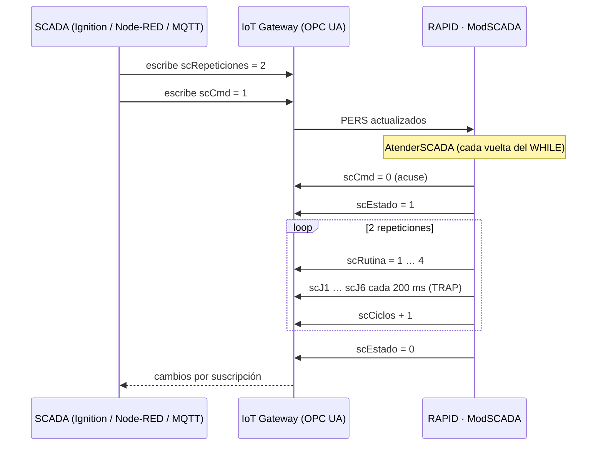

```rapid
PROC AtenderSCADA()
    VAR num orden;
    orden:=scCmd;
    IF orden=0 RETURN;
    scCmd:=0;                  ! acuse
    TEST orden
    CASE 1:
        FOR k FROM 1 TO scRepeticiones DO
            Decorar;           ! secuencia del laboratorio con scRutina y scCiclos
        ENDFOR
    CASE 2:
        Mantenimiento;         ! reanudar exige los dos botones físicos
    CASE 3:
        Homming;
    CASE 4:
        scCiclos:=0;
    ENDTEST
ENDPROC
```

El `main` de referencia (`mainSCADA` en el módulo) atiende **las dos fuentes de órdenes**: el SCADA y los botones del panel. La pose de mantenimiento se puede pedir desde el SCADA, pero para reanudar se siguen exigiendo los dos botones físicos, porque implica que hay una persona junto a la herramienta.

### 21.4 Alternativa con señales de E/S virtuales

El proyecto SCADA del LabSIR de 2023 usó señales virtuales (`DO_IOT_01`, `DI_IOT_01`, `DI_IOT_02` y una señal de grupo para la acción) en lugar de `PERS`. Si prefiere señales:

1. **Crear la señal:** *Configuración → I/O System → Signal → Agregar*, sin *Assigned to Device* (señal virtual).
2. **Permitir escritura externa:** para que un cliente OPC UA escriba una salida, su **Access Level** debe ser `All`. Según el manual del IoT Gateway, las entradas no se deben escribir desde OPC UA; use salidas o `PERS` para las órdenes.
3. **Leerla en RAPID:** con `DOutput(DO_IOT_01)` o directamente en una condición.

> [!CAUTION]
> El servidor OPC UA solo puede escribir variables `PERS` si **ningún otro cliente tiene la *mastership* de RAPID**. Si RobotStudio está conectado con acceso de escritura, las escrituras del SCADA fallan; libere el acceso (*Liberar acceso de escritura*) antes de probar.

---

## 22. OPC UA con ABB IoT Gateway

### 22.1 Qué es

El **ABB IoT Gateway** es un servicio de Windows con una aplicación de configuración. Se conecta a los controladores IRC5 (RobotWare 6) y OmniCore por la interfaz de PC, y expone sus datos como un **servidor OPC UA**. Desde la versión 1.1 también incluye un **publicador MQTT**. ABB distribuye el mismo servidor para IRC5 como **IRC5 OPC UA Server**, con la misma herramienta de configuración y el mismo formato de *endpoint*.

| Requisito | Valor |
|---|---|
| Sistema operativo | Windows 10 de 64 bits (Anniversary Update o posterior) |
| PC | 2 GHz, 4 GB de RAM recomendados, 2 GB libres en disco |
| Software previo | ABB Robot Communication Runtime (incluido con RobotStudio) |
| Opciones del IRC5 | RobotWare 6 anterior a 6.11: **616-1 PC Interface**. RobotWare 6.11 o posterior: **616-1** y **1582-1 OPC UA Server** |
| *Endpoint* | `opc.tcp://<PC>:61510/ABB.IRC5.OPCUA.Server` (puerto configurable) |
| Seguridad | Basic256Sha256, Aes128_Sha256_RsaOaep o Aes256_Sha256_RsaPss; modos *Sign* o *SignAndEncrypt* |
| Usuarios | Anónimo o usuario y contraseña |
| Límites por controlador | 1000 nodos de E/S, 200 nodos de datos RAPID; 1000 suscripciones por sesión |

### 22.2 Configuración paso a paso

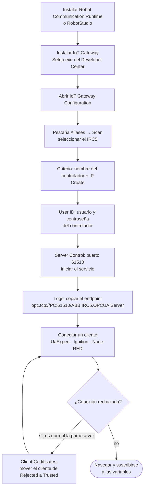

| Pestaña | Para qué sirve |
|---|---|
| **Aliases** | Lista de controladores. *Scan* busca robots en la red; para otra subred se agregan por IP. Cada alias debe identificar un solo controlador: se recomienda nombre del controlador + IP. |
| **IoT Gateways** | Activa o desactiva los módulos (*plug-ins*) del gateway, como el publicador MQTT. |
| **User ID** | Usuario y contraseña con que el gateway entra al controlador. En un IRC5 sin cambios suele ser `Default User` / `robotics`. |
| **Server Control** | Inicia o detiene el servicio y define puerto y nombre del servidor. |
| **Client Certificates** | Certificados de clientes de confianza y rechazados. |
| **Server Certificate** | Crear, importar o exportar el certificado del servidor. |
| **Logs** | Mensajes de operación y *endpoint* del servidor. |

<sub>En el video de 2023 del LabSIR se ve la versión 1.2.2.0 de la herramienta, con los certificados de Node-RED (<code>NodeOPCUA-Client</code>) y de Softing OPC UA Client ya marcados como confiables.</sub>

### 22.3 Seguridad: el primer intento siempre falla

El servidor solo acepta conexiones firmadas o cifradas, y no confía en ningún cliente hasta que el administrador lo autoriza:

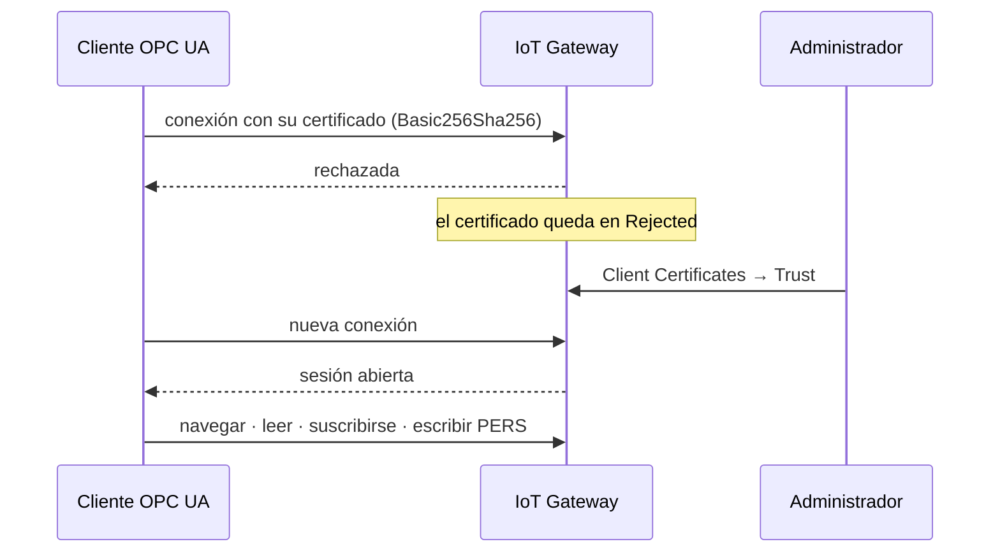

> [!WARNING]
> El modo de seguridad `None` está desactivado por defecto y el manual recomienda no habilitarlo. Tampoco confíe en el acceso anónimo fuera de una red aislada.

### 22.4 Qué se ve en el servidor

| Grupo | Ejemplos de nodos |
|---|---|
| Estado del controlador | `OperatingMode`, `ControllerState`, `ControllerExecutionState`, `SpeedRatio`, `MasterRAPID` |
| Señales de E/S | `DI_01`, `DI_02`, `DO_02`, `Conveyor_FWD` y las señales virtuales |
| Datos RAPID | Variables `PERS`, como las del módulo `ModSCADA` |
| Eventos | Mensajes del registro de eventos del IRC5 como eventos OPC UA |

### 22.5 Probar con un cliente genérico

Antes de construir el SCADA, verifique el servidor con un cliente OPC UA de propósito general, como **UaExpert** o **Softing OPC UA Client** (este último lo usó la práctica de 2023):

1. Agregue el servidor con el *endpoint* y elija **Basic256Sha256 – SignAndEncrypt**.
2. Confíe en el certificado del cliente en el IoT Gateway (sección 22.3).
3. Navegue hasta el alias del robot y ubique las variables de `ModSCADA`.
4. Arrástrelas a la vista de datos: `scJ1` … `scJ6` deben cambiar cuando el robot se mueve.
5. Escriba `scRepeticiones = 1` y luego `scCmd = 1`: el robot debe decorar y `scCmd` debe volver a 0.
6. Anote el **NodeId** de cada variable: Node-RED lo necesita (sección 23.2).

---

## 23. Clientes OPC UA: Ignition y Node-RED

### 23.1 Ignition

Ignition es el SCADA que usó la práctica de 2024-2 del LabSIR, con una conexión OPC UA llamada `ABB` hacia el robot y otra hacia el servidor OPC UA interno de Ignition.

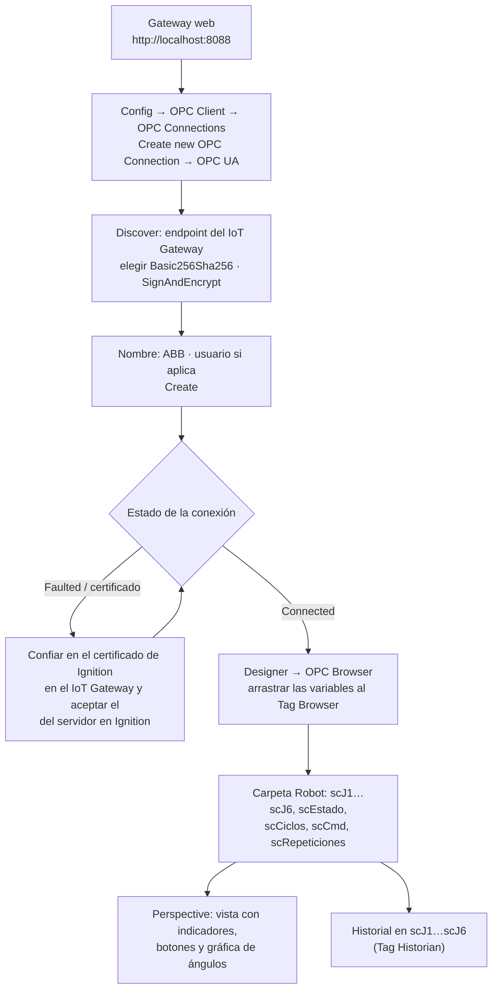

Correspondencia sugerida entre *tags* y componentes de Perspective:

| Tag | Componente | Configuración |
|---|---|---|
| `Robot/scJ1` … `scJ6` | *Time Series Chart* y *Label* | Historial activado; gráfica de los últimos minutos |
| `Robot/scEstado` | *Multi-State Indicator* | 0 espera · 1 decorando · 2 mantenimiento · 3 *home* |
| `Robot/scRutina` | *Label* con transformación de mapa | 1 → NICOLAS … 4 → KYMA |
| `Robot/scCiclos` | *Numeric Entry* (solo lectura) o *Label* | Contador de producción |
| `Robot/scRepeticiones` | *Numeric Entry* | Escritura bidireccional |
| `Robot/scCmd` | *Buttons* "Decorar", "Mantenimiento", "Home" | Script `system.tag.writeBlocking(['[default]Robot/scCmd'], [1])` |
| `ControllerState`, `OperatingMode` | *Label* | Estado del controlador |

> [!TIP]
> La versión de prueba de Ignition funciona por periodos de 2 horas que se reinician desde el Gateway web, suficiente para una práctica.

### 23.2 Node-RED

Node-RED fue la herramienta del proyecto SCADA de 2023 del LabSIR. Con el nodo **`node-red-contrib-opcua`** construyeron un panel con estados del controlador, ángulos en tiempo real, coordenadas XYZ, selección de rutina, número de repeticiones y movimientos articulares y lineales.

1. **Instalar:** `npm install -g --unsafe-perm node-red` y luego `node-red`. El editor queda en `http://localhost:1880`.
2. **Agregar nodos:** en *Manage palette*, instale `node-red-contrib-opcua` y un paquete de panel. El de 2023 usó `node-red-dashboard`, hoy reemplazado por `@flowfuse/node-red-dashboard` (Dashboard 2.0).
3. **Configurar el *endpoint*:** en un nodo **OpcUa-Client**, use la URL del IoT Gateway y la política `Basic256Sha256` con `SignAndEncrypt`.
4. **Confiar en el certificado:** en el IoT Gateway, confíe en el certificado `NodeOPCUA-Client@<PC>`.
5. **Leer:** acción `SUBSCRIBE`, con el NodeId de cada variable copiado de UaExpert en `msg.topic`.
6. **Escribir:** acción `WRITE`, con el NodeId y el tipo de dato que indica la documentación del nodo.

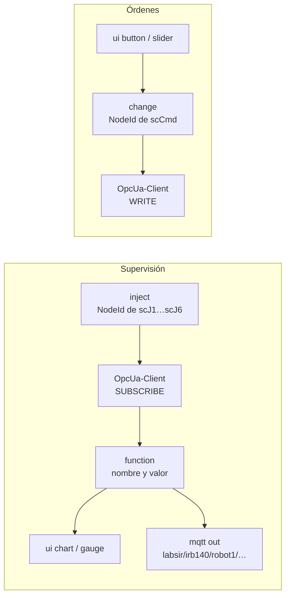

---

## 24. OPC DA (clásico)

OPC DA (*Data Access*) es la versión original de OPC, basada en COM/DCOM de Windows. ABB la ofrece para el IRC5 con el **IRC5 OPC Server**, que incluye servidores DA y de alarmas y eventos (AE).

| Aspecto | IRC5 OPC Server (DA) |
|---|---|
| Última versión documentada | 6.01 (abril de 2015), para Windows 7 SP1 y Windows 8.1 |
| Requisito en el IRC5 | PC Interface en cada controlador conectado por LAN |
| Configuración | Programa *ABB IRC5 OPC Configuration*: elegir controladores e iniciar o detener el servidor |
| Datos | Señales de E/S y variables RAPID (incluidas `PERS`) como *tags*; registro de eventos como eventos AE |
| Limitaciones | Solo alcanza controladores en la misma subred; clientes remotos requieren configurar permisos DCOM |

**Cuándo usarlo:** solo si el cliente únicamente habla DA, como un HMI antiguo. Para Ignition y cualquier desarrollo nuevo, use OPC UA. Si tiene que unir ambos mundos, un servidor intermedio (p. ej. KEPServerEX) puede leer DA y publicar UA.

| | OPC DA | OPC UA | MQTT |
|---|---|---|---|
| Transporte | COM/DCOM (Windows) | TCP binario (`opc.tcp`), multiplataforma | TCP, *publish/subscribe* a través de un broker |
| Seguridad | Permisos DCOM | Certificados, firma y cifrado, usuarios | Usuario y contraseña, TLS (puerto 8883) |
| Modelo de datos | Lista plana de *tags* | Espacio de direcciones con tipos y estructura | Tópicos y cargas libres (p. ej. JSON) |
| Atraviesa firewalls | Con dificultad | Sí, un puerto | Sí, un puerto |
| Rol típico | Sistemas heredados | Integración SCADA y MES | IIoT, nube, muchos consumidores |

---

## 25. MQTT

MQTT es un protocolo de **publicación y suscripción**: los equipos publican mensajes en **tópicos** de un **broker**, y cualquier cliente suscrito a esos tópicos los recibe. No reemplaza al OPC UA del robot. Se agrega detrás de él para distribuir los datos a muchos consumidores, como tableros, bases de datos, la nube o celulares.

```mermaid
sequenceDiagram
    participant P as Puente OPC UA → MQTT
    participant B as Broker (Mosquitto :1883)
    participant I as Ignition / panel
    participant T as Celular / nube
    I->>B: SUBSCRIBE labsir/irb140/robot1/#
    T->>B: SUBSCRIBE labsir/irb140/robot1/estado
    P->>B: PUBLISH …/scJ1 = 12.5 (retain)
    B-->>I: …/scJ1 = 12.5
    P->>B: PUBLISH …/estado = {JSON}
    B-->>I: {JSON}
    B-->>T: {JSON}
    I->>B: PUBLISH …/cmd/scCmd = 1
    B-->>P: …/cmd/scCmd = 1
    Note over P: escribe scCmd en OPC UA → RAPID
```

### 25.1 Diseño de tópicos

| Tópico | Contenido | Dirección |
|---|---|---|
| `labsir/irb140/robot1/scJ1` … `scJ6` | Ángulo de cada eje, número | Robot → consumidores |
| `labsir/irb140/robot1/scX`, `scY`, `scZ` | TCP [mm] | Robot → consumidores |
| `labsir/irb140/robot1/scEstado`, `scRutina`, `scCiclos` | Estado del ciclo | Robot → consumidores |
| `labsir/irb140/robot1/estado` | Todo lo anterior en un JSON con marca de tiempo | Robot → consumidores |
| `labsir/irb140/robot1/cmd/scCmd`, `cmd/scRepeticiones` | Órdenes | Consumidores → robot |
| `labsir/irb140/robot1/puente` | `conectado` / `desconectado` (mensaje de última voluntad) | Diagnóstico |

Ejemplo de mensaje en `labsir/irb140/robot1/estado`:

```json
{"t": 1760546400.215, "scJ1": 12.5, "scJ2": -8.31, "scJ3": 21.07, "scJ4": 0.0, "scJ5": 47.2, "scJ6": 3.1,
 "scX": 512.4, "scY": -655.0, "scZ": 660.2, "scEstado": 1.0, "scRutina": 2.0, "scCiclos": 14.0,
 "scCmd": 0.0, "scRepeticiones": 1.0}
```

### 25.2 Broker Mosquitto

1. Instale Mosquitto en el PC SCADA.
2. Use el archivo [`scada/mosquitto_laboratorio.conf`](scada/mosquitto_laboratorio.conf). Desde la versión 2.0, sin una línea `listener` Mosquitto solo acepta conexiones locales.
3. Ejecute `mosquitto -c mosquitto_laboratorio.conf -v`.
4. Pruebe en otra terminal con `mosquitto_sub -h 192.168.0.50 -t "labsir/irb140/#" -v`.

### 25.3 Ruta A · Puente Python (incluido)

[`scada/opcua_mqtt_bridge.py`](scada/opcua_mqtt_bridge.py) es un cliente OPC UA del IoT Gateway que publica en MQTT y reenvía órdenes:

- Busca por nombre las variables de `ModSCADA` en el espacio de direcciones, así que no necesita conocer los NodeId.
- Se suscribe a los cambios cada 200 ms y publica cada variable y el JSON completo, con *retain*.
- Escucha `…/cmd/<variable>` y escribe solo `scCmd` y `scRepeticiones`; rechaza el resto.
- Crea su propio certificado y usa `Basic256Sha256 – SignAndEncrypt`.
- Se reconecta solo ante caídas de red.

```bash
pip install -r scada/requirements.txt
python scada/opcua_mqtt_bridge.py \
    --endpoint opc.tcp://192.168.0.50:61510/ABB.IRC5.OPCUA.Server \
    --broker 127.0.0.1 --base labsir/irb140/robot1
# Primera ejecución: confíe en su certificado en el IoT Gateway (Client Certificates) y vuelva a ejecutar.

# Enviar una orden desde cualquier cliente MQTT:
mosquitto_pub -h 127.0.0.1 -t labsir/irb140/robot1/cmd/scRepeticiones -m 2
mosquitto_pub -h 127.0.0.1 -t labsir/irb140/robot1/cmd/scCmd -m 1
```

> [!NOTE]
> El puente se probó contra un servidor OPC UA simulado con el mismo *endpoint* y la misma política de seguridad del IoT Gateway (`Basic256Sha256`, `SignAndEncrypt`). En esa prueba publicó las 14 variables, escribió las órdenes y rechazó escrituras a variables de solo lectura. **No se ha probado aún contra el IRC5 del laboratorio**: el primer ensayo real debe hacerse con el robot en modo manual.

### 25.4 Ruta B · Node-RED

En el flujo de la sección 23.2, conecte la salida del nodo `OpcUa-Client` (SUBSCRIBE) a un nodo **`mqtt out`** con el broker `192.168.0.50:1883` y el tópico `labsir/irb140/robot1/<variable>`. Para las órdenes, use **`mqtt in`** en `labsir/irb140/robot1/cmd/#` → un nodo `change` con el NodeId → `OpcUa-Client` (WRITE).

### 25.5 Ruta C · Publicador MQTT del IoT Gateway

Las versiones 1.1 y posteriores del IoT Gateway traen un publicador MQTT configurable, que se activa en la pestaña **IoT Gateways**. Su configuración (broker, tópicos y formato) está en el capítulo 4 del manual de la versión instalada. Si el PC del laboratorio tiene esa versión, el gateway publica sin puente intermedio; verifique primero qué datos y con qué formato los envía.

### 25.6 Consumir MQTT en Ignition

Ignition se conecta a MQTT mediante módulos adicionales, como los de **Cirrus Link** (MQTT Engine, orientado a Sparkplug B), o leyendo el broker con Node-RED y reenviando a Ignition por OPC UA. Para el curso, lo más directo es que Ignition lea el robot por **OPC UA** (sección 23.1) y que MQTT sirva a los demás consumidores.

> [!WARNING]
> `allow_anonymous true` solo es aceptable en la red aislada del laboratorio. Fuera de ella, use usuarios con `password_file` y TLS en el puerto 8883.

---

## 26. Alternativas: sockets y Robot Web Services

Si no hay licencia del servidor OPC, estas dos rutas también llevan datos del robot a Node-RED o Python, y de ahí a MQTT o al SCADA.

### 26.1 Servidor TCP en RAPID (Socket Messaging)

```mermaid
sequenceDiagram
    participant Cliente as Cliente (Python / Node-RED)
    participant IRC5 as IRC5 · ServidorSocket
    IRC5->>IRC5: SocketCreate · SocketBind · SocketListen
    Cliente->>IRC5: Conexión TCP (SocketAccept)
    Cliente->>IRC5: "CUADRADO"
    Note over IRC5: Cuadrado 60
    IRC5-->>Cliente: "OK"
    Cliente->>IRC5: "JOINTS"
    IRC5-->>Cliente: [j1, j2, j3, j4, j5, j6]
    Cliente->>IRC5: Cierra la conexión
    Note over IRC5: ERR_SOCK_CLOSED → SocketClose
```

```rapid
VAR socketdev servidor;
VAR socketdev cliente;
VAR string recibido;
VAR jointtarget jSock;

PROC ServidorSocket()
    SocketCreate servidor;
    SocketBind servidor, "192.168.125.1", 1025;     ! Real: IP del IRC5 · Virtual: "127.0.0.1"
    SocketListen servidor;
    SocketAccept servidor, cliente \Time:=WAIT_MAX;

    WHILE TRUE DO
        SocketReceive cliente \Str:=recibido \Time:=WAIT_MAX;
        TEST recibido
        CASE "CUADRADO": Cuadrado 60;
        CASE "CIRCULO":  Circulo 40;
        CASE "HOME":     MoveAbsJ jHome, v200, fine, tool0;
        CASE "JOINTS":   ! Responder con los ángulos actuales
            jSock := CJointT();
            SocketSend cliente \Str:=ValToStr(jSock.robax);
        DEFAULT:
            SocketSend cliente \Str:="ERR";
        ENDTEST
        IF recibido <> "JOINTS" SocketSend cliente \Str:="OK";
    ENDWHILE
ERROR
    IF ERRNO = ERR_SOCK_CLOSED THEN
        SocketClose cliente;
        SocketClose servidor;
        RETURN;
    ENDIF
ENDPROC
```

<details>
<summary><b>Cliente de prueba en Python</b></summary>

```python
import socket

IP, PUERTO = "192.168.125.1", 1025   # "127.0.0.1" con el controlador virtual

with socket.create_connection((IP, PUERTO), timeout=30) as s:
    for orden in ("HOME", "JOINTS", "CUADRADO"):
        s.sendall(orden.encode())
        print(orden, "→", s.recv(1024).decode())
```

</details>

> [!NOTE]
> `192.168.125.1` es la dirección del puerto de servicio del IRC5. Para la red del laboratorio, use la IP del puerto WAN configurado. El proyecto [Task_Planning_Cobotic](https://github.com/labsir-un/Task_Planning_Cobotic/tree/main/ABB/RAPID) del LabSIR mantiene dos módulos: uno con sockets para el robot real y otro sin sockets para probar la lógica en RobotStudio, una práctica recomendable.

### 26.2 Robot Web Services (RobotWare 6)

<p align="center"></p>
<p align="center"><sub>RWS (HTTP/WebSocket, baja frecuencia) y EGM (UDP a 250 Hz, control de movimiento). Figura de <a href="https://github.com/ros-industrial/abb_librws">abb_librws</a> © 2015 ABB Schweiz AG, licencia BSD-3-Clause, incluida en <a href="https://github.com/labsir-un/abb_un_driver">abb_un_driver</a> del LabSIR.</sub></p>

Recursos REST de uso frecuente (autenticación *digest*; el usuario por defecto es `Default User`, verifique la configuración del laboratorio). El driver [abb_un_driver](https://github.com/labsir-un/abb_un_driver) del LabSIR usa RWS en el puerto 80 del IRC5.

| Dato | Petición |
|---|---|
| Ángulos articulares | `GET http://<ip>/rw/motionsystem/mechunits/ROB_1/jointtarget?json=1` |
| Posición cartesiana | `GET http://<ip>/rw/motionsystem/mechunits/ROB_1/robtarget?json=1` |
| Variable RAPID | `GET http://<ip>/rw/rapid/symbol/data/RAPID/T_ROB1/<Modulo>/nCiclos?json=1` |
| Estado de ejecución | `GET http://<ip>/rw/rapid/execution?json=1` |
| Señal de E/S | `GET http://<ip>/rw/iosystem/signals/<nombre_señal>?json=1` |

```mermaid
sequenceDiagram
    participant NR as Node-RED (cada 200 ms)
    participant RWS as IRC5 · RWS
    participant SC as SCADA (Ignition)
    loop Sondeo periódico
        NR->>RWS: GET …/jointtarget
        RWS-->>NR: rax_1 … rax_6
        NR->>RWS: GET …/RAPID/T_ROB1/Modulo/nCiclos
        RWS-->>NR: valor
        NR->>SC: Publica tags (OPC UA / MQTT)
    end
```

---

## 27. Prácticas de referencia del LabSIR

Tres prácticas del curso muestran el robot del laboratorio integrado con SCADA. Sirven como guía de lo que se espera lograr.

<table>
<tr>
<td align="center" width="33%"><a href="https://www.youtube.com/watch?v=-Wzx1LwJQps"></a></td>
<td align="center" width="33%"><a href="https://www.youtube.com/watch?v=6fMXGUo0rJM"></a></td>
<td align="center" width="33%"><a href="https://www.youtube.com/watch?v=qp5JbV5KLcg"></a></td>
</tr>
<tr>
<td valign="top"><sub><b>2023-1 · IoT Gateway + Node-RED</b><br>Andrés Holguín Restrepo, Sara Jiménez, Nicolás López Bermeo · SCADA y CI</sub></td>
<td valign="top"><sub><b>2024-2 · PLC + Ignition + robot por OPC</b><br>Canal Eduardo Barrera</sub></td>
<td valign="top"><sub><b>2019 · Celular, PLC Allen-Bradley, robot e Ignition</b><br>Camilo Ávila, Danilo Suárez, Sebastián Gómez · Grupo 5</sub></td>
</tr>
</table>

### 27.1 IoT Gateway y Node-RED (2023-1)

| | Detalle |
|---|---|
| Software | RobotStudio, ABB IoT Gateway Configuration (1.2.2.0), Softing OPC UA Client, Node-RED con `node-red-contrib-opcua` y Node-RED Dashboard |
| Hardware | IRB 140 e IRC5 del LabSIR en la red local; primero con controlador virtual (`127.0.0.1`) y luego con el robot real (`192.168.0.101`) |
| Supervisión | Nombre e IP del controlador, modo, programa cargado, paro de emergencia, motores; ángulos de los seis ejes en tiempo real y coordenadas XYZ |
| Control | Adquisición de datos, encendido, selección de rutina, número de repeticiones, movimientos articulares (*jogging*) y lineales |
| Lado RAPID | Señales virtuales `DO_IOT_01`, `DI_IOT_01`, `DI_IOT_02`, una señal de grupo con la acción y un `TEST` que llama la rutina pedida |
| Conclusión del equipo | El acceso por red es posible; en ese momento el LabSIR no tenía la conexión de red adecuada para dejarlo permanente |

### 27.2 PLC, Ignition y robot por OPC (2024-2)

```mermaid
flowchart LR
    PLC["CompactLogix<br/>192.168.0.253<br/>Studio 5000"] <--> IG["Ignition Gateway<br/>OPC UA Server interno"]
    IG <-- "conexión OPC UA 'ABB'" --> RB["IRB 140 · IRC5<br/>192.168.0.101"]
    IG --> HMI["Perspective<br/>PLC Parada / Arranque · Permiso OPC<br/>OPC Robot Start"]
```

Las etiquetas de Ignition se organizaron en una carpeta **PLC** (`Arranque`, `Parada`, `Banda`, `Permiso_OPC`, `OPC_Robot_Start`, `PLC_Salida_Digital`) y otra **Robot** (`DO_01`, `contador`, `start_robot`). El PLC da el permiso, Ignition hace de puente y el robot arranca su rutina: un enclavamiento repartido entre los tres equipos.

### 27.3 Celular, PLC Allen-Bradley y robot (2019)

Desde una interfaz en un celular, los estudiantes envían una orden por OPC a un PLC de Rockwell. El PLC inicia una rutina de *pick and place* en el robot ABB, y todo se visualiza en Ignition.

---

## 28. Errores comunes y buenas prácticas

### 28.1 Programación y simulación

| Problema | Causa probable | Solución |
|---|---|---|
| *Position outside reach* | Punto fuera del volumen de trabajo. | Verificar con `CalcJointT` o en RobotStudio. |
| *Joint out of range* | Una articulación excede su límite. | Cambiar orientación o `confdata`; validar con la función de 6.4. |
| Error de configuración | El `confdata` no coincide con el camino real. | *Configuración automática* en RobotStudio o reenseñar; como último recurso `ConfL \Off`. |
| Singularidad de muñeca | Ejes 4 y 6 alineados (eje 5 ≈ 0°). | Evitar orientaciones con eje 5 cercano a 0°; `SingArea \Wrist`. |
| Lectura de posición adelantada | Ejecución anticipada con zonas `zN`. | Usar `fine` o `WaitRob \InPos` antes de leer. |
| Trayectoria desplazada | `tooldata` o `wobjdata` incorrectos. | Redefinir el TCP y el objeto de trabajo. |
| Cambios perdidos en RAPID | Se sincronizó con RAPID desde una estación desactualizada. | Respaldar el módulo y elegir el sentido correcto (sección 16.1). |
| Señal no definida al cargar | El módulo usa señales que el controlador no tiene. | Crearlas en *I/O System* (virtuales en simulación). |

### 28.2 Comunicación y SCADA

| Problema | Causa probable | Solución |
|---|---|---|
| El IoT Gateway no encuentra el robot | Otra subred o firewall | Agregar el alias por IP; abrir UDP/TCP 5512–5515 |
| Alias en estado `NoPCI` | El controlador no tiene PC Interface | Verificar opciones del sistema (616-1) |
| El cliente OPC UA no conecta | Certificado no confiable | *Client Certificates* → *Trust* en el IoT Gateway; aceptar el del servidor en el cliente |
| Se leen datos, pero no se escriben | Otro cliente tiene la *mastership* de RAPID (p. ej. RobotStudio) | Liberar el acceso de escritura en RobotStudio |
| Una entrada no cambia desde OPC UA | Las entradas no se escriben desde OPC UA | Usar `PERS` o salidas con *Access Level* `All` |
| La variable no aparece en el servidor | Es `VAR`, no `PERS`, o supera el límite de 200 datos RAPID | Declararla `PERS` y agrupar datos |
| Los ángulos no cambian durante un movimiento | Se publican en el `main` y no en un `TRAP` | Usar `ITimer` con una rutina `TRAP` (sección 21.2) |
| Mosquitto rechaza conexiones remotas | Mosquitto 2.x sin `listener` | Usar `scada/mosquitto_laboratorio.conf` |
| El PC no llega al robot con Wi-Fi activo | Ruta por el adaptador equivocado | IP fija en Ethernet en la subred del robot, o desactivar el Wi-Fi |

**Buenas prácticas**

- Especificar siempre `tool` y `\WObj` en cada movimiento.
- Usar `fine` donde se lee una señal, se actúa una herramienta o se toma una medida.
- Aproximarse a la superficie desde una altura segura.
- Empezar con velocidades bajas (`v50`–`v100`) y `VelSet` reducido en las primeras pruebas.
- Mantener las variables de interfaz con el SCADA en un módulo propio y con prefijo (`sc…`).
- No permitir que el SCADA ordene movimientos libres: solo rutinas conocidas, validadas en RAPID.
- Mantener las condiciones de seguridad (paro, mantenimiento) en el robot y el PLC, no solo en el HMI.
- Versionar los módulos `.mod` y los flujos o proyectos SCADA en este repositorio.

### Estructura del repositorio

```text
.
├── README.md
├── docs/img/
│   ├── figuras/                 # Diagramas propios de esta guía (SVG)
│   ├── laboratorio/             # Fotos y capturas del Laboratorio 1
│   ├── abb_librws/              # Figura RWS/EGM (BSD-3-Clause)
│   └── CREDITOS.md
├── rapid/
│   ├── lab01_decoracion/        # Programa del Laboratorio 1 (AQUI.pgf + módulos)
│   └── ModSCADA.mod             # Interfaz SCADA: variables PERS, TRAP y main de referencia
└── scada/
    ├── opcua_mqtt_bridge.py     # Puente OPC UA (IoT Gateway) ↔ MQTT
    ├── mosquitto_laboratorio.conf
    └── requirements.txt
```

---

## 29. Referencias y créditos

**Documentación de ABB**

- *Technical reference manual — RAPID Instructions, Functions and Data types* (RobotWare 6).
- *Technical reference manual — RAPID overview* (RobotWare 6).
- *Operating manual — IRC5 with FlexPendant* y *Operating manual — RobotStudio*.
- *Application manual — Controller software IRC5* (Socket Messaging, multitarea y demás opciones).
- [Application manual — IoT Gateway (3HAC078375-001)](https://tech-community.robotics.abb.com/uploads/short-url/u9lZn7dqnCUmBeuwMbEObwVwvJu.pdf)
- [Application manual — IRC5 OPC UA Server (3HAC074394-001)](https://library.e.abb.com/public/9dab9d097ef64ffc82dbd1b8c9763a0b/3HAC074394%20AM%20IRC5%20OPC%20UA%20Server-en.pdf?x-sign=8d7n+0j05VsVuo8DcV7Zt0Jmyd1RgSXSApc3uQ1Yvv2aCjGTx6AgZekNr2sqP9gw)
- [Release notes — IRC5 OPC Server 6.01 (OPC DA)](https://library.e.abb.com/public/69016bc802e44fc4a25ba5ccddaed7d9/ReleaseNotesOPC_Server601.pdf)
- [IoT Gateway — página de producto de ABB](https://www.abb.com/global/en/areas/robotics/products/software/iot-gateway)
- [Configurar el PC para comunicarse con el robot (PC SDK)](https://developercenter.robotstudio.com/api/pcsdk/articles/Manual/Installation-and-development-environment/How-to-set-up-your-PC-to-communicate-with-robot.html)
- [IRB 140 — Data sheet](https://library.e.abb.com/public/0ab091987347463cb06a3cc653d8ddb8/IRB_140_20211001.pdf) · [IRB 140 en ABB Robotics](https://one.robotics.abb.com/Robots/p/IRB-140)
- [Modelo del IRB 140 en RobotStudio Developer Center](https://developercenter.robotstudio.com/api/robotstudio/articles/How-To/RobotMechanism/BuildthemodeloftheIRB140.html) (límites articulares)

**Laboratorio y LabSIR**

- [Nicolas-Eule/Laboratorio_Robotica_1](https://github.com/Nicolas-Eule/Laboratorio_Robotica_1) — Laboratorio 1 de Robótica Industrial 2025-II: Jorge Nicolás Garzón Acevedo, Johan Camilo Patiño Mogollón y Gabriel Eduardo Bojacá Munar. Docentes: Manuel Felipe Carranza Montenegro y Pedro Fabián Cárdenas Herrera.
- [labsir-un/Task_Planning_Cobotic](https://github.com/labsir-un/Task_Planning_Cobotic) — módulos RAPID con sockets para el IRB 140.
- [labsir-un/abb_un_driver](https://github.com/labsir-un/abb_un_driver) — driver ROS para el IRB 140 (RWS y EGM).
- Videos de prácticas SCADA: [2023-1 IoT Gateway](https://www.youtube.com/watch?v=-Wzx1LwJQps) · [2024-2 PLC y robot](https://www.youtube.com/watch?v=6fMXGUo0rJM) · [2019 Ignition y PLC](https://www.youtube.com/watch?v=qp5JbV5KLcg)

**Software**

- [node-red-contrib-opcua](https://flows.nodered.org/node/node-red-contrib-opcua) · [Eclipse Mosquitto](https://mosquitto.org/) · [asyncua](https://github.com/FreeOpcUa/opcua-asyncio) · [paho-mqtt](https://github.com/eclipse-paho/paho.mqtt.python) · [Ignition](https://inductiveautomation.com/ignition/)

**Imágenes:** ver [docs/img/CREDITOS.md](docs/img/CREDITOS.md). Las figuras de `docs/img/figuras/` son propias de esta guía.

---

<div align="center"><sub>Universidad Nacional de Colombia — Sede Bogotá · Comunicaciones Industriales SCADA · Laboratorio de Robótica (LabSIR)</sub></div>
