<div align="center">

# Programación RAPID para el ABB IRB 140

**Guía introductoria · Comunicaciones Industriales SCADA**<br>
Laboratorio de Robótica (LabSIR) · Universidad Nacional de Colombia, Sede Bogotá


<br><br>

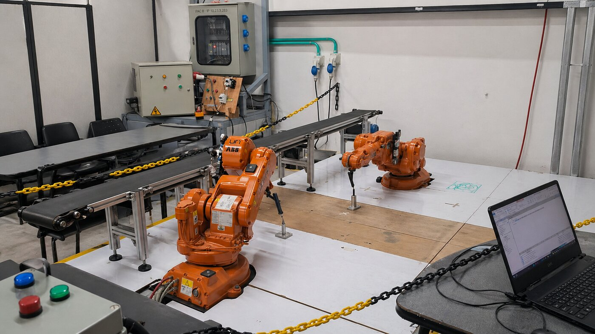

<sub>Celda del laboratorio con los dos IRB 140 (Caín y Abel), las bandas transportadoras y la estación de programación.<br>
Foto: LabSIR UN, repositorio <a href="https://github.com/labsir-un/Robotica_2026_I">Robotica_2026_I</a> (Equipo 1E), licencia MIT.</sub>

</div>

---

Este repositorio reúne, de forma introductoria, las instrucciones, funciones y tipos de datos de **RAPID** (el lenguaje de los controladores ABB) que se usan con el manipulador **IRB 140** del laboratorio. Explica cómo mover el robot eje por eje, cómo construir trayectorias cartesianas, cómo usar variables y contadores para generar movimientos, cómo **simular y sincronizar** el programa en **RobotStudio** con distintos objetos de trabajo, cómo monitorear el estado del robot y cómo comunicarlo con un sistema SCADA.

> [!IMPORTANT]
> Los ejemplos están escritos para un controlador **IRC5 con RobotWare 6.x**. Todo programa nuevo se valida primero en RobotStudio, luego en el robot real en **modo manual** a velocidad reducida, y solo después en modo automático. Revise la sección [0. Antes de empezar](#0-antes-de-empezar).

### Ruta de trabajo

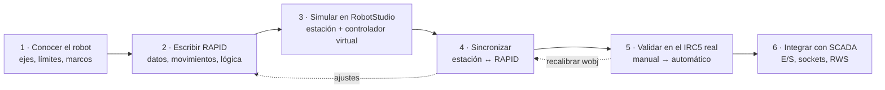

---

## Tabla de contenido

| Fundamentos | Programación | Simulación e integración |
|---|---|---|
| [0. Antes de empezar](#0-antes-de-empezar) | [5. Instrucciones de movimiento](#5-instrucciones-de-movimiento) | [15. RobotStudio: flujo de trabajo](#15-robotstudio-flujo-de-trabajo) |
| [1. El manipulador IRB 140](#1-el-manipulador-irb-140) | [6. Movimiento articular](#6-movimiento-articular-control-de-los-ángulos-de-cada-eje) | [16. Sincronización estación ↔ RAPID](#16-sincronización-estación--rapid) |
| [2. Estructura de un programa](#2-estructura-de-un-programa-rapid) | [7. Funciones de posición](#7-funciones-de-posición-y-transformación) | [17. Trabajo con varios objetos de trabajo](#17-trabajo-con-varios-objetos-de-trabajo) |
| [3. Tipos de datos](#3-tipos-de-datos-y-declaración-de-variables) | [8. Trayectorias de ejemplo](#8-construcción-de-trayectorias) | [18. Del simulador al robot real](#18-del-simulador-al-robot-real) |
| [4. Marcos de referencia](#4-sistemas-de-coordenadas-herramientas-y-objetos-de-trabajo) | [9. Control de flujo](#9-control-de-flujo) | [19. Comunicación con SCADA](#19-comunicación-con-sistemas-scada) |
| | [10. Variables y contadores](#10-variables-contadores-arreglos-y-matemáticas) | [20. Errores comunes](#20-errores-comunes-y-buenas-prácticas) |
| | [11. Entradas y salidas](#11-entradas-y-salidas-es) | [21. Referencias y créditos](#21-referencias-y-créditos) |
| | [12. FlexPendant](#12-interacción-con-el-flexpendant) | |
| | [13. Interrupciones y errores](#13-interrupciones-y-manejo-de-errores) | |
| | [14. Monitoreo del robot](#14-monitoreo-y-seguimiento-del-robot) | |

---

## 0. Antes de empezar

Varios elementos dependen de la configuración de cada controlador. Verifíquelos antes de usar los ejemplos:

| Elemento | Dónde se verifica | Por qué importa |
|---|---|---|
| Versión de RobotWare | FlexPendant → *Información del sistema* | Robot Web Services (RWS) requiere RobotWare 6 o superior. |
| Opciones de software | FlexPendant → *Información del sistema → Opciones de sistema* | Sockets (*PC Interface*), multitarea (*Multitasking*) y buses de campo son opciones adicionales. |
| Nombres de las señales de E/S | FlexPendant → *Entradas y salidas* · RobotStudio → *Configuración → I/O System* | Esta guía usa `DI_01…DI_03` y `DO_01…DO_03`, los nombres usados en el Laboratorio 1 de Robótica 2026-I con el robot Caín. Confírmelos para cada robot. |
| Herramienta montada (`tooldata`) | Medición del TCP en el laboratorio | Un TCP o una masa incorrectos producen trayectorias erróneas. |
| Límites articulares | RobotStudio → *Configuración → Motion → Arm* | Pueden ser más restrictivos que los mecánicos. |
| Zonas de seguridad de la celda | Responsable del laboratorio | Bandas, mesas y el otro robot comparten el volumen de trabajo. |

> [!NOTE]
> En los repositorios del LabSIR hay evidencia útil: el Laboratorio 1 se ejecutó en un **IRC5** físico, y el proyecto [Task_Planning_Cobotic](https://github.com/labsir-un/Task_Planning_Cobotic/tree/main/ABB/RAPID) usa *Socket Messaging* en el IRB 140 real (puerto de servicio `192.168.125.1`), lo que indica que la opción de sockets está instalada en al menos uno de los controladores. Confirme las opciones del robot que va a usar.

---

## 1. El manipulador IRB 140

<table>
<tr>
<td align="center" width="33%"><br><sub>Versión estándar</sub></td>
<td align="center" width="33%"><br><sub>Versión Foundry Plus</sub></td>
<td align="center" width="33%"><br><sub>Configuración para soldadura de arco</sub></td>
</tr>
</table>
<p align="center"><sub>Imágenes © ABB, enlazadas desde el sitio de producto de ABB Robotics (no se redistribuyen en este repositorio).</sub></p>

Robot industrial articulado de **6 ejes**, de carga ligera. ABB lo lista hoy como producto **descontinuado**, reemplazado por la familia **IRB 1300**; la programación en RAPID es la misma.

| Característica | Valor |
|---|---|
| Ejes | 6 (rotacionales) |
| Carga útil | 6 kg (hojas de datos antiguas: 5 kg) |
| Alcance (al centro del eje 5) | 810 mm |
| Repetibilidad | ± 0,03 mm |
| Montaje | Piso, pared o invertido |
| Controlador en el laboratorio | IRC5 |

### 1.1 Ejes, límites y velocidades

<p align="center">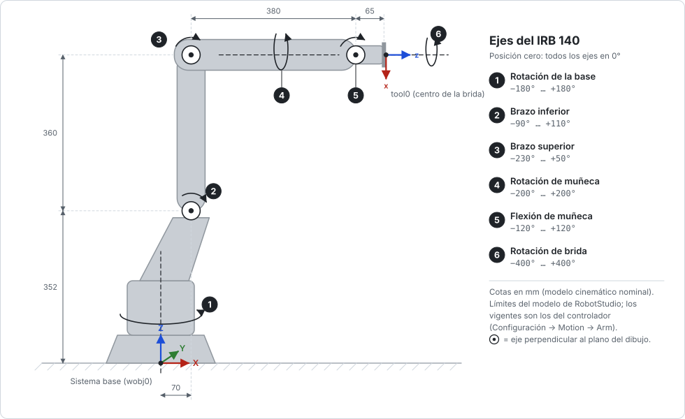</p>

| Eje | Movimiento | Límite inferior | Límite superior | Velocidad máx. |
|:-:|---|:-:|:-:|:-:|
| 1 | Rotación de la base | −180° | +180° | 200 °/s |
| 2 | Brazo inferior | −90° | +110° | 200 °/s |
| 3 | Brazo superior | −230° | +50° | 260 °/s |
| 4 | Rotación de muñeca | −200° | +200° | 360 °/s |
| 5 | Flexión de muñeca | −120° | +120° | 360 °/s |
| 6 | Rotación de brida | −400° | +400° | 450 °/s |

> [!NOTE]
> Los límites son los del modelo del IRB 140 en RobotStudio. La hoja de datos de ABB da un recorrido total de 230° para el eje 5 y define los ejes 4 y 6 como de rotación ilimitada (400° por defecto en el eje 4). **Los límites vigentes son los configurados en el controlador.**

**Posición *home* típica:** `[0, 0, 0, 0, 30, 0]` grados. El eje 5 queda a 30° para alejar la muñeca de la singularidad (ejes 4 y 6 alineados cuando el eje 5 vale 0°).

---

## 2. Estructura de un programa RAPID

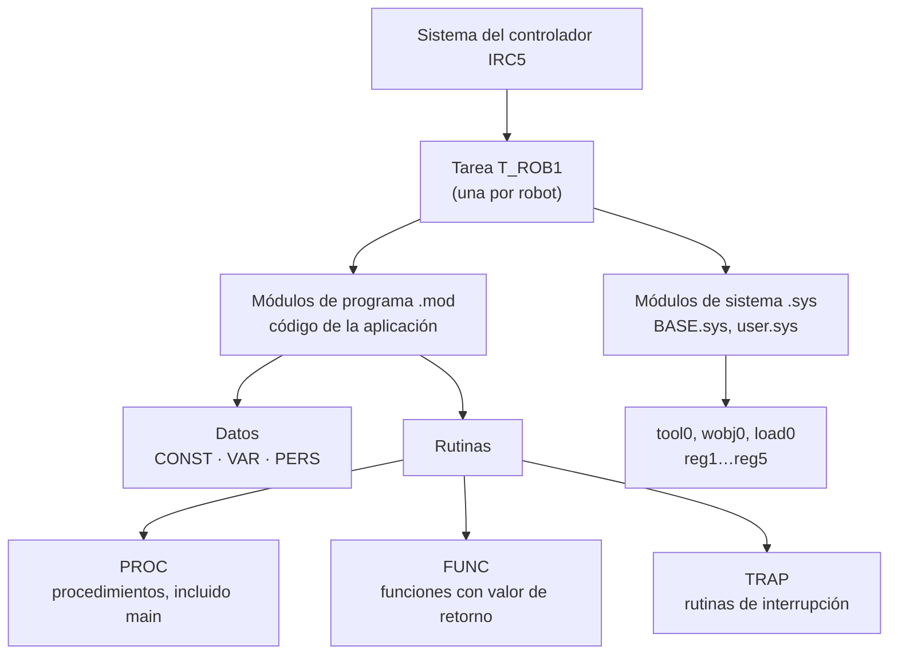

| Rutina | Palabra clave | Uso |
|---|---|---|
| Procedimiento | `PROC … ENDPROC` | Ejecuta acciones; no retorna valor. |
| Función | `FUNC <tipo> … ENDFUNC` | Retorna un valor con `RETURN`. |
| Rutina de interrupción | `TRAP … ENDTRAP` | Se ejecuta al dispararse una interrupción. |

El punto de entrada del programa es el procedimiento `main`.

```rapid
MODULE Modulo_Ejemplo
    ! Los comentarios empiezan con signo de exclamación

    ! ---- Datos ----
    CONST jointtarget jHome := [[0,0,0,0,30,0],[9E9,9E9,9E9,9E9,9E9,9E9]];
    VAR num contador := 0;

    ! ---- Rutina principal ----
    PROC main()
        Inicializar;
        MoveAbsJ jHome, v200, fine, tool0;
        TPWrite "Programa terminado. Ciclos: " \Num:=contador;
    ENDPROC

    ! ---- Procedimiento auxiliar ----
    PROC Inicializar()
        contador := 0;
        TPErase;
    ENDPROC

    ! ---- Función con parámetros ----
    FUNC num Cuadrado(num x)
        RETURN x * x;
    ENDFUNC
ENDMODULE
```

**Parámetros de rutinas:** se pasan por valor por defecto; `INOUT` permite modificar el argumento; `VAR` y `PERS` exigen ese tipo de almacenamiento (los datos que reciben las instrucciones de movimiento, como `tooldata` y `wobjdata`, se pasan como `PERS`). Los parámetros opcionales se escriben con `\` (`PROC Mover(robtarget p \num vel)`) y su presencia se consulta con `Present(vel)`.

---

## 3. Tipos de datos y declaración de variables

### 3.1 Tipos de almacenamiento

| Declaración | Comportamiento | Uso típico |
|---|---|---|
| `CONST` | Valor fijo; no se modifica en ejecución. | Puntos fijos, parámetros. |
| `VAR` | Vuelve a su valor inicial al cargar el programa o al mover el puntero a `main`. | Contadores, variables de trabajo. |
| `PERS` | Persistente: el valor actual se guarda en el código y sobrevive a reinicios del programa. Visible desde otras tareas y desde el exterior. | `tooldata`, `wobjdata`, intercambio con SCADA. |

### 3.2 Tipos básicos

| Tipo | Descripción | Ejemplo |
|---|---|---|
| `num` | Número real o entero | `VAR num i := 0;` |
| `dnum` | Número de doble precisión | `VAR dnum t := 0;` |
| `bool` | Lógico | `VAR bool listo := FALSE;` |
| `string` | Texto (máx. 80 caracteres) | `VAR string msg := "Hola";` |
| `byte` | Entero 0–255 | `VAR byte b := 10;` |

### 3.3 Tipos de movimiento y geometría

| Tipo | Contenido | Estructura |
|---|---|---|
| `pos` | Posición cartesiana [mm] | `[x, y, z]` |
| `orient` | Orientación en cuaternión | `[q1, q2, q3, q4]` |
| `pose` | Marco de referencia | `[pos, orient]` |
| `confdata` | Configuración del brazo (cuadrantes) | `[cf1, cf4, cf6, cfx]` |
| `extjoint` | Ejes externos (`9E9` = sin eje) | `[e1, …, e6]` |
| `robtarget` | Punto cartesiano del TCP | `[pos, orient, confdata, extjoint]` |
| `robjoint` | Ángulos de los 6 ejes [°] | `[rax_1, …, rax_6]` |
| `jointtarget` | Posición articular | `[robjoint, extjoint]` |
| `speeddata` | Velocidad | `[v_tcp, v_ori, v_leax, v_reax]` |
| `zonedata` | Zona de aproximación | `fine`, `z0`, `z1`, `z5`, `z10`, … |
| `tooldata` | Herramienta (TCP + carga) | `[robhold, tframe, tload]` |
| `wobjdata` | Objeto de trabajo | `[robhold, ufprog, ufmec, uframe, oframe]` |
| `loaddata` | Carga útil | `[masa, cog, aom, ix, iy, iz]` |

Acceso a componentes con punto: `p10.trans.x`, `p10.rot`, `j1.robax.rax_3`.

### 3.4 Datos predefinidos

- **Velocidades** (`speeddata`, mm/s del TCP): `v5`, `v10`, `v20`, `v50`, `v100`, `v150`, `v200`, `v300`, `v400`, `v500`, `v600`, `v800`, `v1000`, `v1500`, `v2000`, `v2500`, `v3000`, `v4000`, `v5000`, `v6000`, `v7000`, `vmax`.
- **Zonas** (`zonedata`, radio en mm): `fine`, `z0`, `z1`, `z5`, `z10`, `z15`, `z20`, `z30`, `z40`, `z50`, `z60`, `z80`, `z100`, `z150`, `z200`.
- **Herramienta y objeto por defecto:** `tool0` (TCP en el centro de la brida) y `wobj0` (coincide con el sistema base).

### 3.5 Declaración de un `robtarget`

```rapid
!                         pos [mm]        orient (cuaternión)   confdata     ejes externos
CONST robtarget pA := [[500, 0, 400], [0, 0, 1, 0], [0, 0, 0, 0], [9E9,9E9,9E9,9E9,9E9,9E9]];
```

El cuaternión `[0, 0, 1, 0]` es una rotación de 180° alrededor de Y: el eje Z de la herramienta apunta hacia abajo.

> [!TIP]
> Enseñe (*teach*) los puntos de referencia con el FlexPendant o créelos en RobotStudio en lugar de escribir el `confdata` a mano, y derive el resto con `Offs` o `RelTool`.

---

## 4. Sistemas de coordenadas, herramientas y objetos de trabajo

<p align="center">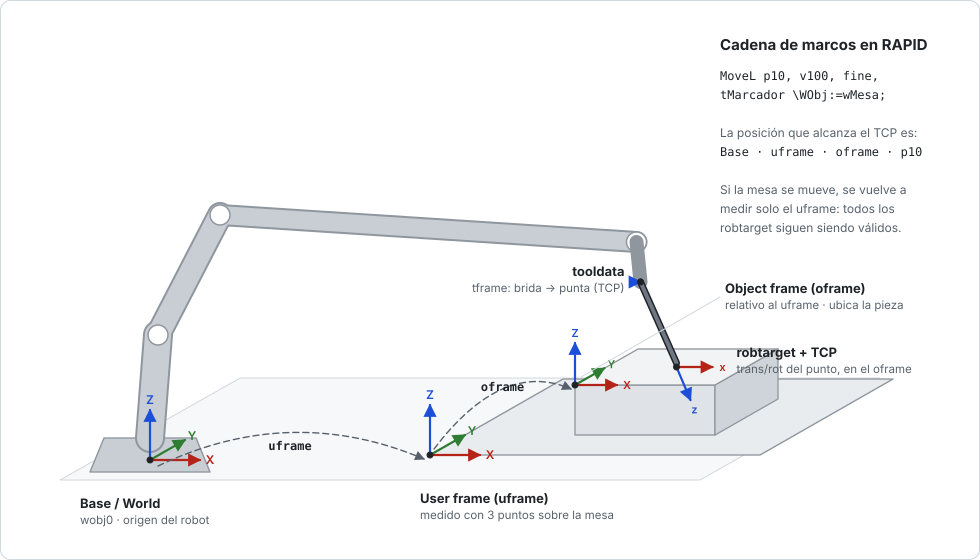</p>

| Sistema | Descripción |
|---|---|
| **World** | Referencia global de la celda. Con un solo robot suele coincidir con **Base**. |
| **Base** | Origen en la base del robot (`wobj0`). |
| **User frame** (`uframe`) | Marco de la mesa o del accesorio; se mide con 3 puntos. |
| **Object frame** (`oframe`) | Marco de la pieza, relativo al `uframe`. |
| **Tool** (`tooldata`) | Marco de la herramienta; su origen es el **TCP**. |

Programar los puntos dentro de un `wobjdata` permite **reubicar toda una trayectoria** cambiando solo el marco del objeto de trabajo (sección [17](#17-trabajo-con-varios-objetos-de-trabajo)).

### 4.1 Definición de una herramienta

```rapid
!                       robhold  [ TCP [mm]  , orientación ]   [ masa[kg], cog[mm], aom, Ix, Iy, Iz ]
PERS tooldata tMarcador := [TRUE, [[0, 0, 150], [1, 0, 0, 0]], [0.3, [0, 0, 60], [1, 0, 0, 0], 0, 0, 0]];
```

- `robhold = TRUE`: la herramienta la sostiene el robot.
- La **masa debe ser mayor que 0**.
- El TCP se mide con el método de 4 puntos en el FlexPendant (*Movimiento → Herramienta → Definir*).

<table>
<tr>
<td width="45%">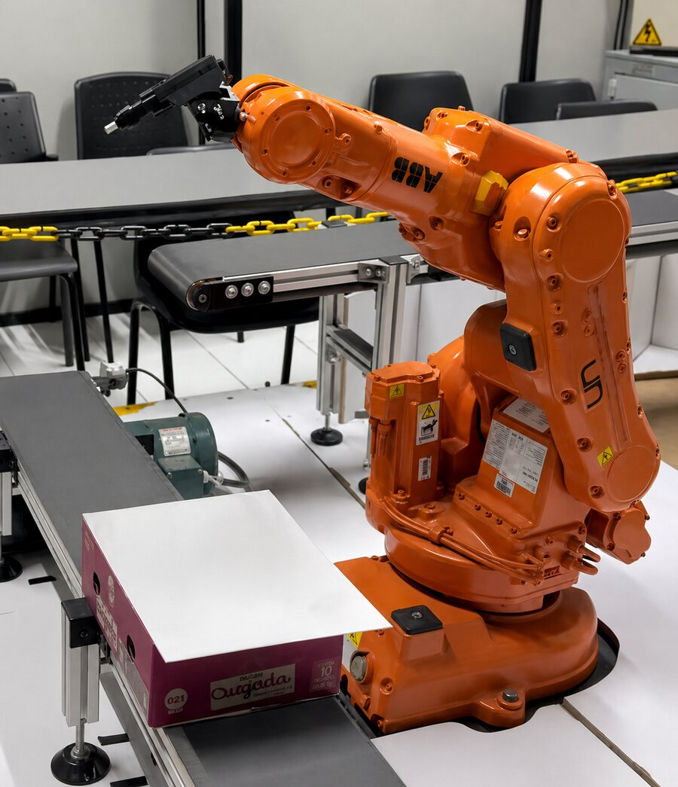</td>
<td>

**Ejemplo del laboratorio.** Portamarcador impreso en PETG y atornillado a la brida. El eje del marcador está rotado respecto al eje de la brida para evitar trabajar con la muñeca en singularidad, y un sistema de dos resortes absorbe hasta 20 mm de error en Z.

Ese diseño produce un `tframe` con traslación **y** rotación, por ejemplo:

```rapid
PERS tooldata tMarcador :=
  [TRUE, [[25.0, 7.6, 145.1],
          [0.9239, 0, 0.3827, 0]],
   [1, [0,0,1], [1,0,0,0], 0, 0, 0]];
```

<sub>Valores tomados del código del Equipo 1E, Robótica 2026-I (LabSIR, MIT). Mida su propia herramienta.</sub>

</td>
</tr>
</table>

### 4.2 Definición de un objeto de trabajo

```rapid
!                        robhold ufprog ufmec  uframe (marco de usuario)          oframe (marco del objeto)
PERS wobjdata wMesa := [FALSE, TRUE, "", [[400, -200, 100], [1, 0, 0, 0]], [[0, 0, 0], [1, 0, 0, 0]]];
```

El `uframe` se mide con el método de 3 puntos (origen, punto sobre X, punto sobre Y), en el FlexPendant o en RobotStudio.

---

## 5. Instrucciones de movimiento

<p align="center">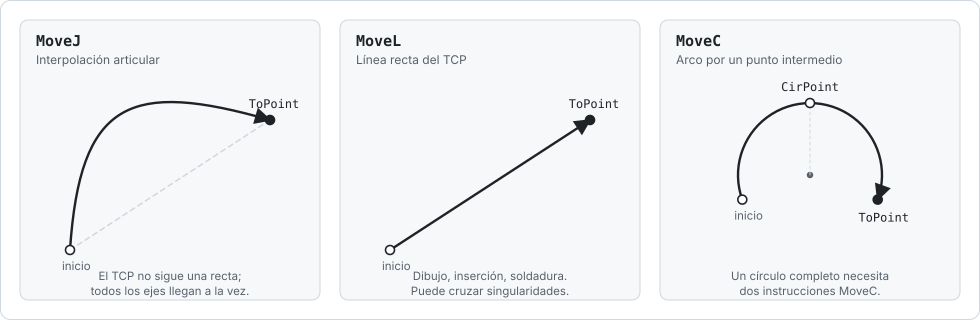</p>

### 5.1 Resumen

| Instrucción | Interpolación | Destino | Uso |
|---|---|---|---|
| `MoveAbsJ` | Articular | `jointtarget` | Ángulos absolutos (home, posiciones seguras). |
| `MoveJ` | Articular | `robtarget` | Desplazamientos rápidos donde la trayectoria del TCP no importa. |
| `MoveL` | Lineal | `robtarget` | TCP en línea recta (dibujo, inserción, soldadura). |
| `MoveC` | Circular | 2 × `robtarget` | Arco por un punto intermedio hasta un punto final. |
| `MoveJDO` / `MoveLDO` / `MoveCDO` | J / L / C | `robtarget` | Movimiento + activación de una salida digital en el punto. |
| `MoveJSync` / `MoveLSync` / `MoveCSync` | J / L / C | `robtarget` | Movimiento + llamada a un procedimiento en el punto. |
| `SearchL` / `SearchC` | L / C | `robtarget` | Se detiene o registra la posición al cambiar una señal. |
| `TriggL` / `TriggJ` / `TriggC` | L / J / C | `robtarget` | Eventos de E/S a una distancia o tiempo dentro de la trayectoria. |

### 5.2 Sintaxis general

```rapid
MoveL ToPoint [\ID] , Speed [\V] | [\T] , Zone [\Z] [\Inpos] , Tool [\WObj] [\Corr];
```

| Argumento | Descripción |
|---|---|
| `ToPoint` | Punto de destino (`robtarget`). |
| `Speed` | `speeddata` (`v100`) o personalizado. |
| `\V:=` | Sobrescribe la velocidad del TCP (mm/s). |
| `\T:=` | Fija el tiempo total del movimiento (s). |
| `Zone` | `fine` = parada exacta; `zN` = paso suave con radio N mm. |
| `Tool` | `tooldata` activa. |
| `\WObj:=` | Objeto de trabajo (por defecto `wobj0`). |
| `\Conc` | Ejecuta las instrucciones siguientes mientras el robot se mueve. |

### 5.3 Zonas de aproximación

<p align="center">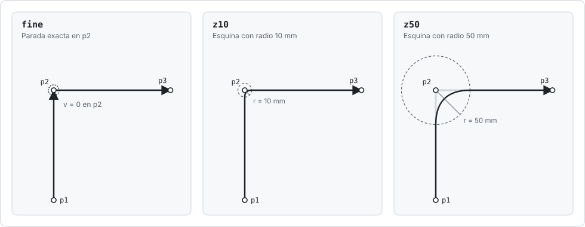</p>

Con `fine` el robot se detiene exactamente en el punto. Con `zN` pasa cerca del punto sin detenerse, redondeando la esquina dentro de un radio de N mm. Use `fine` donde lea una señal, actúe una herramienta o tome una medida.

### 5.4 Ejemplos

```rapid
MoveAbsJ jHome, v200, fine, tool0;                              ! Ángulos absolutos
MoveJ pA, v500, z50, tMarcador \WObj:=wMesa;                    ! Articular hacia pA
MoveL Offs(pA, 0, 0, -50), v50, fine, tMarcador \WObj:=wMesa;   ! Baja 50 mm en línea recta
MoveL pB, v100 \V:=75, z1, tMarcador \WObj:=wMesa;              ! Velocidad TCP = 75 mm/s
MoveL pC, v100 \T:=3, fine, tMarcador \WObj:=wMesa;             ! Llega en 3 s
MoveC pMedio, pFin, v100, z10, tMarcador \WObj:=wMesa;          ! Arco por pMedio hasta pFin
MoveLDO pD, v100, fine, tMarcador, DO_01, 1;                    ! Activa DO_01 al llegar a pD
```

### 5.5 Ajustes globales del movimiento

| Instrucción | Efecto |
|---|---|
| `VelSet 50, 500;` | Escala las velocidades programadas al 50 % y limita el TCP a 500 mm/s. |
| `AccSet 50, 100;` | Reduce la aceleración al 50 % (rampa al 100 %). |
| `ConfJ \Off;` / `ConfL \Off;` | Desactiva el control de configuración del brazo (usar con cuidado). |
| `SingArea \Wrist;` | Permite variar la orientación para atravesar singularidades de muñeca. |
| `SingArea \Off;` | Comportamiento por defecto. |
| `WaitRob \InPos;` | Espera a que el robot se detenga en posición. |
| `StopMove;` / `StartMove;` | Detiene / reanuda el movimiento (útil en rutinas TRAP). |

---

## 6. Movimiento articular: control de los ángulos de cada eje

### 6.1 Definir y alcanzar ángulos

```rapid
VAR jointtarget jObjetivo := [[0, 0, 0, 0, 30, 0], [9E9,9E9,9E9,9E9,9E9,9E9]];

PROC IrAAngulos()
    jObjetivo.robax.rax_1 := 45;      ! Eje 1 a 45°
    jObjetivo.robax.rax_2 := 10;      ! Eje 2 a 10°
    jObjetivo.robax.rax_3 := -20;     ! Eje 3 a -20°
    MoveAbsJ jObjetivo, v200, fine, tool0;
ENDPROC
```

### 6.2 Leer la posición articular actual

```rapid
VAR jointtarget jActual;

jActual := CJointT();
TPWrite "Eje 1 [deg]: " \Num:=jActual.robax.rax_1;
TPWrite "Eje 5 [deg]: " \Num:=jActual.robax.rax_5;
```

### 6.3 Barrido de una articulación con contador

Mueve cada eje de forma independiente alrededor del *home*, dentro de un margen seguro.

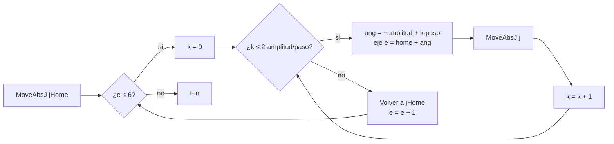

```rapid
PROC BarridoEje(num eje, num amplitud, num paso)
    VAR jointtarget j;
    VAR num ang;

    j := jHome;
    FOR k FROM 0 TO Trunc(2 * amplitud / paso) DO
        ang := -amplitud + k * paso;
        TEST eje
        CASE 1: j.robax.rax_1 := jHome.robax.rax_1 + ang;
        CASE 2: j.robax.rax_2 := jHome.robax.rax_2 + ang;
        CASE 3: j.robax.rax_3 := jHome.robax.rax_3 + ang;
        CASE 4: j.robax.rax_4 := jHome.robax.rax_4 + ang;
        CASE 5: j.robax.rax_5 := jHome.robax.rax_5 + ang;
        CASE 6: j.robax.rax_6 := jHome.robax.rax_6 + ang;
        ENDTEST
        MoveAbsJ j, v100, z5, tool0;
    ENDFOR
    MoveAbsJ jHome, v100, fine, tool0;
ENDPROC

PROC main()
    MoveAbsJ jHome, v200, fine, tool0;
    FOR e FROM 1 TO 6 DO
        BarridoEje e, 20, 5;       ! ±20° en pasos de 5°
    ENDFOR
ENDPROC
```

### 6.4 Validar ángulos antes de mover

```rapid
FUNC bool DentroDeLimites(jointtarget j)
    ! Límites de referencia (ajustar a los configurados en el controlador)
    IF Abs(j.robax.rax_1) > 180 RETURN FALSE;
    IF j.robax.rax_2 < -90 OR j.robax.rax_2 > 110 RETURN FALSE;
    IF j.robax.rax_3 < -230 OR j.robax.rax_3 > 50 RETURN FALSE;
    IF Abs(j.robax.rax_4) > 200 RETURN FALSE;
    IF Abs(j.robax.rax_5) > 120 RETURN FALSE;
    IF Abs(j.robax.rax_6) > 400 RETURN FALSE;
    RETURN TRUE;
ENDFUNC
```

### 6.5 Conversión entre espacio articular y cartesiano

| Función | Descripción |
|---|---|
| `CalcJointT(robtarget, tool \WObj)` | Cinemática inversa: ángulos para alcanzar un `robtarget`. |
| `CalcRobT(jointtarget, tool \WObj)` | Cinemática directa: `robtarget` a partir de ángulos. |

```rapid
VAR jointtarget jCalc;
VAR robtarget pCalc;

jCalc := CalcJointT(pA, tMarcador \WObj:=wMesa);
pCalc := CalcRobT(jCalc, tMarcador \WObj:=wMesa);
```

---

## 7. Funciones de posición y transformación

<p align="center">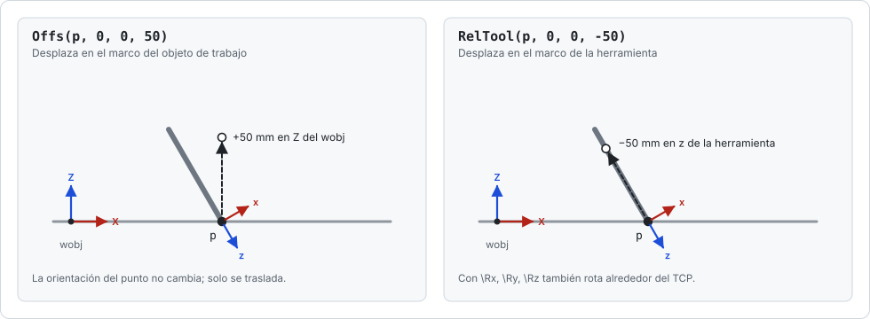</p>

| Función / instrucción | Descripción | Ejemplo |
|---|---|---|
| `Offs(p, dx, dy, dz)` | Desplaza un punto en el marco del objeto de trabajo. | `Offs(pA, 100, 0, 0)` |
| `RelTool(p, dx, dy, dz \Rx \Ry \Rz)` | Desplaza o rota en el marco de la herramienta. | `RelTool(pA, 0, 0, 20 \Rz:=45)` |
| `CRobT(\Tool \WObj)` | Posición cartesiana actual (`robtarget`). | `pAct := CRobT(\Tool:=tMarcador \WObj:=wMesa);` |
| `CPos(\Tool \WObj)` | Posición actual (`pos`) sin orientación. | `posAct := CPos();` |
| `CJointT()` | Ángulos articulares actuales. | `jAct := CJointT();` |
| `OrientZYX(z, y, x)` | Cuaternión a partir de ángulos de Euler ZYX [°]. | `pA.rot := OrientZYX(0, 180, 0);` |
| `EulerZYX(\X \| \Y \| \Z, orient)` | Extrae un ángulo de Euler de un cuaternión. | `rz := EulerZYX(\Z, pA.rot);` |
| `NOrient(orient)` | Normaliza un cuaternión. | `q := NOrient(q);` |
| `PoseMult(p1, p2)` | Composición de marcos. | `T := PoseMult(T1, T2);` |
| `PoseInv(p)` | Inversa de un marco. | `Ti := PoseInv(T);` |
| `PoseVect(p, pos)` | Transforma un vector por un marco. | `v2 := PoseVect(T, v1);` |
| `Distance(p1, p2)` | Distancia entre dos `pos` [mm]. | `d := Distance(pA.trans, pB.trans);` |
| `PDispSet` / `PDispOn` / `PDispOff` | Desplazamiento de programa: traslada o rota los puntos siguientes. | Ver 8.6 |

---

## 8. Construcción de trayectorias

<p align="center">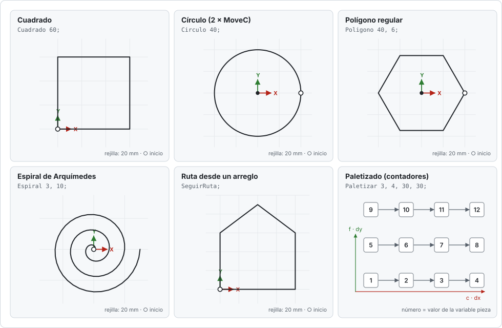</p>

<sub>Las figuras se calcularon con los mismos parámetros de las rutinas de esta sección (vista superior del plano XY del objeto de trabajo, origen en <code>pCentro</code>).</sub>

> [!NOTE]
> `pCentro` es un punto enseñado sobre la superficie de trabajo con el eje Z de la herramienta hacia abajo. Las dimensiones son ilustrativas: compruebe el alcance en RobotStudio.

```rapid
PERS robtarget pCentro := [[0, 0, 0], [0, 0, 1, 0], [0, 0, 0, 0], [9E9,9E9,9E9,9E9,9E9,9E9]];
CONST num zSeg := 50;   ! Altura de aproximación [mm]
```

### 8.1 Cuadrado con `Offs`

```rapid
PROC Cuadrado(num lado)
    MoveJ Offs(pCentro, 0, 0, zSeg), v300, z10, tMarcador \WObj:=wMesa;
    MoveL pCentro, v50, fine, tMarcador \WObj:=wMesa;
    MoveL Offs(pCentro, lado, 0, 0),    v100, z1, tMarcador \WObj:=wMesa;
    MoveL Offs(pCentro, lado, lado, 0), v100, z1, tMarcador \WObj:=wMesa;
    MoveL Offs(pCentro, 0, lado, 0),    v100, z1, tMarcador \WObj:=wMesa;
    MoveL pCentro,                      v100, fine, tMarcador \WObj:=wMesa;
    MoveL Offs(pCentro, 0, 0, zSeg),    v100, z10, tMarcador \WObj:=wMesa;
ENDPROC
```

### 8.2 Círculo completo con `MoveC`

`MoveC` traza como máximo un arco; un círculo completo requiere dos instrucciones o más.

```rapid
PROC Circulo(num r)
    MoveJ Offs(pCentro, r, 0, zSeg), v300, z10, tMarcador \WObj:=wMesa;
    MoveL Offs(pCentro, r, 0, 0), v50, fine, tMarcador \WObj:=wMesa;
    MoveC Offs(pCentro, 0, r, 0),  Offs(pCentro, -r, 0, 0), v100, z1, tMarcador \WObj:=wMesa;
    MoveC Offs(pCentro, 0, -r, 0), Offs(pCentro,  r, 0, 0), v100, fine, tMarcador \WObj:=wMesa;
    MoveL Offs(pCentro, r, 0, zSeg), v100, z10, tMarcador \WObj:=wMesa;
ENDPROC
```

### 8.3 Trayectorias paramétricas con contadores

Las funciones trigonométricas de RAPID trabajan en **grados**.

```rapid
! Polígono regular de n lados (n grande ≈ círculo)
PROC Poligono(num r, num n)
    VAR num ang;
    MoveJ Offs(pCentro, r, 0, zSeg), v300, z10, tMarcador \WObj:=wMesa;
    FOR i FROM 0 TO n DO
        ang := i * 360 / n;
        MoveL Offs(pCentro, r * Cos(ang), r * Sin(ang), 0), v100, z1, tMarcador \WObj:=wMesa;
    ENDFOR
    MoveL Offs(pCentro, r, 0, zSeg), v100, z10, tMarcador \WObj:=wMesa;
ENDPROC

! Espiral de Arquímedes
PROC Espiral(num vueltas, num paso)
    VAR num ang;
    VAR num r;
    MoveJ Offs(pCentro, 0, 0, zSeg), v300, z10, tMarcador \WObj:=wMesa;
    MoveL pCentro, v50, fine, tMarcador \WObj:=wMesa;
    FOR i FROM 0 TO vueltas * 36 DO
        ang := i * 10;                     ! 10° por iteración
        r := paso * ang / 360;             ! El radio crece 'paso' mm por vuelta
        MoveL Offs(pCentro, r * Cos(ang), r * Sin(ang), 0), v80, z1, tMarcador \WObj:=wMesa;
    ENDFOR
    MoveL Offs(CRobT(\Tool:=tMarcador \WObj:=wMesa), 0, 0, zSeg), v100, fine, tMarcador \WObj:=wMesa;
ENDPROC

! Hélice (variación en Z)
PROC Helice(num r, num vueltas, num avanceZ)
    VAR num ang;
    FOR i FROM 0 TO vueltas * 36 DO
        ang := i * 10;
        MoveL Offs(pCentro, r * Cos(ang), r * Sin(ang), zSeg + avanceZ * ang / 360), v100, z1, tMarcador \WObj:=wMesa;
    ENDFOR
ENDPROC
```

> [!TIP]
> Los puntos calculados con `Offs` dentro de un bucle no existen como *targets* en la estación de RobotStudio, así que no se dibujan al sincronizar. Para verlos use **Rastreo del TCP** (*TCP Trace*) durante la simulación (sección [15.4](#154-simular-y-depurar)).

### 8.4 Trayectoria definida por un arreglo de puntos

```rapid
CONST num nPts := 5;
CONST pos ruta{nPts} := [[0,0,0], [80,0,0], [80,60,0], [40,90,0], [0,60,0]];

PROC SeguirRuta()
    MoveJ Offs(pCentro, ruta{1}.x, ruta{1}.y, zSeg), v300, z10, tMarcador \WObj:=wMesa;
    FOR i FROM 1 TO Dim(ruta, 1) DO
        MoveL Offs(pCentro, ruta{i}.x, ruta{i}.y, ruta{i}.z), v100, z1, tMarcador \WObj:=wMesa;
    ENDFOR
    MoveL Offs(pCentro, ruta{1}.x, ruta{1}.y, 0), v100, fine, tMarcador \WObj:=wMesa;   ! Cierra la figura
    MoveL Offs(pCentro, ruta{1}.x, ruta{1}.y, zSeg), v100, z10, tMarcador \WObj:=wMesa;
ENDPROC
```

### 8.5 Paletizado con contadores de filas y columnas

```rapid
PROC Paletizar(num filas, num cols, num dx, num dy)
    VAR num pieza := 0;
    FOR f FROM 0 TO filas - 1 DO
        FOR c FROM 0 TO cols - 1 DO
            Incr pieza;
            MoveJ Offs(pCentro, c * dx, f * dy, zSeg), v500, z20, tMarcador \WObj:=wMesa;
            MoveL Offs(pCentro, c * dx, f * dy, 0), v100, fine, tMarcador \WObj:=wMesa;
            ! Aquí: SetDO / Reset de la pinza
            WaitTime 0.3;
            MoveL Offs(pCentro, c * dx, f * dy, zSeg), v200, z20, tMarcador \WObj:=wMesa;
            TPWrite "Pieza: " \Num:=pieza;
        ENDFOR
    ENDFOR
ENDPROC
```

### 8.6 Reutilizar una figura en otra posición (`PDispSet`)

```rapid
PROC FiguraDesplazada()
    VAR pose desp := [[150, 0, 0], [1, 0, 0, 0]];   ! Trasladar 150 mm en X
    PDispSet desp;
    Cuadrado 50;
    PDispOff;
ENDPROC
```

La alternativa recomendada es usar otro objeto de trabajo (sección [17](#17-trabajo-con-varios-objetos-de-trabajo)).

### 8.7 Variación de orientación sobre un punto (`RelTool`)

```rapid
PROC Inclinaciones()
    FOR k FROM -2 TO 2 DO
        MoveL RelTool(pCentro, 0, 0, -zSeg \Rx:=k * 10), v50, fine, tMarcador \WObj:=wMesa;
    ENDFOR
    FOR k FROM 0 TO 8 DO
        MoveL RelTool(pCentro, 0, 0, -zSeg \Rz:=k * 45), v50, z1, tMarcador \WObj:=wMesa;
    ENDFOR
ENDPROC
```

---

## 9. Control de flujo

| Estructura | Sintaxis |
|---|---|
| Condicional | `IF cond THEN … ELSEIF cond THEN … ELSE … ENDIF` |
| Condicional compacto | `IF cond instrucción;` |
| Bucle con contador | `FOR i FROM 1 TO 10 [STEP 2] DO … ENDFOR` |
| Bucle condicional | `WHILE cond DO … ENDWHILE` |
| Selección | `TEST var CASE 1: … CASE 2, 3: … DEFAULT: … ENDTEST` |
| Salto | `GOTO etiqueta;` … `etiqueta:` |
| Retorno | `RETURN;` / `RETURN valor;` |
| Esperas | `WaitTime 1.5;` · `WaitUntil cond \MaxTime:=5;` |
| Detener | `Stop;` (pausa reanudable) · `EXIT;` (termina el programa) · `Break;` |

> [!NOTE]
> La variable de un `FOR` se declara implícitamente y solo existe dentro del bucle.

**Menú de trayectorias seleccionable desde el FlexPendant:**

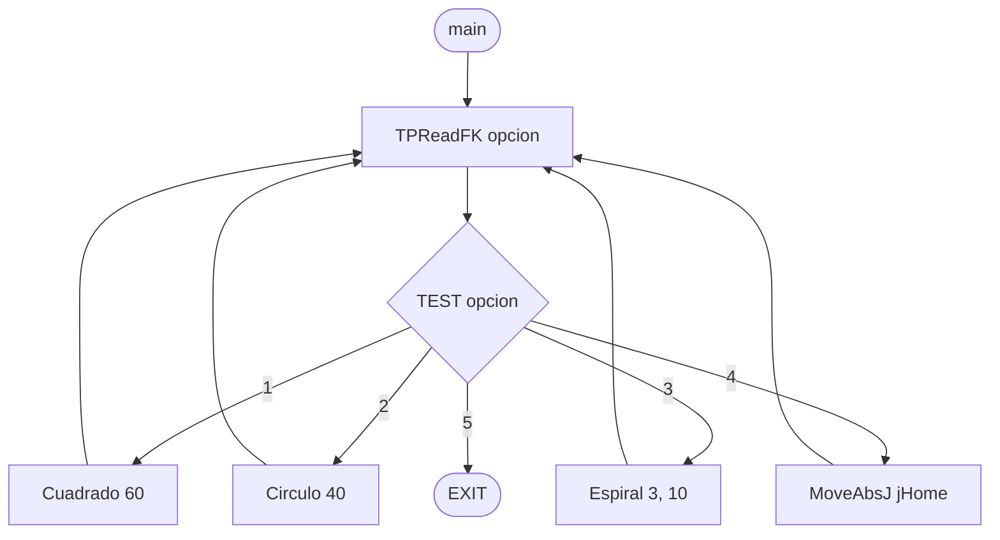

```rapid
PROC main()
    VAR num opcion;
    WHILE TRUE DO
        TPReadFK opcion, "Seleccione trayectoria", "Cuadrado", "Circulo", "Espiral", "Home", "Salir";
        TEST opcion
        CASE 1: Cuadrado 60;
        CASE 2: Circulo 40;
        CASE 3: Espiral 3, 10;
        CASE 4: MoveAbsJ jHome, v200, fine, tool0;
        CASE 5: EXIT;
        ENDTEST
    ENDWHILE
ENDPROC
```

---

## 10. Variables, contadores, arreglos y matemáticas

### 10.1 Contadores

| Instrucción | Efecto |
|---|---|
| `Incr reg1;` | `reg1 := reg1 + 1` |
| `Decr reg1;` | `reg1 := reg1 - 1` |
| `Add reg1, 5;` | `reg1 := reg1 + 5` |
| `Clear reg1;` | `reg1 := 0` |

`reg1` … `reg5` son variables `num` predefinidas en el módulo de sistema `user.sys`.

### 10.2 Arreglos

```rapid
VAR num angulos{6};                     ! Arreglo de 6 elementos (índice desde 1)
VAR num matriz{3, 4};                   ! Matriz 3x4
VAR robtarget puntos{10};

angulos{1} := 45;
n := Dim(angulos, 1);                   ! Tamaño en la dimensión 1
```

### 10.3 Funciones matemáticas

| Función | Descripción |
|---|---|
| `Abs(x)`, `Sqrt(x)`, `Pow(b, e)`, `Exp(x)`, `Ln(x)` | Básicas |
| `Sin`, `Cos`, `Tan` | Trigonométricas (**grados**) |
| `ASin`, `ACos`, `ATan`, `ATan2(y, x)` | Inversas (resultado en grados) |
| `Round(x \Dec:=n)`, `Trunc(x \Dec:=n)` | Redondeo y truncamiento |
| `Max(a, b)`, `Min(a, b)` | Máximo y mínimo |
| `DOT(v1, v2)`, `CrossProd(v1, v2)`, `VectMagn(v)` | Operaciones vectoriales sobre `pos` |
| `a DIV b`, `a MOD b` | División entera y residuo |

### 10.4 Cadenas de texto

| Función | Descripción |
|---|---|
| `NumToStr(x, dec)` | Número → texto con `dec` decimales |
| `StrToVal(str, var)` | Texto → valor (retorna `bool`) |
| `ValToStr(dato)` | Cualquier dato → texto |
| `StrLen(str)`, `StrPart(str, ini, len)`, `StrFind(…)` | Manipulación |
| `+` | Concatenación: `"Eje: " + NumToStr(a, 2)` |

---

## 11. Entradas y salidas (E/S)

Las señales se definen en la configuración de E/S del controlador (`EIO.cfg`). Tipos: `signaldi`, `signaldo`, `signalai`, `signalao`, `signalgi`, `signalgo`.

| Instrucción / función | Descripción |
|---|---|
| `SetDO DO_01, 1;` | Escribe una salida digital. |
| `Set DO_01;` / `Reset DO_01;` | Pone a 1 / a 0. |
| `PulseDO \PLength:=0.5, DO_01;` | Pulso de 0,5 s. |
| `SetAO AO_01, 2.5;` | Salida analógica. |
| `SetGO GO_01, 7;` | Salida de grupo (entero sobre varios bits). |
| `DInput(DI_01)` / `DOutput(DO_01)` | Lee una señal; también se puede usar directamente: `IF DI_01 = 1 THEN`. |
| `AInput(AI_01)`, `GInput(GI_01)` | Lectura analógica / de grupo. |
| `WaitDI DI_01, 1 \MaxTime:=10;` | Espera a que una entrada tome un valor. |
| `WaitDO DO_01, 1;` | Espera sobre una salida. |

### 11.1 Intercambio de señales con un PLC

El patrón típico es un *handshake*: el PLC elige la trayectoria y da la orden de arranque, y el robot informa si está ocupado y cuándo terminó.

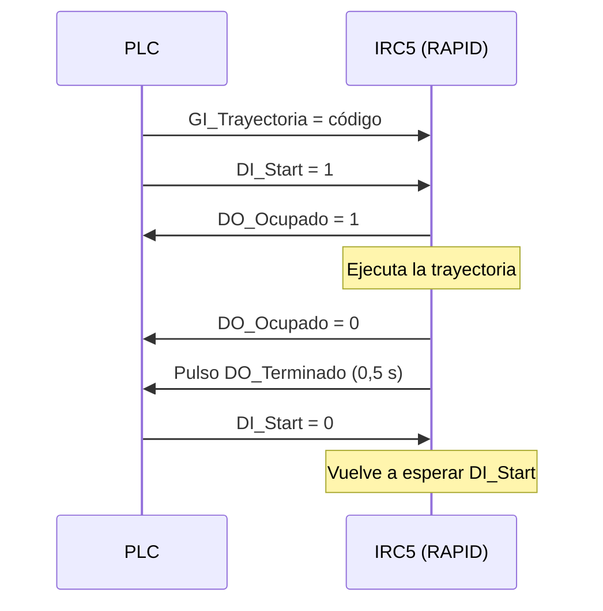

```rapid
PROC main()
    WHILE TRUE DO
        WaitDI DI_Start, 1;
        SetDO DO_Ocupado, 1;
        TEST GInput(GI_Trayectoria)
        CASE 1: Cuadrado 60;
        CASE 2: Circulo 40;
        DEFAULT: TPWrite "Codigo no valido";
        ENDTEST
        SetDO DO_Ocupado, 0;
        PulseDO \PLength:=0.5, DO_Terminado;
        WaitDI DI_Start, 0;
    ENDWHILE
ENDPROC
```

> [!WARNING]
> `DI_Start`, `GI_Trayectoria`, `DO_Ocupado` y `DO_Terminado` son nombres de ejemplo. Defínalos en el controlador (o use `DI_0x` / `DO_0x` del laboratorio) antes de cargar el módulo; una señal no declarada impide cargar el programa.

---

## 12. Interacción con el FlexPendant

| Instrucción | Descripción |
|---|---|
| `TPErase;` | Limpia la pantalla. |
| `TPWrite "Texto" [\Num:=] [\Bool:=] [\Pos:=] [\Orient:=];` | Escribe un mensaje con un dato. |
| `TPReadNum var, "Pregunta";` | Solicita un número al operador. |
| `TPReadFK var, "Texto", "F1", "F2", "F3", "F4", "F5";` | Menú de 5 teclas de función (`stEmpty` para vacías). Retorna 1–5. |
| `UIMsgBox`, `UINumEntry`, `UIListView` | Cuadros de diálogo más elaborados. |
| `ErrWrite "Titulo", "Detalle";` | Registra un mensaje en el registro de eventos. |

```rapid
PROC ParametrosOperador()
    VAR num lado;
    TPReadNum lado, "Lado del cuadrado [mm] (10-100):";
    IF lado < 10 OR lado > 100 THEN
        TPWrite "Valor fuera de rango";
        RETURN;
    ENDIF
    Cuadrado lado;
ENDPROC
```

---

## 13. Interrupciones y manejo de errores

### 13.1 Interrupciones (`TRAP`)

| Instrucción | Descripción |
|---|---|
| `CONNECT intnum WITH rutinaTrap;` | Asocia una interrupción a una rutina. |
| `ISignalDI DI_01, 1, intnum;` | Interrupción por flanco de una entrada digital. |
| `ITimer 1, intnum;` | Interrupción periódica cada 1 s (`\Single` = una sola vez). |
| `ISleep` / `IWatch` | Desactiva / reactiva temporalmente. |
| `IDelete intnum;` | Elimina la interrupción. |

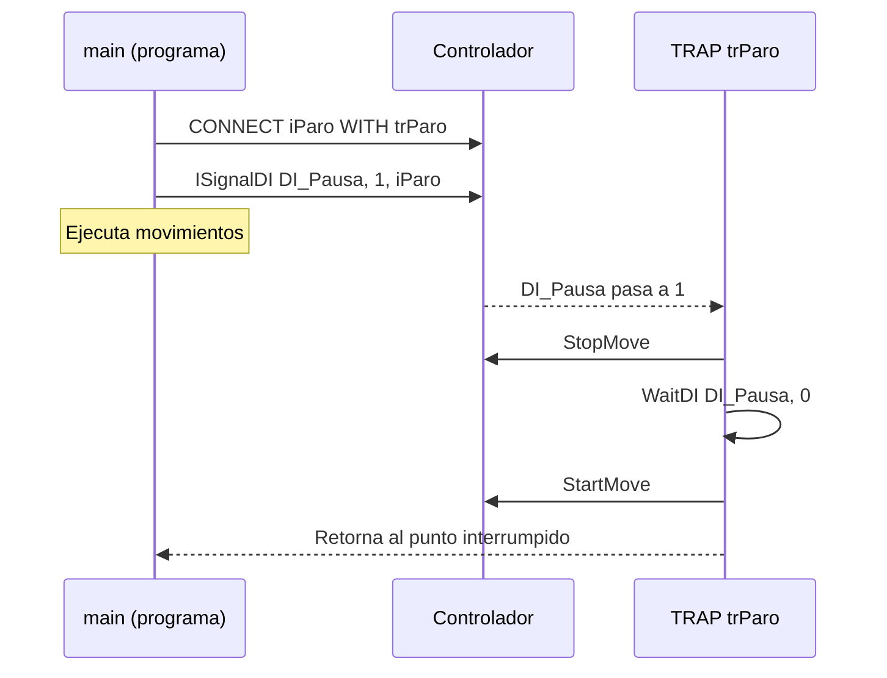

```rapid
VAR intnum iParo;

PROC main()
    IDelete iParo;
    CONNECT iParo WITH trParo;
    ISignalDI DI_Pausa, 1, iParo;
    ! ... programa ...
ENDPROC

TRAP trParo
    StopMove;
    TPWrite "Pausa solicitada";
    WaitDI DI_Pausa, 0;
    StartMove;
ENDTRAP
```

### 13.2 Manejo de errores

Cada rutina puede tener un bloque `ERROR` que se ejecuta cuando ocurre un error recuperable; el código está en `ERRNO`.

```rapid
PROC LeerValor()
    VAR num x;
    x := 10 / reg1;
ERROR
    IF ERRNO = ERR_DIVZERO THEN
        reg1 := 1;
        RETRY;          ! Reintenta la instrucción que falló
    ENDIF
ENDPROC
```

| Instrucción | Acción |
|---|---|
| `RETRY` | Reintenta la instrucción que causó el error. |
| `TRYNEXT` | Continúa con la siguiente instrucción. |
| `RETURN` | Sale de la rutina. |
| `RAISE` | Propaga el error a la rutina llamadora. |

---

## 14. Monitoreo y seguimiento del robot

### 14.1 Mostrar ángulos y posición durante un recorrido

```rapid
PROC Reportar()
    VAR jointtarget j;
    VAR robtarget p;
    j := CJointT();
    p := CRobT(\Tool:=tMarcador \WObj:=wMesa);
    TPWrite "J1..J3: " + NumToStr(j.robax.rax_1, 1) + " / " + NumToStr(j.robax.rax_2, 1) + " / " + NumToStr(j.robax.rax_3, 1);
    TPWrite "J4..J6: " + NumToStr(j.robax.rax_4, 1) + " / " + NumToStr(j.robax.rax_5, 1) + " / " + NumToStr(j.robax.rax_6, 1);
    TPWrite "TCP [mm]: " \Pos:=p.trans;
ENDPROC
```

> [!CAUTION]
> Con zonas `zN` el controlador ejecuta instrucciones por adelantado. Use `fine` (o `WaitRob \InPos`) antes de leer `CJointT` / `CRobT` si necesita el valor en el punto exacto.

### 14.2 Registro en archivo (*data logging*)

```rapid
VAR iodev log;
VAR clock reloj;

PROC IniciarLog()
    Open "HOME:" \File:="log_ejes.csv", log \Write;
    Write log, "t;J1;J2;J3;J4;J5;J6";
    ClkReset reloj;
    ClkStart reloj;
ENDPROC

PROC RegistrarMuestra()
    VAR jointtarget j;
    j := CJointT();
    Write log, NumToStr(ClkRead(reloj), 3) + ";" + NumToStr(j.robax.rax_1, 2) + ";" + NumToStr(j.robax.rax_2, 2) + ";"
             + NumToStr(j.robax.rax_3, 2) + ";" + NumToStr(j.robax.rax_4, 2) + ";" + NumToStr(j.robax.rax_5, 2) + ";"
             + NumToStr(j.robax.rax_6, 2);
ENDPROC

PROC CerrarLog()
    ClkStop reloj;
    Close log;
ENDPROC
```

El archivo queda en la carpeta `HOME` del controlador y se descarga con RobotStudio (*Controlador → Transferencia de archivos*, *File Transfer*) o por FTP.

### 14.3 Muestreo periódico con interrupción de tiempo

```rapid
VAR intnum iMuestreo;

PROC main()
    IniciarLog;
    CONNECT iMuestreo WITH trMuestreo;
    ITimer 0.2, iMuestreo;          ! Muestra cada 200 ms
    Espiral 3, 10;
    IDelete iMuestreo;
    CerrarLog;
ENDPROC

TRAP trMuestreo
    RegistrarMuestra;
ENDTRAP
```

### 14.4 Variables persistentes como interfaz de estado

Publicar el estado del programa en variables `PERS` permite leerlo desde fuera del controlador (sección [19](#19-comunicación-con-sistemas-scada)):

```rapid
PERS num  nCiclos := 0;
PERS num  nPaso := 0;
PERS bool bEnMovimiento := FALSE;
PERS jointtarget jUltima := [[0,0,0,0,30,0],[9E9,9E9,9E9,9E9,9E9,9E9]];
```

### 14.5 Tiempos de ciclo

```rapid
VAR clock cCiclo;
VAR num tCiclo;

ClkReset cCiclo;
ClkStart cCiclo;
Cuadrado 60;
ClkStop cCiclo;
tCiclo := ClkRead(cCiclo);
TPWrite "Tiempo de ciclo [s]: " \Num:=tCiclo;
```

---

## 15. RobotStudio: flujo de trabajo

RobotStudio combina una **estación** (geometría 3D: robot, herramienta, mesas, piezas, *targets* y trayectorias) con un **controlador virtual** que ejecuta RAPID igual que el IRC5 real. La mayoría de los errores del laboratorio aparecen porque estas dos partes no están sincronizadas.

<table>
<tr>
<td width="50%">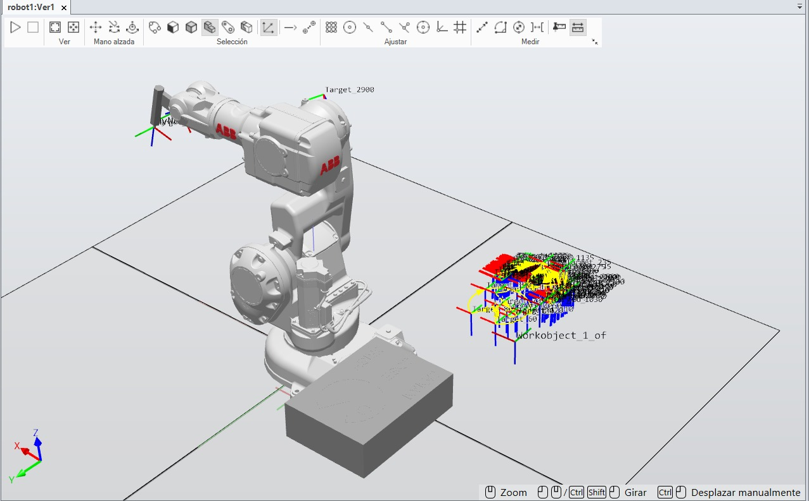</td>
<td width="50%">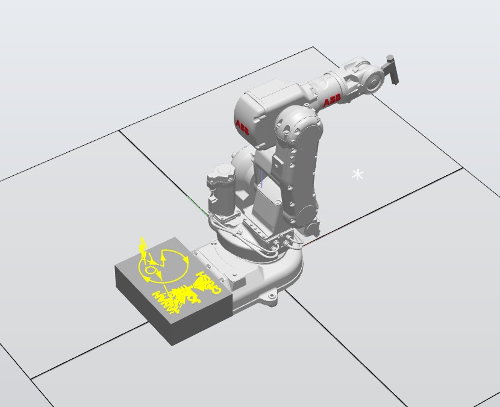</td>
</tr>
<tr>
<td align="center"><sub>Objeto de trabajo <code>Workobject_1</code> con sus <i>targets</i></sub></td>
<td align="center"><sub>Trayectorias de dibujo sobre la pieza</sub></td>
</tr>
</table>
<p align="center"><sub>Capturas: Equipo 1E, Robótica 2026-I, LabSIR UN (licencia MIT).</sub></p>

> [!NOTE]
> Los nombres de menú se dan en español con el nombre en inglés entre paréntesis. Pueden variar ligeramente entre versiones de RobotStudio.

### 15.1 Flujo completo

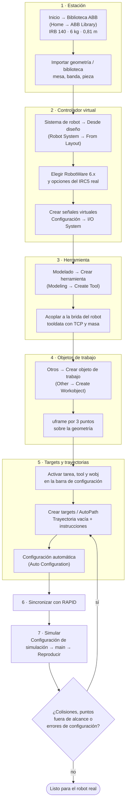

### 15.2 Puntos clave de cada paso

| Paso | Qué configurar | Error típico si se omite |
|---|---|---|
| Controlador virtual | Misma versión de RobotWare y mismas opciones que el IRC5 del laboratorio. | Instrucciones de sockets o de multitarea no reconocidas. |
| Señales de E/S | Crear `DI_0x` / `DO_0x` sin dispositivo asignado (señales virtuales) y reiniciar el controlador virtual. | *Reference error*: señal no definida al cargar el módulo. |
| Herramienta | TCP en la punta real y masa mayor que 0. | Trayectoria desplazada respecto a la pieza. |
| Objeto de trabajo | Crear los *targets* con el objeto de trabajo correcto activo. | Los puntos quedan en `wobj0` y no se mueven con la mesa. |
| Configuración | Ejecutar *Configuración automática* en cada trayectoria antes de sincronizar. | *Configuration error* al simular o en el robot real. |
| Simulación | Punto de entrada `main` en *Configuración de simulación*. | La simulación no ejecuta el procedimiento esperado. |

### 15.3 Señales virtuales para probar la lógica de E/S

En el controlador virtual no hay tarjeta de E/S: las señales se crean sin dispositivo y se fuerzan desde el **Simulador de E/S** (*I/O Simulator*). Para que una señal mueva objetos de la estación (por ejemplo una banda), se conecta en **Lógica de estación** (*Station Logic*) con un *Smart Component*.

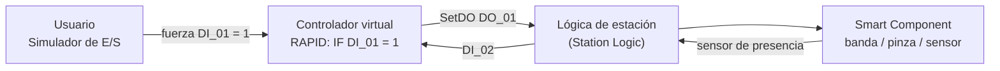

### 15.4 Simular y depurar

| Herramienta | Dónde | Para qué |
|---|---|---|
| **Rastreo del TCP** (*TCP Trace*) | Simulación | Dibuja la trayectoria real del TCP, incluidos los puntos calculados con `Offs` en bucles. |
| **Detección de colisiones** (*Create Collision Set*) | Simulación | Avisa si la herramienta o el brazo tocan la mesa, la banda o la pieza. |
| **Editor RAPID** con ejecución paso a paso | RAPID | Ejecutar instrucción por instrucción y ver el valor de las variables. |
| **Ventana de E/S** | Controlador | Ver y forzar señales durante la simulación. |
| **Analizador de señales** (*Signal Analyzer*) | Simulación | Registrar señales durante la simulación (por ejemplo, velocidad del TCP) y exportarlas. |
| **Desplazar ejes** (*Jog Joint*) | Clic derecho sobre el robot | Mover cada eje a mano y ver sus límites. |

---

## 16. Sincronización estación ↔ RAPID

La estación y el código RAPID son **dos copias** de la misma información. Sincronizar copia en un sentido y sobrescribe el otro.

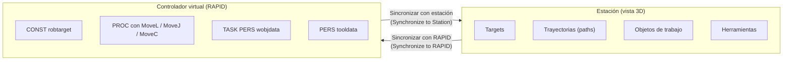

| Equivalencia | Estación | RAPID |
|---|---|---|
| Punto | *Target* | `robtarget` |
| Trayectoria | *Path* | `PROC` con instrucciones de movimiento |
| Objeto de trabajo | *Workobject* | `wobjdata` (`TASK PERS`) |
| Herramienta | *Tool* | `tooldata` (`PERS`) |

### 16.1 ¿Qué sentido usar?

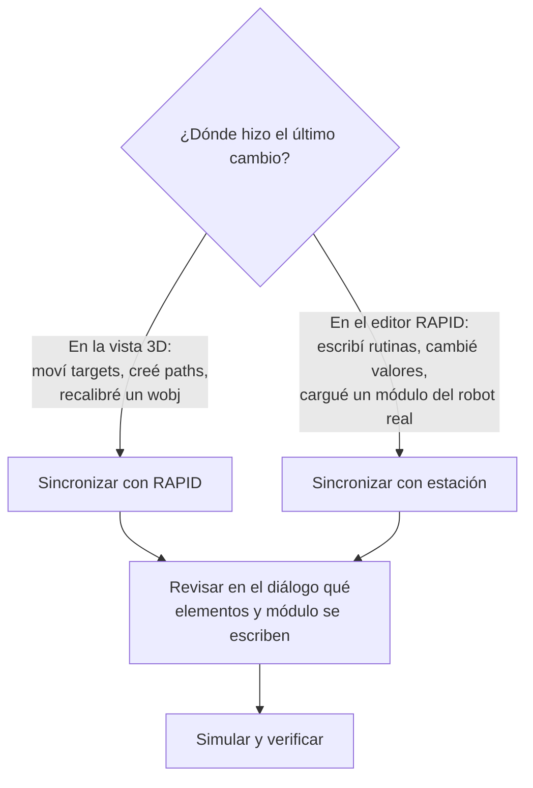

> [!WARNING]
> Sincronizar **sobrescribe** el destino. Si editó el código RAPID a mano y luego sincroniza con RAPID desde una estación desactualizada, perderá esos cambios. Guarde una copia del módulo (o haga *commit*) antes de sincronizar.

> [!TIP]
> *Sincronizar con estación* solo puede dibujar instrucciones con argumentos que resuelve al leer el código (`robtarget`, `wobjdata` y `tooldata` declarados). Las rutinas con `Offs` en bucles o con el objeto de trabajo como parámetro se ejecutan bien en simulación, pero no aparecen como *paths*; verifíquelas con el **Rastreo del TCP**.

---

## 17. Trabajo con varios objetos de trabajo

El mismo dibujo puede ejecutarse sobre distintas superficies (mesa, banda, plano inclinado) si los puntos se definen respecto a un objeto de trabajo. Al cambiar el objeto de trabajo, **toda la trayectoria se traslada y rota con él**.

### 17.1 En RobotStudio


### 17.2 En RAPID: una rutina, varios objetos de trabajo

```rapid
TASK PERS wobjdata wMesa      := [FALSE, TRUE, "", [[400, -200, 100], [1, 0, 0, 0]], [[0, 0, 0], [1, 0, 0, 0]]];
TASK PERS wobjdata wBanda     := [FALSE, TRUE, "", [[-150, 450, 180], [0.7071, 0, 0, 0.7071]], [[0, 0, 0], [1, 0, 0, 0]]];
TASK PERS wobjdata wInclinado := [FALSE, TRUE, "", [[450, 150, 120], [0.9659, 0, 0.2588, 0]], [[0, 0, 0], [1, 0, 0, 0]]];

! El objeto de trabajo es un parámetro PERS: la misma figura sirve en cualquier superficie
PROC CuadradoEn(num lado, PERS wobjdata wo)
    MoveJ Offs(pCentro, 0, 0, zSeg), v300, z10, tMarcador \WObj:=wo;
    MoveL pCentro, v50, fine, tMarcador \WObj:=wo;
    MoveL Offs(pCentro, lado, 0, 0),    v100, z1, tMarcador \WObj:=wo;
    MoveL Offs(pCentro, lado, lado, 0), v100, z1, tMarcador \WObj:=wo;
    MoveL Offs(pCentro, 0, lado, 0),    v100, z1, tMarcador \WObj:=wo;
    MoveL pCentro,                      v100, fine, tMarcador \WObj:=wo;
    MoveL Offs(pCentro, 0, 0, zSeg),    v100, z10, tMarcador \WObj:=wo;
ENDPROC

PROC main()
    MoveAbsJ jHome, v200, fine, tool0;
    CuadradoEn 60, wMesa;
    CuadradoEn 60, wBanda;          ! Rotado 90° en Z respecto a la base
    CuadradoEn 60, wInclinado;      ! Plano inclinado 30° alrededor de Y
    MoveAbsJ jHome, v200, fine, tool0;
ENDPROC
```

<sub>Los marcos <code>uframe</code> de este ejemplo son ilustrativos; mídalos en la celda real. Los cuaterniones corresponden a 90° alrededor de Z (<code>[0.7071, 0, 0, 0.7071]</code>) y 30° alrededor de Y (<code>[0.9659, 0, 0.2588, 0]</code>).</sub>

### 17.3 Mover un objeto de trabajo desde el programa

Útil cuando un sensor o el SCADA informan dónde quedó la pieza (por ejemplo, un desplazamiento sobre la banda):

```rapid
PROC AjustarBanda(num dx)
    wBanda.oframe.trans.x := dx;    ! Solo cambia el marco del objeto
    CuadradoEn 60, wBanda;
ENDPROC
```

---

## 18. Del simulador al robot real

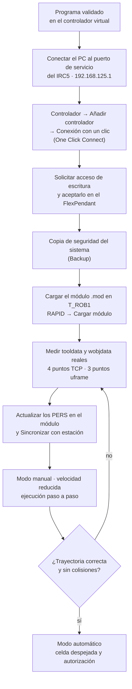

> [!CAUTION]
> En modo manual el controlador limita la velocidad del TCP a 250 mm/s y exige mantener el dispositivo de habilitación. No pase a automático sin la autorización del responsable del laboratorio y con la celda despejada: hay dos robots y bandas compartiendo el espacio.

**Resultado esperado de este flujo.** El Equipo 1E de Robótica 2026-I documentó el ciclo completo con el IRB 140 Caín: simulación del gemelo digital, transferencia al IRC5 y ajuste del objeto de trabajo por las tolerancias de la banda real.

<table>
<tr>
<td align="center" width="50%"><a href="https://youtu.be/xfqMgtFwBRc"></a><br><sub>Simulación en RobotStudio</sub></td>
<td align="center" width="50%"><a href="https://youtu.be/4slQGHLm8xY"></a><br><sub>Ejecución real en el IRB 140 con IRC5</sub></td>
</tr>
</table>
<p align="center"><sub>Videos del <a href="https://github.com/labsir-un/Robotica_2026_I/tree/main/Estudiantes/Equipo-1E-Carreno-Hoyos-Zapata">Equipo 1E (Carreño, Hoyos, Zapata)</a>, Robótica 2026-I.</sub></p>

---

## 19. Comunicación con sistemas SCADA

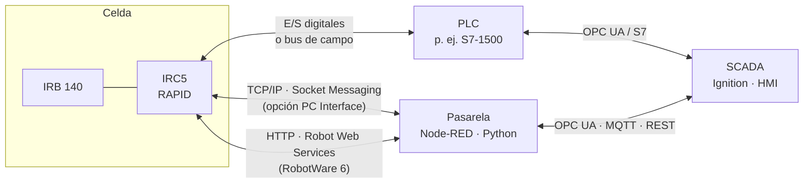

| Vía | Requisito | Qué permite | Lado SCADA |
|---|---|---|---|
| **E/S digitales cableadas** | Tarjeta de E/S en el IRC5 | Arranque/paro, códigos de trayectoria, estados. | PLC → SCADA |
| **Bus de campo** (PROFINET, EtherNet/IP, DeviceNet) | Opción de bus de campo | Intercambio de señales y grupos con un PLC. | PLC → SCADA |
| **Socket Messaging (TCP/IP)** | Opción *PC Interface* | Enviar y recibir cadenas o datos desde RAPID. | Python, Node-RED, LabVIEW |
| **Robot Web Services (RWS)** | RobotWare 6.x | API REST para leer/escribir variables RAPID, E/S, posición y estado. | Node-RED, Python, Ignition |
| **OPC (DA/UA)** | Servidor OPC de ABB en un PC | Variables del robot como *tags* OPC. | Ignition, KEPServerEX |
| **PC SDK** | Opción *PC Interface* | Aplicaciones .NET a la medida. | C# / VB.NET |

### 19.1 Servidor TCP en RAPID (Socket Messaging)

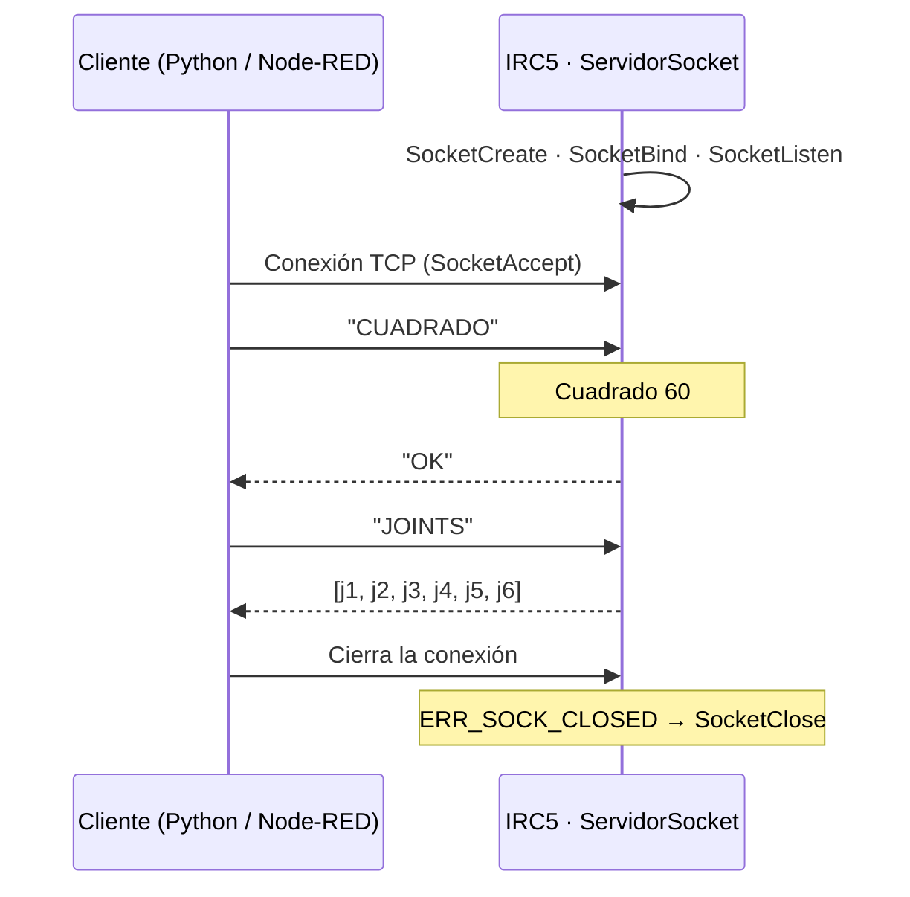

```rapid
VAR socketdev servidor;
VAR socketdev cliente;
VAR string recibido;
VAR jointtarget jSock;

PROC ServidorSocket()
    SocketCreate servidor;
    SocketBind servidor, "192.168.125.1", 1025;     ! Real: IP del IRC5 · Virtual: "127.0.0.1"
    SocketListen servidor;
    SocketAccept servidor, cliente \Time:=WAIT_MAX;

    WHILE TRUE DO
        SocketReceive cliente \Str:=recibido \Time:=WAIT_MAX;
        TEST recibido
        CASE "CUADRADO": Cuadrado 60;
        CASE "CIRCULO":  Circulo 40;
        CASE "HOME":     MoveAbsJ jHome, v200, fine, tool0;
        CASE "JOINTS":   ! Responder con los ángulos actuales
            jSock := CJointT();
            SocketSend cliente \Str:=ValToStr(jSock.robax);
        DEFAULT:
            SocketSend cliente \Str:="ERR";
        ENDTEST
        IF recibido <> "JOINTS" SocketSend cliente \Str:="OK";
    ENDWHILE
ERROR
    IF ERRNO = ERR_SOCK_CLOSED THEN
        SocketClose cliente;
        SocketClose servidor;
        RETURN;
    ENDIF
ENDPROC
```

<details>
<summary><b>Cliente de prueba en Python</b></summary>

```python
import socket

IP, PUERTO = "192.168.125.1", 1025   # "127.0.0.1" con el controlador virtual

with socket.create_connection((IP, PUERTO), timeout=30) as s:
    for orden in ("HOME", "JOINTS", "CUADRADO"):
        s.sendall(orden.encode())
        print(orden, "→", s.recv(1024).decode())
```

</details>

> [!NOTE]
> `192.168.125.1` es la dirección del puerto de servicio del IRC5. Para la red del laboratorio, use la IP del puerto WAN configurado. El proyecto [Task_Planning_Cobotic](https://github.com/labsir-un/Task_Planning_Cobotic/tree/main/ABB/RAPID) del LabSIR mantiene dos módulos: uno con sockets para el robot real y otro sin sockets para probar la lógica en RobotStudio, una práctica recomendable.

### 19.2 Lectura con Robot Web Services (RobotWare 6)

<p align="center">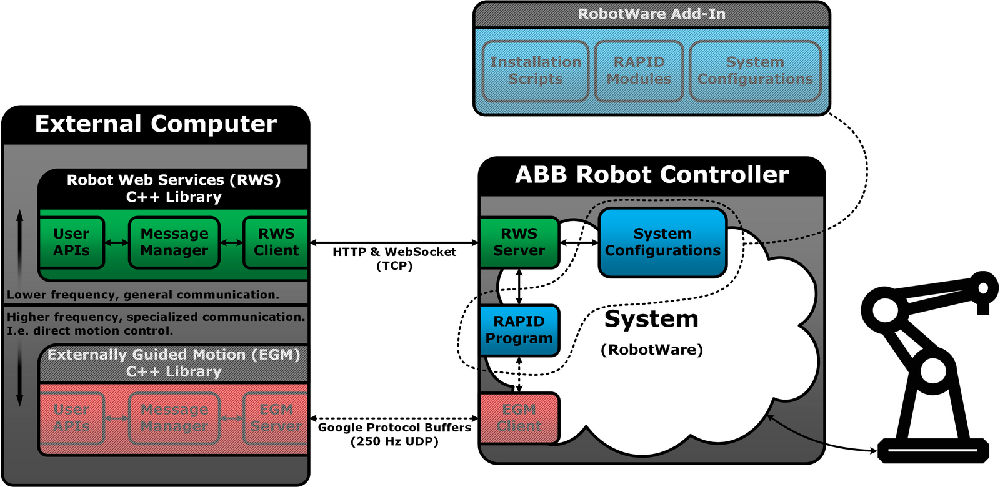</p>
<p align="center"><sub>RWS (HTTP/WebSocket, baja frecuencia) y EGM (UDP a 250 Hz, control de movimiento). Figura de <a href="https://github.com/ros-industrial/abb_librws">abb_librws</a> © 2015 ABB Schweiz AG, licencia BSD-3-Clause, incluida en <a href="https://github.com/labsir-un/abb_un_driver">abb_un_driver</a> del LabSIR.</sub></p>

Recursos REST de uso frecuente (autenticación *digest*; el usuario por defecto es `Default User`, verifique la configuración del laboratorio). El driver [abb_un_driver](https://github.com/labsir-un/abb_un_driver) del LabSIR usa RWS en el puerto 80 del IRC5.

| Dato | Petición |
|---|---|
| Ángulos articulares | `GET http://<ip>/rw/motionsystem/mechunits/ROB_1/jointtarget?json=1` |
| Posición cartesiana | `GET http://<ip>/rw/motionsystem/mechunits/ROB_1/robtarget?json=1` |
| Variable RAPID | `GET http://<ip>/rw/rapid/symbol/data/RAPID/T_ROB1/<Modulo>/nCiclos?json=1` |
| Estado de ejecución | `GET http://<ip>/rw/rapid/execution?json=1` |
| Señal de E/S | `GET http://<ip>/rw/iosystem/signals/<nombre_señal>?json=1` |

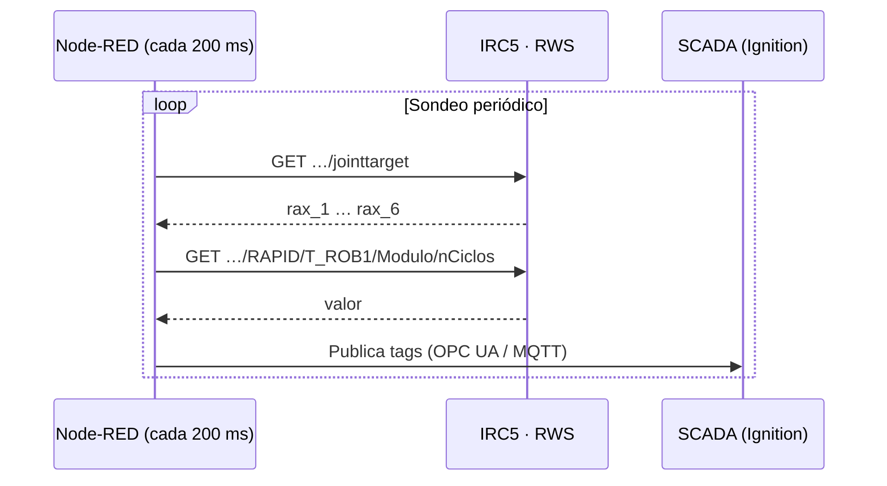

---

## 20. Errores comunes y buenas prácticas

| Problema | Causa probable | Solución |
|---|---|---|
| *Position outside reach* | Punto fuera del volumen de trabajo. | Verificar con `CalcJointT` o en RobotStudio. |
| *Joint out of range* | Una articulación excede su límite. | Cambiar orientación o `confdata`; validar con la función de 6.4. |
| Error de configuración | El `confdata` no coincide con el camino real. | *Configuración automática* en RobotStudio o reenseñar; como último recurso `ConfL \Off`. |
| Singularidad de muñeca | Ejes 4 y 6 alineados (eje 5 ≈ 0°). | Evitar orientaciones con eje 5 cercano a 0°; `SingArea \Wrist`. |
| Lectura de posición adelantada | Ejecución anticipada con zonas `zN`. | Usar `fine` o `WaitRob \InPos` antes de leer. |
| Trayectoria desplazada | `tooldata` o `wobjdata` incorrectos. | Redefinir el TCP y el objeto de trabajo. |
| Cambios perdidos en RAPID | Se sincronizó con RAPID desde una estación desactualizada. | Respaldar el módulo y elegir el sentido correcto (sección 16.1). |
| Señal no definida al cargar | El módulo usa señales que el controlador no tiene. | Crearlas en *I/O System* (virtuales en simulación). |

**Buenas prácticas**

- Especificar siempre `tool` y `\WObj` en cada movimiento.
- Usar `fine` donde se lee una señal, se actúa una herramienta o se toma una medida.
- Aproximarse a la superficie desde una altura segura (`zSeg`).
- Empezar con velocidades bajas (`v50`–`v100`) y `VelSet` reducido en las primeras pruebas.
- Nombrar puntos y variables de forma descriptiva (`pCentroMesa`, `nCiclos`, `jHome`).
- Mantener un módulo de simulación y uno para el robot real cuando haya sockets o E/S reales.
- Versionar los módulos `.mod` en este repositorio y respaldar el controlador antes de cada práctica.

### Estructura sugerida del repositorio

```text
.
├── README.md
├── docs/
│   └── img/
│       ├── figuras/        # Diagramas propios de esta guía (SVG)
│       ├── labsir/         # Fotos y capturas del LabSIR (MIT)
│       ├── abb_librws/     # Figura RWS/EGM (BSD-3-Clause)
│       └── CREDITOS.md
├── rapid/                  # Módulos .mod de las prácticas
├── robotstudio/            # Estación (.rspag) y respaldos del controlador
└── scada/                  # Flujos de Node-RED, scripts Python, proyecto SCADA
```

---

## 21. Referencias y créditos

**Documentación de ABB**

- *Technical reference manual — RAPID Instructions, Functions and Data types* (RobotWare 6).
- *Technical reference manual — RAPID overview* (RobotWare 6).
- *Operating manual — IRC5 with FlexPendant*.
- *Operating manual — RobotStudio*.
- *Application manual — Controller software IRC5* (Socket Messaging, multitarea y demás opciones).
- [IRB 140 — Data sheet](https://library.e.abb.com/public/0ab091987347463cb06a3cc653d8ddb8/IRB_140_20211001.pdf)
- [IRB 140 en ABB Robotics](https://one.robotics.abb.com/Robots/p/IRB-140)
- [Modelo del IRB 140 en RobotStudio Developer Center](https://developercenter.robotstudio.com/api/robotstudio/articles/How-To/RobotMechanism/BuildthemodeloftheIRB140.html) (límites articulares)
- [Robot Web Services — Developer Center](https://developercenter.robotstudio.com/)

**Repositorios del LabSIR**

- [labsir-un/Robotica_2026_I](https://github.com/labsir-un/Robotica_2026_I) — Laboratorio 1: IRB 140 y RobotStudio.
- [labsir-un/Task_Planning_Cobotic](https://github.com/labsir-un/Task_Planning_Cobotic) — módulos RAPID con sockets para el IRB 140.
- [labsir-un/abb_un_driver](https://github.com/labsir-un/abb_un_driver) — driver ROS para el IRB 140 (RWS y EGM).

**Imágenes:** ver [docs/img/CREDITOS.md](docs/img/CREDITOS.md). Las figuras de `docs/img/figuras/` son propias de esta guía.

---

<div align="center"><sub>Universidad Nacional de Colombia — Sede Bogotá · Comunicaciones Industriales SCADA · Laboratorio de Robótica (LabSIR)</sub></div>
